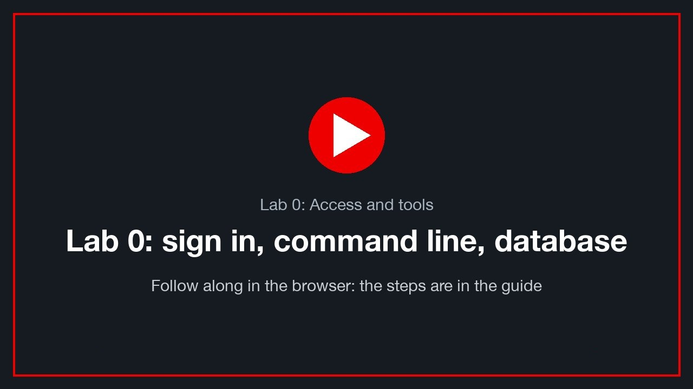

# Lab 0: Access and tools

> **Version 1.0.0 · draft · 2026-10-12** · class/demos/00-access-and-tools.md

**About 5 minutes.** You sign in to the lab in your browser, open a command line, and prove you can reach the cluster
and your own VM's database. One recording covers the whole lab: watch it, then do the same with the steps below.

<!-- 🎬 video slot 00-access-and-tools -->
[](../.images/00-access-and-tools.mp4)
<sub>🎬 *Lab 0: Access and tools: a recording of the whole lab, done in the browser (placeholder until recorded: `class/.images/00-access-and-tools.mp4`).*</sub>

**You need** your class ID and password from the instructor (one login for everything), and your booking's three
addresses. The instructor gives you `N`, `A` and `B`; the examples below use `1`, `ocp-lz1` and `ocp-lz2`.

| Open in a browser tab | Address |
|---|---|
| vCenter | `https://vcenter0<N>.demo.lab-paragonmicro.com/ui` |
| Site A console | `https://console-openshift-console.apps.<A>.demo.lab-paragonmicro.com` |
| Site B console | `https://console-openshift-console.apps.<B>.demo.lab-paragonmicro.com` |

---

## 0.1 Sign in to vCenter, and note your VM's address

1. Open the vCenter tab, choose **Launch vSphere Client**, then the **SSO / Entra** sign-in with your class account.
2. Go to **VMs and Templates → datacenter01 → vms → students → `<your class ID>`** and select your VM,
   **`win-pg-s<NN>`** (for example `student-03` → `win-pg-s03`).
3. On its **Summary** tab, find **IP Addresses**. ✍️ **Write it down:** this is your VM's address (for example
   `10.101.23.103`). You use it in step 0.4, and your VM keeps it after every move.

✅ Your VM is powered on, with three disks (60 GB, 5 GB and 10 GB).

---

## 0.2 Sign in to both OpenShift consoles

1. Open the **site A** console tab and choose **Entra (SSO)**. Your vCenter sign-in carries over.
2. Do the same in the **site B** console tab.
3. In each, **Home → Projects** shows your own project, named your class ID. You are admin there.

---

## 0.3 Open a command line

The command line is `oc`, signed in **as you** with a token you copy from the console:

1. In the **site A** console, open your name (top right) → **Copy login command** → **Display Token**.
2. Copy the line that starts with `oc login --token=… --server=…`.

You can run it in either of two places.

### Option 1: `oc` on your own computer (outside this class)

If your company allows it, install the `oc` client yourself: [Getting started with the OpenShift
CLI](https://docs.redhat.com/en/documentation/openshift_container_platform/4.19/html/cli_tools/openshift-cli-oc#cli-getting-started)
(the console's **? → Command Line Tools** has the download). **Installing it is outside this class's scope:** the
class needs only your browser. Paste the copied line into your terminal and press Enter.

### Option 2: a command line inside OpenShift (the class way)

Nothing to install. Use one of:

- **The console's Web Terminal:** the **`>_`** icon at the top right of the console opens a terminal already signed
  in as you. Every lab cluster includes it. If you don't see `>_`, use your class terminal.
  **[verify: `>_` for a student account on a booking]**
- **Your class terminal:** in your project, **Workloads → Pods → `sql-client-…` → Terminal**. It has `oc` and
  `psql` ready. Sign its `oc` in: type `oclogin` and a space, paste the copied line, and press Enter.

> 📋 **Copy and paste:** paste with **right-click → Paste** (or Ctrl+Shift+V, ⌘V on a Mac); copy by selecting the text,
> then **right-click → Copy**. **[verify: per browser]**

---

## 0.4 Test: the cluster, then your VM's database

**The cluster:**

```bash
oc whoami            # your class ID
oc get nodes         # the cluster's nodes, all Ready
```

**Your VM's database**, PostgreSQL inside your Windows VM, as `student_NN` (your number, with an underscore) at the
address you wrote down in 0.1. In **your class terminal**, `psql` is already there:

```bash
psql -h <your VM address> -U student_NN -d bcdr
```

From `oc` anywhere else (your computer, or the Web Terminal), run the same `psql` inside your class terminal:

```bash
oc exec -it -n <your class ID> deploy/sql-client -- psql -h <your VM address> -U student_NN -d bcdr
```

Enter your class password. At the `bcdr=>` prompt:

```sql
SELECT current_user, inet_server_addr() AS vm_address, now();   -- student_NN, your VM's address
\q
```

✅ `oc get nodes` lists the nodes, and PostgreSQL answers as `student_NN` from your VM's address.

---

## Done

You are signed in to vCenter and both OpenShift clusters, you have a command line, and you reached your own VM's
database. **Go back to the [Student Guide](../student-guide.md)** and continue with the next module, Demo 1.

Every demo uses the class commands that write and prove your data (`mark`, `verify`, `alive`): they are in the
[Toolkit](toolkit.md), which each demo points to when you need it.

## Thank you

- [OpenShift CLI (`oc`)](https://docs.redhat.com/en/documentation/openshift_container_platform/4.19/html/cli_tools/openshift-cli-oc)
- [OpenShift authentication and authorization (4.19)](https://docs.redhat.com/en/documentation/openshift_container_platform/4.19/html/authentication_and_authorization/index)
- [OpenShift Virtualization documentation (4.19)](https://docs.redhat.com/en/documentation/openshift_container_platform/4.19/html/virtualization/index)
- [Red Hat interactive labs (free, in the browser)](https://www.redhat.com/en/interactive-labs)
