# Demo 1: VMware to OpenShift Virtualization (cold migration)

> **Version 0.6.1 · draft · 2026-10-12** · class/demos/01-vmware-to-ove-cold.md

## What you will learn

You will take your own Windows Server + PostgreSQL VM off VMware vSphere and rehost it on OpenShift Virtualization
with the Migration Toolkit for Virtualization (MTV). Along the way you will see how OpenShift reproduces what vSphere
gave the VM: VLAN-backed port groups become Linux bridges and network attachments, datastores become storage
classes, and VMware Tools gives way to virtio drivers and the QEMU guest agent. You will also see when to replatform
from a Red Hat template instead of rehosting. At every stage you write data and then prove that it arrived intact.

## How the lab is set up for this demo

The CI customization pre-built everything below (see the [lab diagram](lab-diagram.md) and
[Toolkit](toolkit.md)). **Every staged piece has a "how it was built"
section in [Lab S](setup-how-the-lab-is-built.md)**, with the CLI and console steps to build it yourself and links to the Red Hat docs.

| Component | State when you start | How it was built · Red Hat docs |
|---|---|---|
| **Your VM** `win-pg-s<NN>` | on **vSphere** `vcenter0<N>`, powered on, in **your own folder `vms/students/<class ID>`**, at its own address `$VM_IP` (`.100+NN`) on port group `vm-network` (VLAN `22+N`). A full clone of the instructor's `win-pg-i01`: Windows Server 2022, VMware Tools, PostgreSQL 16 with WAL on `L:` (5 GB) and data on `D:` (10 GB), the heartbeat writer, the integrity toolkit, and your Windows login `.\student-NN` (a local administrator on **your** VM). | [S.11](setup-how-the-lab-is-built.md) |
| **Site A** (the target) | OpenShift Virtualization (`ove: cnv`, from demo-openshift); NMState bridge `br<VLAN>` with NAD `vmnet<VLAN>`; storage on **ODF** (`ocs-storagecluster-ceph-rbd-virtualization`); ACM and cert-manager (base build, the same on both sites). | [S.2](setup-how-the-lab-is-built.md) · [S.3](setup-how-the-lab-is-built.md) · [S.4](setup-how-the-lab-is-built.md) · [OpenShift Virtualization](https://docs.redhat.com/en/documentation/openshift_container_platform/4.19/html/virtualization/index) · [NMState](https://docs.redhat.com/en/documentation/openshift_container_platform/4.19/html/kubernetes_nmstate/index) [verify link] · [ODF](https://docs.redhat.com/en/documentation/red_hat_openshift_data_foundation/4.19) |
| **MTV** on site A | the operator, its **Migration for Virtualization** console menu, provider `ovedr-vcenter0<N>` linked to vCenter (least-privilege `ovedr-mtv@vsphere.local`), network maps `…-net` (pod) and `…-net-bridge` (your VLAN), storage map `…-storage` (datastore → ODF). | [S.5](setup-how-the-lab-is-built.md) · [S.6](setup-how-the-lab-is-built.md) · [S.8](setup-how-the-lab-is-built.md) · [MTV 2.11](https://docs.redhat.com/en/documentation/migration_toolkit_for_virtualization/2.11) · [Installing and using MTV](https://docs.redhat.com/en/documentation/migration_toolkit_for_virtualization/2.11/html/installing_and_using_the_migration_toolkit_for_virtualization/index) [verify link] |
| **Your migration plan `d1-<your VM>`** | **staged, NOT started**: cold, your VM → **your own namespace** (`$VMNS`, your class ID) on site A, the **bridge** network map (your VM keeps `$VM_IP`) and the storage map. It shows **Ready** in the console. | [S.12](setup-how-the-lab-is-built.md) · [Creating and running a migration plan](https://docs.redhat.com/en/documentation/migration_toolkit_for_virtualization/2.11/html/installing_and_using_the_migration_toolkit_for_virtualization/index) [verify link] |
| **Your namespace** `$VMNS` (your class ID) on site A and site B, plus `ovedr-app` | in yours: **admin** rights for you, `Service/<your VM>-sql` waiting for your VM to arrive, and your browser terminal `sql-client` (Toolkit T.1). | [S.9](setup-how-the-lab-is-built.md) · [Using RBAC](https://docs.redhat.com/en/documentation/openshift_container_platform/4.19/html/authentication_and_authorization/using-rbac) [verify link] |
| **Read access** for students | MTV objects in `openshift-mtv` (and the right to run plans and migrations), NNCPs, storage classes, ACM clusters. | [S.9](setup-how-the-lab-is-built.md) |
| **Site B** | the same operators, on **NFS** (`nfs-csi`); its own staged plan `d1b-<your VM>-to-<B>` waits for Demo 1b. Not used in this demo. | [S.12](setup-how-the-lab-is-built.md) |

**You do yourself:** inspect the VM and the OpenShift side, optionally create your own provider, review your staged
plan (and see how it would be built), shut down your VM, and, as the **last step**, start your plan. Then start the VM
on OpenShift, swap VMware Tools for virtio and the guest agent, and prove your data. Your VM keeps its own address, so
Toolkit T.4 is not needed.

**Pattern at every stage:** inject (`mark` + a line in your file) → change → read (`verify` + read the file).

> **Before you start:** do [Lab 0](00-access-and-tools.md), then sign your class terminal in on both sites and to your
> database ([Toolkit T.1-T.2](toolkit.md): `oclogin` for site A and site B, then `dblogin`). It already holds the
> variables (`$ME`, `$N`, `$A`, `$B`, `$VM`, `$VM_IP`, `$WINUSER`) and the commands (`sql`, `mark`, `load`, `verify`,
> `alive`, `where`).

> 🖥️ **Where you type the commands: your browser terminal.** Every `bash` block in this guide runs in **your own
> terminal pod**, in the browser: in the site A console, project **`<your class ID>`** → **Workloads → Pods →
> `sql-client` → Terminal** ([Toolkit T.1](toolkit.md)). Nothing is installed on your computer. It already
> knows your VM and its address (type `ovedr`); `dblogin` and `oclogin` (Toolkit T.1-T.2) stay signed in while the pod runs.
> Variables you `export` last until you close that Terminal tab: if you reopen it, re-run the guide's `export` lines.
> Paste with **right-click → Paste** (or Ctrl+Shift+V / ⌘V). `powershell` blocks run **inside your Windows VM**, from its
> console (vCenter **Launch Web Console**, or the VM's **Console** tab in OpenShift).

---

## 1.1 Sign your class terminal in (2 min)

<!-- 🎬 video slot 01-1-1-sign-class-terminal -->
[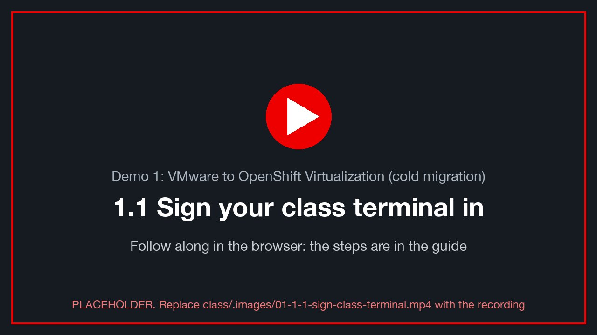](../.images/01-1-1-sign-class-terminal.mp4)
<sub>🎬 *1.1 Sign your class terminal in: a recording of this whole section, done in the console (placeholder until recorded: `class/.images/01-1-1-sign-class-terminal.mp4`).*</sub>

In your class terminal (site A console → your project → **Workloads → Pods → `sql-client` → Terminal**), sign in once
per site with each console's **Copy login command**, and once to your VM's database ([Toolkit T.1-T.2](toolkit.md)):

```bash
oclogin <paste the site A login command>                          # ✓ site-a
oclogin <paste the site B login command>                          # ✓ site-b
dblogin                                                           # your class password
oc --context site-a whoami && oc --context site-b whoami          # both print $ME
echo "vm=$VM  db-host=${PGHOST:-$VM_IP}"                          # still the vSphere IP ($VM_IP) for now
alive                                                             # staleness < 10 s
```

**Check:** ✅ both contexts answer as `$ME`, and the heartbeat is fresh. If not, see [Toolkit T.1-T.2](toolkit.md).

---

## 1.2 Inspect the VMware VM (10 min)

<!-- 🎬 video slot 01-1-2-inspect-vmware-vm -->
[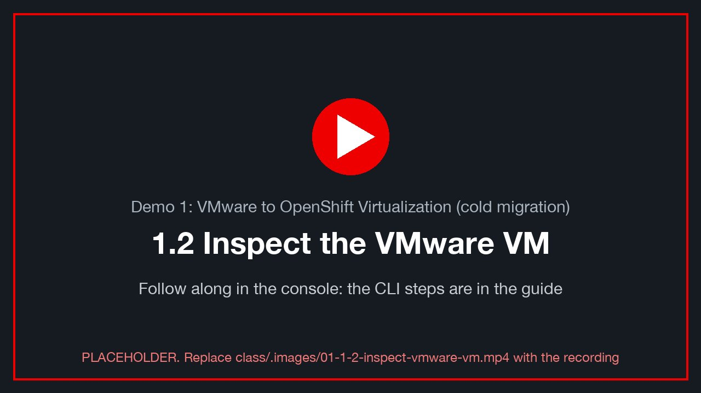](../.images/01-1-2-inspect-vmware-vm.mp4)
<sub>🎬 *1.2 Inspect the VMware VM: a recording of this whole section, done in the console (placeholder until recorded: `class/.images/01-1-2-inspect-vmware-vm.mp4`).*</sub>

### In vCenter

Open **VMs and Templates → datacenter01 → vms → students → `<your class ID>` → your VM (`win-pg-s<NN>`)**, then look at:

| Where | What to note |
|---|---|
| **Summary → VM Hardware** | 4 vCPU, 8 GB, **three** hard disks: 60 GB (`C:`), 5 GB (`L:` = WAL), 10 GB (`D:` = data) |
| **Summary → Guest OS** | *VMware Tools: Running, version …*. This is what OpenShift will replace (§1.6) |
| **Summary → Network adapter** | port group `vm-network`, adapter `e1000e`, IP `$VM_IP` |
| **Networking → Distributed port groups → `vm-network`** | the **VLAN ID** of the port group. Write it down, because §1.3 maps it to a bridge |

📸 `01-vcenter-vm-summary`: VM summary with the three disks and VMware Tools *Running*.
📸 `01-vcenter-portgroup-vlan`: the port group's VLAN setting.

✍️ The VLAN ID of `vm-network`: ________ (expected: `22 + N`, so `23` for `vcenter01`).

### Inside Windows (your touch file)

Launch the **Web Console** from vCenter, send **Ctrl-Alt-Del**, and log in as `.\<WINUSER>` (for example
`.\student-03`). Open **PowerShell**:

```powershell
$f = "C:\Users\Public\ovedr\$env:USERNAME.txt"
Add-Content $f "$(Get-Date -Format o)  d1-before  on=vSphere  host=$env:COMPUTERNAME"
Get-Content $f
Get-Service VMTools, postgresql-16 | Format-Table Name, Status
Get-Volume -DriveLetter C, D, L | Format-Table DriveLetter, FileSystemLabel, Size
```

✅ `VMTools` is *Running*. `postgresql-16` is *Running*. `D:` is `pgdata` and `L:` is `pg_wal`.

### Inject: your database row

```bash
mark d1-before
verify
```

✍️ **Row 1.1:** the mark `id`, `chain_ok`, `fingerprint`.

---

## 1.3 Review the OpenShift side (15 min)

<!-- 🎬 video slot 01-1-3-review-openshift-side -->
[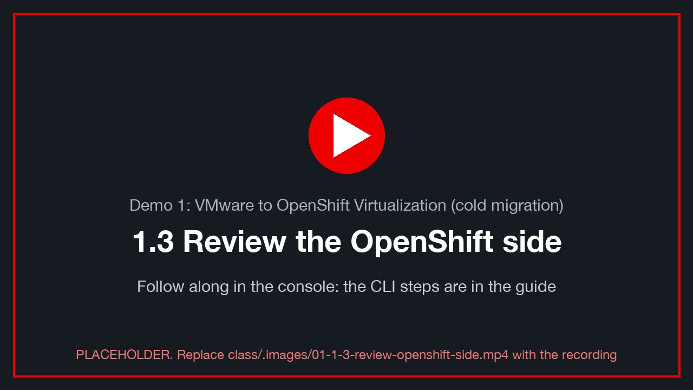](../.images/01-1-3-review-openshift-side.mp4)
<sub>🎬 *1.3 Review the OpenShift side: a recording of this whole section, done in the console (placeholder until recorded: `class/.images/01-1-3-review-openshift-side.mp4`).*</sub>

Everything here is read-only. Run it on **site A** (the migration target), then repeat on **site B** if you are
curious: both sites were built the same way.

### The Migration Toolkit (MTV / Forklift)

```bash
oc --context site-a get csv -n openshift-mtv | grep -i mtv                       # operator installed, Succeeded
oc --context site-a get forkliftcontroller -n openshift-mtv                      # the operator's instance
oc --context site-a get pods -n openshift-mtv                                    # controller, inventory, UI plugin
oc --context site-a get providers -n openshift-mtv                               # host (this cluster) + ovedr-vcenter0N + ovedr-ocp-<B>
```

Console: **Migration for Virtualization → Overview**, then **Providers**.

📸 `01-mtv-overview`: the Migration overview page.

> If `get providers -n openshift-mtv` says *forbidden*, your role cannot read the MTV namespace. Use the console
> pages, which the instructor's screen also shows **[verify: BL-D09, student view on openshift-mtv]**.

### Networking: from VLAN-backed port group to OpenShift bridge

On vSphere, the VM sits on a **port group** tagged with a VLAN. On OpenShift, the same VLAN reaches a VM in
three layers:

| Layer | Object | What it does |
|---|---|---|
| Node | `NodeNetworkConfigurationPolicy` (NNCP) `br<VLAN>-policy` | builds Linux bridge `br<VLAN>` on every node, on top of the trunk NIC, tagged with VLAN `<VLAN>` |
| Namespace | `NetworkAttachmentDefinition` (NAD) `vmnet<VLAN>` in `default` | lets a VM plug a second NIC into that bridge (Multus) |
| Migration | `NetworkMap` `ovedr-vcenter0N-net-bridge` | tells MTV: port group `vm-network` → NAD `vmnet<VLAN>` |

```bash
VLAN=$((22 + N))
oc --context site-a get nncp                                                      # br<VLAN>-policy … Available
oc --context site-a get nncp "br$VLAN-policy" -o yaml | sed -n '/desiredState:/,/status:/p'
oc --context site-a get nnce | grep "br$VLAN"                                     # one per node: SuccessfullyConfigured
oc --context site-a -n default get net-attach-def "vmnet$VLAN" -o jsonpath='{.spec.config}' | jq .
```

✅ The NNCP is **Available**, every node's enactment is **SuccessfullyConfigured**, and the NAD's `bridge` is
`br<VLAN>`. That is the OpenShift twin of the vSphere port group.

The two network maps MTV can use, and the storage map:

```bash
oc --context site-a -n openshift-mtv get networkmap,storagemap
oc --context site-a -n openshift-mtv get networkmap "ovedr-vcenter0$N-net"        -o jsonpath='{.spec.map}' | jq .
oc --context site-a -n openshift-mtv get networkmap "ovedr-vcenter0$N-net-bridge" -o jsonpath='{.spec.map}' | jq .
oc --context site-a -n openshift-mtv get storagemap "ovedr-vcenter0$N-storage"    -o jsonpath='{.spec.map}' | jq .
oc --context site-a get storageclass                                              # ODF's virtualization class (site A); site B: nfs-csi
```

| Map | Source → destination | When to choose it |
|---|---|---|
| `…-net` | `vm-network` → **pod network** | the VM gets a cluster address. Clients reach it through `Service/$VM-sql`. **This demo uses it.** |
| `…-net-bridge` | `vm-network` → **`vmnet<VLAN>`** | the VM stays on its own VLAN and keeps its subnet. Needs the static IP carried over (§1.5, note) |
| `…-storage` | datastore `coresan01_data00` → `ocs-storagecluster-ceph-rbd-virtualization` on site A (ODF); `nfs-csi` on site B | where each of the three disks lands. How it was built: [Lab S §S.8](setup-how-the-lab-is-built.md) |

📸 `01-nncp-available`: NNCP list with `Available`.
📸 `01-networkmap-bridge`: the bridge network map in the console (**Migration for Virtualization → Network maps**).

### Templates: the *replatform* alternative

Migration is **rehosting**: the same Windows install, disks and data, now on KVM. **Replatforming** means building
a *new* VM from a clean, vendor-maintained image, and then moving only the application and data into it.

OpenShift Virtualization ships templates and **boot sources** for the replatform path:

```bash
oc --context site-a get templates -n openshift -l template.kubevirt.io/type=base \
  -o custom-columns=NAME:.metadata.name,DISPLAY:'.metadata.annotations.openshift\.io/display-name' | head -20
oc --context site-a get datasources   -n openshift-virtualization-os-images     # rhel8, rhel9, centos-stream9, fedora …
oc --context site-a get dataimportcrons -n openshift-virtualization-os-images   # keeps those images current, automatically
oc --context site-a get datasource rhel9 -n openshift-virtualization-os-images \
  -o jsonpath='{.status.conditions[?(@.type=="Ready")].status}{"\n"}'          # True: a RHEL 9 cloud image is ready to clone
```

Console: **Virtualization → Catalog → Template catalog**. The templates with a ✓ **Source available** badge boot
from a Red Hat cloud image in seconds. Windows templates show *no source*, because Red Hat ships no Windows image:
you upload your own golden image.

| | Rehost (this demo) | Replatform |
|---|---|---|
| What moves | the whole VM: OS, disks, data | data and application only |
| OS | the existing Windows, now with virtio drivers | a fresh image from a template (e.g. RHEL 9 + PostgreSQL) |
| Effort | low, minutes per VM | higher, because the app must be reinstalled |
| Result | same machine, new hypervisor | a clean, supported, cloud-native-ready VM |

📸 `01-template-catalog`: the template catalog with boot-source badges.

---

## 1.4 Link OpenShift to vCenter, and validate the link (10 min)

<!-- 🎬 video slot 01-1-4-link-openshift-vcenter-validate-link -->
[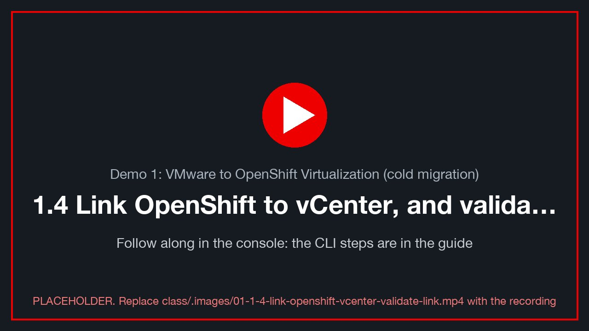](../.images/01-1-4-link-openshift-vcenter-validate-link.mp4)
<sub>🎬 *1.4 Link OpenShift to vCenter, and validate the link: a recording of this whole section, done in the console (placeholder until recorded: `class/.images/01-1-4-link-openshift-vcenter-validate-link.mp4`).*</sub>

The lab already created the link. A **Provider** of type `vsphere` named `ovedr-vcenter0<N>` logs in to vCenter as
a least-privilege account (`ovedr-mtv@vsphere.local`) and pulls an **inventory** of every VM, network and datastore.

### Validate the existing link

```bash
P=ovedr-vcenter0$N
oc --context site-a -n openshift-mtv get provider "$P" \
  -o jsonpath='{range .status.conditions[*]}{.type}={.status}  {.message}{"\n"}{end}'
oc --context site-a -n openshift-mtv get provider "$P" -o jsonpath='{.spec.url}{"\n"}'
```

✅ `Ready=True`, `ConnectionTestSucceeded=True`, `InventoryCreated=True`, and the URL is
`https://vcenter0<N>.demo.lab-paragonmicro.com/sdk`.

Console: **Migration for Virtualization → Providers → `ovedr-vcenter0<N>` → Virtual Machines**. Find your VM
(`win-pg-s<NN>`) and open its **Concerns** column. Typical concerns are *VMware Tools installed* or *static IP*. Read them now,
because they explain §1.5 and §1.6.

📸 `01-provider-ready`: the provider page with *Ready* and the VM inventory.

### Optional: create your own provider [verify: BL-D09]

This shows how the link is made. Use **your own name**, so that you never overwrite the class provider. The
provider belongs in your own namespace `$VMNS`, where you are admin.

**Console:** **Migration for Virtualization → Providers → Create Provider → vSphere**:

| Field | Value |
|---|---|
| Name | `ovedr-vcenter-<WINUSER>` |
| URL | `https://vcenter0<N>.demo.lab-paragonmicro.com/sdk` |
| Username / password | `<ME>@vsphere.local` / your class password |
| CA certificate | upload the chain from the command below, or tick *Skip certificate validation* (lab only) |
| VDDK image | leave empty (cold migration still works, just slower) |

**YAML equivalent:**

```bash
# vCenter's CA chain, taken from its TLS handshake
openssl s_client -connect "$VC:443" -showcerts </dev/null 2>/dev/null \
  | awk '/BEGIN CERT/,/END CERT/' > /tmp/vc-chain.pem
read -rsp "class password: " PW; echo
oc --context site-a -n "$VMNS" create secret generic "ovedr-vcenter-$WINUSER" \
  --from-literal=user="$ME@vsphere.local" --from-literal=password="$PW" \
  --from-literal=url="https://$VC/sdk" --from-file=cacert=/tmp/vc-chain.pem \
  --from-literal=insecureSkipVerify=false
unset PW
oc --context site-a -n "$VMNS" label secret "ovedr-vcenter-$WINUSER" \
  createdForProviderType=vsphere createdForResourceType=providers
oc --context site-a -n "$VMNS" apply -f - <<EOF
apiVersion: forklift.konveyor.io/v1beta1
kind: Provider
metadata: { name: ovedr-vcenter-$WINUSER, namespace: $VMNS }
spec:
  type: vsphere
  url: https://$VC/sdk
  secret: { name: ovedr-vcenter-$WINUSER, namespace: $VMNS }
EOF
oc --context site-a -n "$VMNS" get provider "ovedr-vcenter-$WINUSER" -w     # Ctrl-C at Ready
```

✅ `Ready`. If it shows `ConnectionTestFailed`, read the message: *x509* means a CA problem, and *permission* means
your vCenter role can log in but cannot read the whole inventory. Either is a useful lesson.
Afterwards, clean up: `oc --context site-a -n "$VMNS" delete provider,secret "ovedr-vcenter-$WINUSER"`.

---

## 1.5 Cold migration (30 min)

<!-- 🎬 video slot 01-1-5-cold-migration -->
[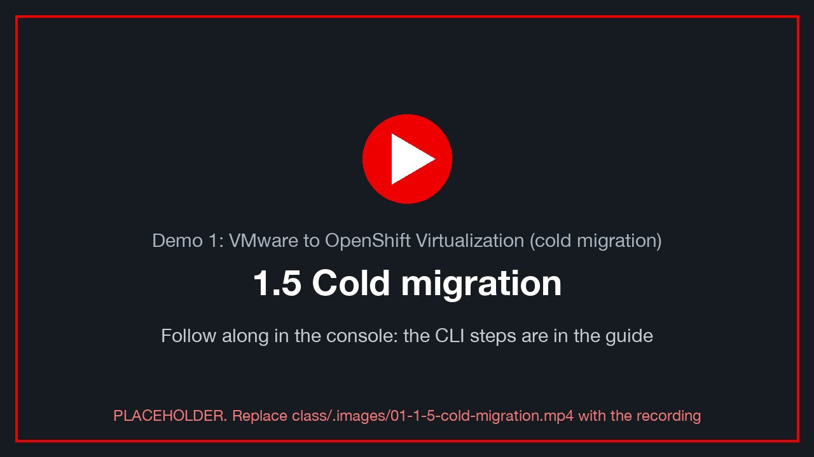](../.images/01-1-5-cold-migration.mp4)
<sub>🎬 *1.5 Cold migration: a recording of this whole section, done in the console (placeholder until recorded: `class/.images/01-1-5-cold-migration.mp4`).*</sub>

A **cold** migration copies the disks while the VM is **off**. It is simple and consistent. The outage is the whole
copy plus the driver conversion.

### Inject before the move

```bash
mark d1-before-migration "on=vSphere"
verify
```

In the Windows console:

```powershell
Add-Content "C:\Users\Public\ovedr\$env:USERNAME.txt" "$(Get-Date -Format o)  d1-before-migration  on=vSphere"
```

✍️ **Row 1.2:** mark id and fingerprint, **before** the migration.

### Shut your VM down

In vCenter, choose **your VM → Actions → Power → Shut Down Guest OS**. (MTV can also power it off for you,
but a clean guest shutdown flushes PostgreSQL first.)

```bash
# the heartbeat goes stale once the guest is down
alive                 # staleness grows; then the query fails once Windows is off: expected
```

### Review your staged plan

The lab already created **your** plan, `d1-<your VM>`, and left it **not started**. Read it before you run it.

**Console:** site A → **Migration for Virtualization → Migration plans → `d1-<your VM>`**: source provider, your VM,
target namespace **your** namespace (`$VMNS`), the bridge network map, the storage map, type **Cold**, status **Ready**.

📸 `01-staged-plan`: your plan's details page, *Ready*, with the Start button.

```bash
oc --context site-a -n openshift-mtv get plan "d1-$VM" \
  -o jsonpath='{.spec.warm}{"  "}{.spec.map.network.name}{"  "}{.spec.map.storage.name}{"  "}{.status.conditions[?(@.type=="Ready")].status}{"\n"}'
#   false  ovedr-vcenter0<N>-net-bridge  ovedr-vcenter0<N>-storage  True
oc --context site-a -n openshift-mtv get plan "d1-$VM" -o yaml | less                 # the whole object
```

How it was built, and why each field: [Lab S §S.12](setup-how-the-lab-is-built.md) (the plan) and [§S.8](setup-how-the-lab-is-built.md) (the maps). Red Hat:
[Creating and running a migration plan](https://docs.redhat.com/en/documentation/migration_toolkit_for_virtualization/2.11/html/installing_and_using_the_migration_toolkit_for_virtualization/index) [verify link].

### Build it yourself (learning path, optional)

To build the plan by hand, give it a **different name** (e.g. `<your class ID>-cold-migration-plan`): your VM can be in only one running
plan at a time, so start **either** the staged plan **or** yours, never both.

**Console:** site A → **Migration for Virtualization → Migration plans → Create plan**. The wizard has three parts:
**1 Basic setup** (General · Virtual machines · Network map · Storage map · Migration type), **2 Additional setup**, and
**3 Review and create**.

**1 · Basic setup → General:**

| Field | Value |
|---|---|
| Plan name | `<your class ID>-cold-migration-plan` (e.g. `student-03-0024-006-cold-migration-plan`): unique, and not the staged `d1-<your VM>` |
| Plan project | `openshift-mtv` (where plans live) |
| Description | e.g. `My VMware cold migration plan` |
| Source provider | `ovedr-vcenter0<N>` |
| Target provider | `host` (this cluster) |
| Target project | **your namespace** (`$VMNS`, your class ID) |

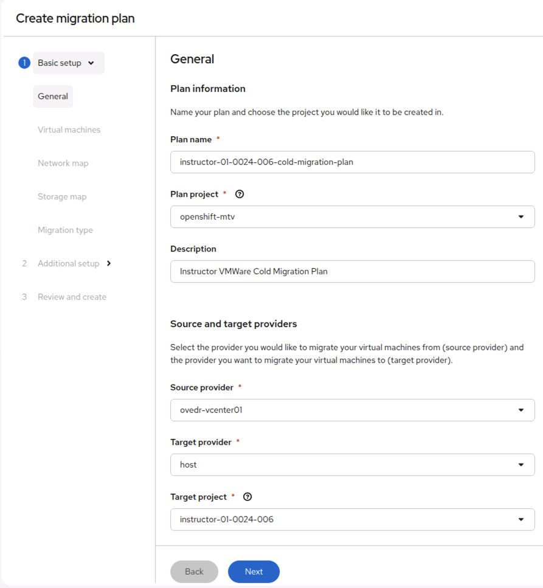
*The General step, filled in by the instructor (`instructor-01-0024-006`, project `openshift-mtv`, source `ovedr-vcenter01`,
target `host`, target project `instructor-01-0024-006`). Use **your** class ID and namespace. Then **Next**.*

**The remaining steps:**

| Step | Choose |
|---|---|
| Virtual machines | **your** VM only (`win-pg-s<NN>`) |
| Network map | `ovedr-vcenter0<N>-net-bridge` (`vm-network` → **your VLAN's bridge**: keeps your address) |
| Storage map | `ovedr-vcenter0<N>-storage` |
| Migration type | **Cold** |
| Additional setup | leave the defaults |
| Review and create | check every value, then **Create plan** (do not start it yet) |

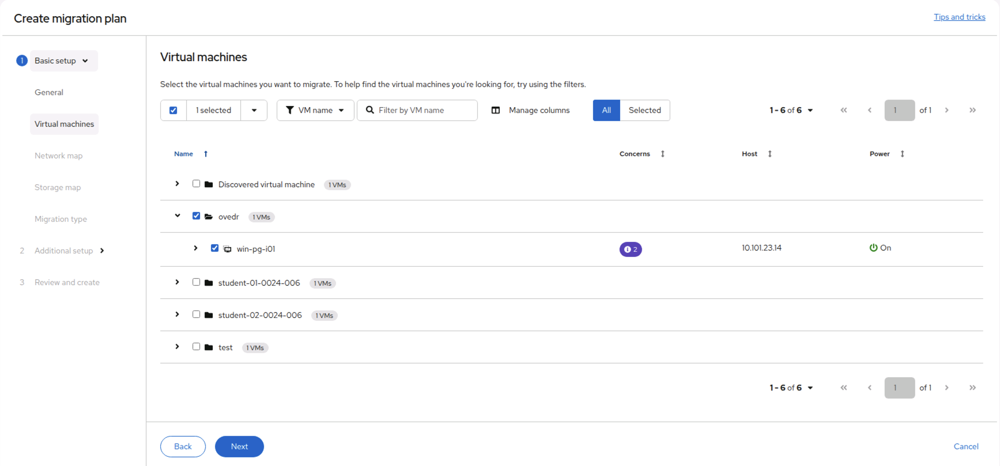
*The Virtual machines step. VMs are grouped by vCenter folder: the instructor's `win-pg-i01` sits in `ovedr`, each
student's VM in their own folder (`student-01-0024-006`, …). Expand **your** folder and tick **only your** VM. The
**Concerns** badge lists MTV's pre-migration findings for that VM (expand the row to read them); they are warnings, not
blockers, for a cold migration.*

🎬 The rest of the wizard (network map, storage map, migration type, review) is short and follows the table above; a
short screen recording of the whole wizard replaces per-step screenshots (BL-D15).

### If your plan says "Cannot start" (critical concerns)

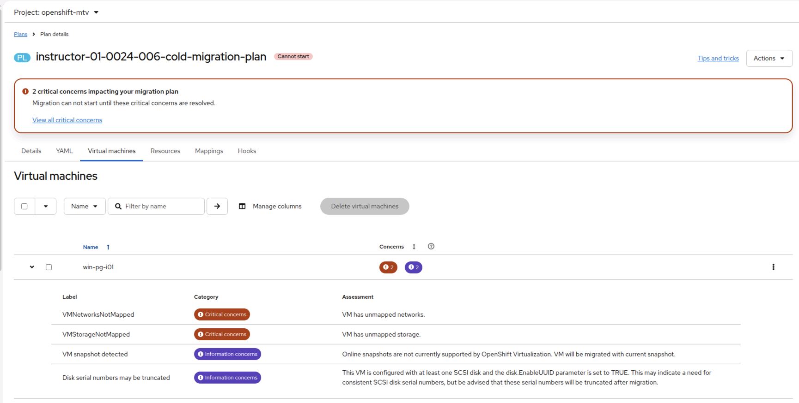
*Two critical concerns block the start: the plan's maps don't cover your VM's network or its datastore. The two
information concerns are fine for a cold migration.*

| Concern | What it means | Fix |
|---|---|---|
| **VMNetworksNotMapped** (critical) | Your VM's NIC is on a vSphere network (`vm-network`) that the plan's **network map** has no row for: usually because the wizard made a new, empty map | Map `vm-network` |
| **VMStorageNotMapped** (critical) | Your VM's disks are on a datastore (`coresan01_data00`) that the plan's **storage map** has no row for | Map `coresan01_data00` |
| VM snapshot detected (info) | Your VM has a snapshot (the clone source `ovedr-golden` on `win-pg-i01`). MTV migrates the VM's **current** state | Nothing to do |
| Disk serial numbers may be truncated (info) | `disk.EnableUUID=TRUE`; SCSI serials are shortened on OpenShift | Nothing to do (the guest finds its disks by size and label, not by serial) |

**Fix in the console:** open the plan → **Mappings** tab → **Edit mappings**:
1. **Network:** source `vm-network` → target **your VLAN's bridge** `default/vmnet<22+N>` (keeps your address) or
   **Pod networking**.
2. **Storage:** source `coresan01_data00` → target this site's storage class (`nfs-csi`, or
   `ocs-storagecluster-ceph-rbd-virtualization` on an ODF site).
3. **Save.** The concerns clear within a minute, and the status changes from *Cannot start* to *Ready*.

📸 `01-plan-edit-mappings`: the Mappings tab with both rows filled in.

Or, simplest, **use the class's maps**, which already cover both: build the plan again and at the wizard's Network map
and Storage map steps pick **Use an existing map**: `ovedr-vcenter0<N>-net-bridge` and `ovedr-vcenter0<N>-storage`.
These are the maps your staged plan `d1-<your VM>` uses, and that plan is *Ready* (Lab S [S.8](setup-how-the-lab-is-built.md)).

**Fix from the command line:** point the plan at the class's maps, then check the concerns are gone.

```bash
PLAN="$VMNS-cold-migration-plan"
oc --context site-a -n openshift-mtv patch plan "$PLAN" --type merge -p "{\"spec\":{\"map\":{
  \"network\":{\"name\":\"ovedr-vcenter0$N-net-bridge\",\"namespace\":\"openshift-mtv\"},
  \"storage\":{\"name\":\"ovedr-vcenter0$N-storage\",\"namespace\":\"openshift-mtv\"}}}}"
oc --context site-a -n openshift-mtv get plan "$PLAN" \
  -o jsonpath='{range .status.conditions[*]}{.type}={.status} {.category}{"\n"}{end}'   # no Critical left; Ready=True
```

What a map holds, side by side with the class's own (read-only for you):

```bash
oc --context site-a -n openshift-mtv get networkmap "ovedr-vcenter0$N-net-bridge" -o jsonpath='{.spec.map}{"\n"}'
oc --context site-a -n openshift-mtv get storagemap "ovedr-vcenter0$N-storage"    -o jsonpath='{.spec.map}{"\n"}'
```

**YAML equivalent** (what the console creates; not started):

```bash
oc --context site-a apply -f - <<EOF
apiVersion: forklift.konveyor.io/v1beta1
kind: Plan
metadata: { name: $VMNS-cold-migration-plan, namespace: openshift-mtv }
spec:
  warm: false
  targetNamespace: $VMNS
  provider:
    source:      { name: ovedr-vcenter0$N, namespace: openshift-mtv }
    destination: { name: host,             namespace: openshift-mtv }
  map:
    network: { name: ovedr-vcenter0$N-net-bridge, namespace: openshift-mtv }
    storage: { name: ovedr-vcenter0$N-storage,    namespace: openshift-mtv }
  vms:
    - name: $VM                # your source VM on vSphere; on OpenShift it keeps the same name
EOF
```

> **One VM, one address.** Every class VM has its own static address, so the bridge map lets each one keep it on
> OpenShift: twenty students run twenty plans side by side without colliding. Choose the **pod** map (`…-net`)
> instead and the VM lands on the pod network, where its static address answers nothing: then follow Toolkit T.4.

### Start your plan (your task: the last step)

**Console:** your plan → **Start** → confirm.

📸 `01-plan-start`: the Start confirmation for `d1-<your VM>`.

**CLI** (what the Start button creates):

```bash
oc --context site-a apply -f - <<EOF
apiVersion: forklift.konveyor.io/v1beta1
kind: Migration
metadata: { name: d1-$VM-1, namespace: openshift-mtv }
spec: { plan: { name: d1-$VM, namespace: openshift-mtv } }
EOF
```

### Watch the pipeline

```bash
oc --context site-a -n openshift-mtv get plan "d1-$VM" -w                         # Ready → Executing → Succeeded
oc --context site-a -n openshift-mtv get migration "d1-$VM-1" \
  -o jsonpath='{range .status.vms[*].pipeline[*]}{.name}{"  "}{.phase}{"  "}{.progress.completed}/{.progress.total}{"\n"}{end}'
oc --context site-a -n "$VMNS" get pvc,dv                                       # three volumes appear and fill
```

The pipeline's phases, in order:

1. **Initialize** and **PreflightInspection**
2. **DiskTransfer**: three disks, so three DataVolumes
3. **ImageConversion**: `virt-v2v` installs the virtio drivers and the QEMU guest agent, and removes VMware specifics
4. **VirtualMachineCreation**

Console: **Plans → `d1-<VM>` → the VM row → expand** shows the same, with progress bars.

📸 `01-plan-pipeline`: the plan's per-VM pipeline mid-copy.

✍️ **Row 1.3:** the migration's start and end times (outage = guest shutdown → first heartbeat on OpenShift).


### If a step fails: read the logs before you delete anything

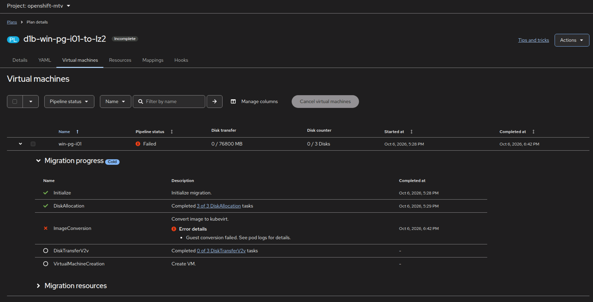
*A failed cold migration: ImageConversion (virt-v2v) failed, and the error says "See pod logs for details". There is no
Cancel on a failed plan, only Delete, and **deleting the plan deletes its pods and their logs**, so read them first.*

The conversion runs in a **pod in your target namespace**, named `<plan>-<vm id>-<suffix>`. After a failure it stays
there in status *Error*, with its full log.

**Console:** **Workloads → Pods**, project **your namespace** (`$VMNS`) → the pod named after your plan → **Logs**. Or
from the plan: **Virtual machines** → expand your VM → **Migration resources** → the pod.

**Command line:**

```bash
PLAN="d1-$VM"                                                                   # or your own plan's name
oc --context site-a -n "$VMNS" get pods | grep "$PLAN"                          # the conversion pod (Error)
POD=$(oc --context site-a -n "$VMNS" get pods -o name | grep "$PLAN" | head -1)
oc --context site-a -n "$VMNS" logs "$POD" | grep -E 'virt-v2v: error|error:|HTTP' | sort | uniq -c | tail
oc --context site-a -n "$VMNS" logs "$POD" > "$PLAN.log"                        # keep the whole log
oc --context site-a -n openshift-mtv get migration -o json | jq -r --arg p "$PLAN" \
  '.items[] | select(.spec.plan.name == $p) | .status.vms[] | .pipeline[] | "\(.name): \(.phase) \(.error.reasons // [] | join("; "))"'
```

Read the log **bottom up**: the last `virt-v2v: error:` line is the verdict, and the repeated lines above it are the
cause. For example, `HTTP 404` on a `…-flat.vmdk` URL means MTV could not read the VM's disk from vCenter: the source
VM's files moved or were deleted after the plan started. The instructor can collect everything for Red Hat support with
MTV's must-gather: `oc adm must-gather --image=<mtv-must-gather image for MTV 2.11> -- /usr/bin/targeted --plan=$PLAN`
**[verify: image name and targeted flags, MTV 2.11]**.

When you're done reading: **Actions → Archive** keeps the plan's history and removes its running resources, while
**Delete** removes everything. Then fix the cause and start a new plan.

### Power on in OpenShift

```bash
oc --context site-a -n "$VMNS" get vm "$VM" -o jsonpath='{.spec.runStrategy}{"\n"}'
virtctl --context site-a -n "$VMNS" start "$VM" 2>/dev/null \
  || oc --context site-a -n "$VMNS" patch vm "$VM" --type merge -p '{"spec":{"runStrategy":"Always"}}'
oc --context site-a -n "$VMNS" get vmi "$VM" -w                                 # Scheduling → Running
```

(MTV starts the target if the source was running when the plan began. After a guest shutdown it may stay
stopped, which is why this step exists **[verify: target power state in this MTV release]**.)

### Your VM keeps its address

The staged plan used the **bridge** map, so your VM's NIC is on the same VLAN with the same static address, and the
helpers keep using `$VM_IP`. (Only if you built and ran a plan with the **pod** map: follow
[Toolkit T.4](toolkit.md#t4-optional-give-your-vm-a-pod-network-address-on-openshift) with `CTX=site-a`.)

```bash
echo "PGHOST=${PGHOST:-$VM_IP}"         # still your own address
pg_isready -h "${PGHOST:-$VM_IP}" -p 5432
```

### The database now lives on OpenShift

```bash
where                                   # site-a Running  node=…
alive                                   # postgres_started is NEW (the VM rebooted); staleness < 10 s again
verify                                  # your d1-before and d1-before-migration rows are present, chain_ok = t
mark d1-after-migration "on=OVE site-a"
sql -c "SELECT id, ts, date_trunc('second', gap) AS outage
                  FROM (SELECT id, ts, ts - lag(ts) OVER (ORDER BY id) AS gap FROM heartbeat) g
                  WHERE gap > interval '10 seconds' ORDER BY id DESC LIMIT 3;"
```

✅ `chain_ok = t`, and your two earlier marks are present.
✅ The newest heartbeat gap is the migration's outage.

✍️ **Row 1.4:** the outage from the gap query, plus the mark id and fingerprint after the move.

### Your file, read on OpenShift

Console: **Virtualization → VirtualMachines → your VM → Console** (VNC). Send **Ctrl-Alt-Del** and log in as
`.\<WINUSER>`:

```powershell
$f = "C:\Users\Public\ovedr\$env:USERNAME.txt"
Get-Content $f                                                # d1-before … d1-before-migration: all there
Add-Content $f "$(Get-Date -Format o)  d1-after-migration  on=OVE"
```

📸 `01-ove-console-touchfile`: the OpenShift VNC console showing your file.

---

## 1.6 VMware Tools out, virtio and the QEMU guest agent in (10 min)

<!-- 🎬 video slot 01-1-6-vmware-tools-out-virtio-qemu-guest -->
[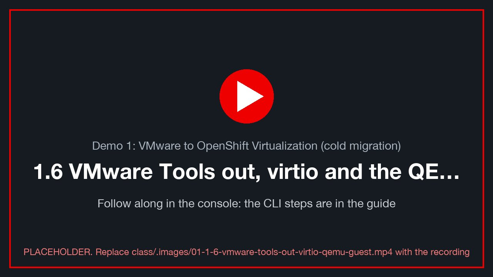](../.images/01-1-6-vmware-tools-out-virtio-qemu-guest.mp4)
<sub>🎬 *1.6 VMware Tools out, virtio and the QEMU guest agent in: a recording of this whole section, done in the console (placeholder until recorded: `class/.images/01-1-6-vmware-tools-out-virtio-qemu-guest.mp4`).*</sub>

On vSphere, **VMware Tools** provided paravirtual drivers and the guest agent. On OpenShift, **virtio-win**
drivers and the **QEMU guest agent** do that job. `virt-v2v` installed them during *ImageConversion*.

### From OpenShift

```bash
oc --context site-a -n "$VMNS" get vmi "$VM" \
  -o jsonpath='{range .status.conditions[*]}{.type}={.status}{"\n"}{end}'          # AgentConnected=True
oc --context site-a -n "$VMNS" get vmi "$VM" -o jsonpath='{.status.guestOSInfo}' | jq .
oc --context site-a -n "$VMNS" get vmi "$VM" -o jsonpath='{.status.interfaces}'   | jq .   # IPs reported by the agent
virtctl --context site-a -n "$VMNS" guestosinfo "$VM" 2>/dev/null | jq '.guestAgentVersion, .os.prettyName'
```

✅ `AgentConnected=True`, `guestOSInfo` names *Windows Server 2022*, and the agent reports the VM's IP.
The console's VM **Overview** shows the same on its *Guest agent* tile.

### From inside Windows

```powershell
Get-Service QEMU-GA, VMTools -ErrorAction SilentlyContinue | Format-Table Name, Status, StartType
Get-PnpDevice -PresentOnly | Where-Object FriendlyName -match 'VirtIO|Red Hat' |
  Format-Table FriendlyName, Status, Class -AutoSize
pnputil /enum-drivers | Select-String -Context 0,5 'vioscsi|viostor|netkvm|balloon'
Get-ItemProperty 'HKLM:\SOFTWARE\Microsoft\Windows\CurrentVersion\Uninstall\*' |
  Where-Object DisplayName -match 'VMware Tools|Virtio|QEMU' | Format-Table DisplayName, DisplayVersion
```

✅ `QEMU-GA` is *Running*. The disks and NIC use **Red Hat VirtIO** devices. `VMTools` is gone, or stopped and
disabled.

If VMware Tools is still installed, it does nothing on KVM, but remove it: **Settings → Apps → VMware Tools →
Uninstall**, then reboot **[verify: whether virt-v2v removed it in this build]**.

📸 `01-virtio-devices`: Device Manager showing *Red Hat VirtIO* storage and network.

### Update virtio-win and the agent

The replacement for "upgrade VMware Tools" is to mount the **virtio-win** media and run its installer.

Console: **VM → Configuration → Storage → Mount Windows drivers disk** ✓, then **Restart** the VM. Or in YAML:

```bash
oc --context site-a -n "$VMNS" patch vm "$VM" --type json -p '[
 {"op":"add","path":"/spec/template/spec/domain/devices/disks/-",
  "value":{"name":"virtio-win","cdrom":{"bus":"sata"}}},
 {"op":"add","path":"/spec/template/spec/volumes/-",
  "value":{"name":"virtio-win","containerDisk":{"image":"registry.redhat.io/container-native-virtualization/virtio-win-rhel9:v4.19"}}}]'
virtctl --context site-a -n "$VMNS" restart "$VM"
```

**[verify: the virtio-win image tag shipped with this cluster:
`oc get cm -n openshift-cnv virtio-win -o yaml`.]**

Then, in Windows (as Administrator), run the guest-tools installer from the new CD drive:

```powershell
$cd = (Get-Volume | Where-Object { $_.DriveType -eq 'CD-ROM' -and (Test-Path "$($_.DriveLetter):\virtio-win-guest-tools.exe") }).DriveLetter
Start-Process "$($cd):\virtio-win-guest-tools.exe" -ArgumentList '/install','/passive','/norestart' -Wait
Get-ItemProperty 'HKLM:\SOFTWARE\Microsoft\Windows\CurrentVersion\Uninstall\*' |
  Where-Object DisplayName -match 'Virtio|QEMU' | Format-Table DisplayName, DisplayVersion
Get-Service QEMU-GA
```

✅ The versions changed (or matched already), and `QEMU-GA` is *Running*. Back on the CLI, `AgentConnected=True`.
Remove the drivers disk again in the console (untick it) and restart.

```bash
alive && verify                        # the reboots cost heartbeat gaps, never rows
```

---

## 1.7 End of demo: prove the data (5 min)

<!-- 🎬 video slot 01-1-7-end-demo-prove-data -->
[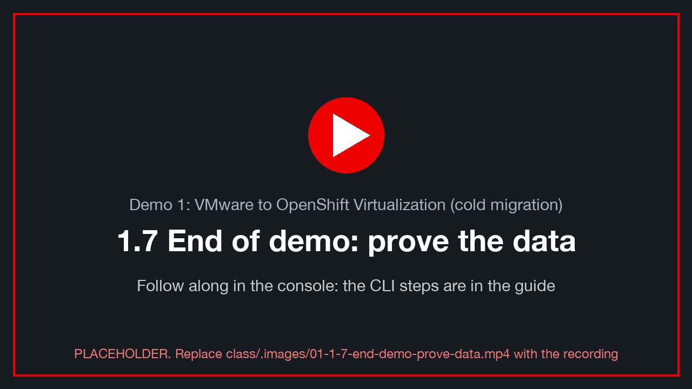](../.images/01-1-7-end-demo-prove-data.mp4)
<sub>🎬 *1.7 End of demo: prove the data: a recording of this whole section, done in the console (placeholder until recorded: `class/.images/01-1-7-end-demo-prove-data.mp4`).*</sub>

```bash
mark d1-end "demo 1 complete"
verify
sql -c "SELECT stage, id, ts FROM marks WHERE student = '$ME' ORDER BY id;"
```

```powershell
Get-Content "C:\Users\Public\ovedr\$env:USERNAME.txt"
```

✅ Every stage you marked (`d1-before`, `d1-before-migration`, `d1-after-migration`, `d1-end`) is
present and in order, and `chain_ok = t`.
✅ Your file holds every line you wrote, including the ones written on vSphere.

📸 `01-final-verify`: `verify` output and the stage list.

✍️ **Row 1.5:** the final fingerprint.

---

## Thank you

Thank you for working through Demo 1. You moved a real Windows + PostgreSQL workload off VMware, kept every byte
of its data, and saw how each vSphere building block (port group, datastore, VMware Tools) has an OpenShift
counterpart. To keep learning:

- [Lab S — how this lab was built](setup-how-the-lab-is-built.md): build the provider, maps and plan yourself (CLI + console)
- [OpenShift Virtualization documentation (4.19)](https://docs.redhat.com/en/documentation/openshift_container_platform/4.19/html/virtualization/index)
- [Migration Toolkit for Virtualization 2.11 documentation](https://docs.redhat.com/en/documentation/migration_toolkit_for_virtualization/2.11)
- [MTV: planning your migration (network and storage mapping)](https://docs.redhat.com/en/documentation/migration_toolkit_for_virtualization/2.11/html/planning_your_migration_to_red_hat_openshift_virtualization/index) [verify link]
- [OpenShift Virtualization: managing VMs (guest agent and VirtIO drivers)](https://docs.redhat.com/en/documentation/openshift_container_platform/4.19/html/virtualization/managing-vms) [verify link]
- [OpenShift Virtualization: live migration](https://docs.redhat.com/en/documentation/openshift_container_platform/4.19/html/virtualization/live-migration) [verify link]
- [OpenShift Virtualization: backup and restore (VM snapshots)](https://docs.redhat.com/en/documentation/openshift_container_platform/4.19/html/virtualization/backup-and-restore) [verify link]
- [Red Hat OpenShift Virtualization (product overview)](https://www.redhat.com/en/technologies/cloud-computing/openshift/virtualization)
- [DO316: Managing Virtual Machines with Red Hat OpenShift Virtualization (course)](https://www.redhat.com/en/services/training/do316-managing-virtual-machines-red-hat-openshift-virtualization)
- [Red Hat interactive labs (free, in the browser)](https://www.redhat.com/en/interactive-labs)
- [Red Hat Developer: OpenShift](https://developers.redhat.com/products/openshift/overview)
- [Migration Toolkit for Virtualization (product page)](https://www.redhat.com/en/technologies/cloud-computing/openshift/virtualization/migration-toolkit) **[verify: URL]**

The bonus rounds below go further: moving a running VM between nodes, and recovering a destroyed database from a
snapshot.

---

## Bonus A: live migration between nodes (15 min)

<!-- 🎬 video slot 01-bonus-a-live-migration-nodes -->
[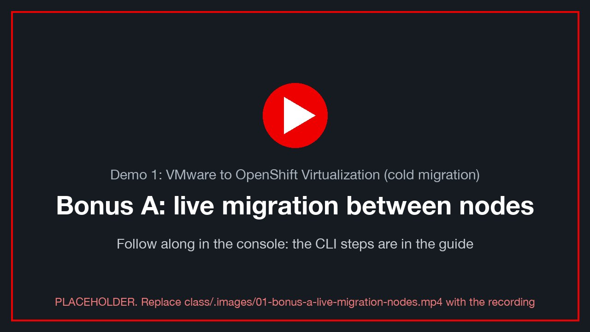](../.images/01-bonus-a-live-migration-nodes.mp4)
<sub>🎬 *Bonus A: live migration between nodes: a recording of this whole section, done in the console (placeholder until recorded: `class/.images/01-bonus-a-live-migration-nodes.mp4`).*</sub>

**Goal:** move the *running* VM from one OpenShift node to another, with no reboot and almost no gap.

A live migration copies the VM's memory to another node while it runs, then switches over in milliseconds. It
needs the disks to be reachable from **both** nodes at once, which means **ReadWriteMany** (RWX) storage:

- `nfs-csi`: RWX filesystem ✅
- ODF's `ocs-storagecluster-ceph-rbd-virtualization`: RWX block ✅

```bash
oc --context site-a -n "$VMNS" get vmi "$VM" \
  -o jsonpath='{.status.conditions[?(@.type=="LiveMigratable")].status}  {.status.conditions[?(@.type=="LiveMigratable")].message}{"\n"}'
oc --context site-a -n "$VMNS" get pvc -o custom-columns=NAME:.metadata.name,MODES:.spec.accessModes,SC:.spec.storageClassName
where                                                  # ✍️ the node it is on now
mark d1-bonusA-before
```

✅ `LiveMigratable=True`. If it is `False`, the message names the reason: usually a RWO disk or a mounted CD.

Start the live migration:

```bash
virtctl --context site-a -n "$VMNS" migrate "$VM" 2>/dev/null || oc --context site-a apply -f - <<EOF
apiVersion: kubevirt.io/v1
kind: VirtualMachineInstanceMigration
metadata: { generateName: d1-live-, namespace: $VMNS }
spec: { vmiName: $VM }
EOF
```

Console: **VM → Actions → Migrate → Compute** (the wording varies by version).

Watch it:

```bash
oc --context site-a -n "$VMNS" get vmim -w                          # Scheduling → … → Succeeded
where                                                                 # a different node
alive                                                                 # postgres_started UNCHANGED: no reboot
mark d1-bonusA-after
verify
sql -c "SELECT max(gap) FROM (SELECT ts - lag(ts) OVER (ORDER BY id) AS gap
                 FROM heartbeat WHERE ts > now() - interval '10 minutes') g;"
```

✅ New node, same `postgres_started`, and the largest gap is around the normal 5 s tick (a cold move costs minutes).
✅ `chain_ok = t`.

📸 `01-live-migration`: the VM's overview showing the node change, or the `vmim` watch.

✍️ **Row 1.A:** from-node → to-node, the max gap, the fingerprint.

---

## Bonus B: snapshot, destroy the database, restore from the snapshot's disks (25 min)

<!-- 🎬 video slot 01-bonus-b-snapshot-destroy-database-restore-snapshot-s -->
[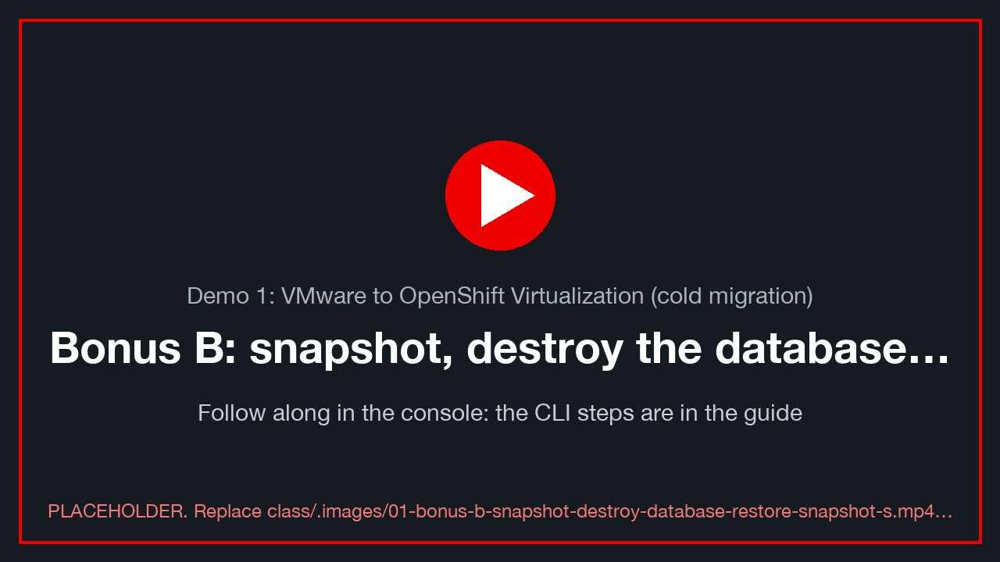](../.images/01-bonus-b-snapshot-destroy-database-restore-snapshot-s.mp4)
<sub>🎬 *Bonus B: snapshot, destroy the database, restore from the snapshot's disks: a recording of this whole section, done in the console (placeholder until recorded: `class/.images/01-bonus-b-snapshot-destroy-database-restore-snapshot-s.mp4`).*</sub>

**Goal:** take a VM snapshot, delete the database for real, then bring the data back by attaching the snapshot's
disks and restarting PostgreSQL.

> ⚠️ **Data and WAL go together.** PostgreSQL keeps its data on `D:` and its write-ahead log on `L:`. If you restore
> only `D:` and keep today's `L:`, PostgreSQL replays the newer WAL on start, including the `DROP DATABASE`, and you
> lose the database again. Restore **both** disks from the **same** snapshot. A VM snapshot with the guest agent
> freezes all disks at the same instant (VSS), so its `D:` and `L:` match.

### Snapshot

```bash
mark d1-pre-snapshot "this row must come back"
oc --context site-a apply -f - <<EOF
apiVersion: snapshot.kubevirt.io/v1beta1
kind: VirtualMachineSnapshot
metadata: { name: $VM-d1-snap, namespace: $VMNS }
spec:
  source: { apiGroup: kubevirt.io, kind: VirtualMachine, name: $VM }
EOF
oc --context site-a -n "$VMNS" get vmsnapshot "$VM-d1-snap" -w        # Ctrl-C when READYTOUSE=true
oc --context site-a -n "$VMNS" get vmsnapshot "$VM-d1-snap" \
  -o jsonpath='{.status.indications}{"\n"}'                             # ["Online","GuestAgent"]: frozen, consistent
```

Console: **VM → Snapshots → Take snapshot**.

Each storage option ships its own VolumeSnapshotClass (ODF's, or `nfs-csi-snapclass` on NFS;
[Lab S §S.4](setup-how-the-lab-is-built.md)); without a class the snapshot stays *not ready*. Red Hat:
[Backing up and restoring VMs with snapshots](https://docs.redhat.com/en/documentation/openshift_container_platform/4.19/html/virtualization/backup-and-restore) [verify link].

📸 `01-snapshot-ready`: the Snapshots tab with the snapshot *Ready* and indications *Online, GuestAgent*.

Now write a row **after** the snapshot. It exists only in the live database, so the restore must lose it:

```bash
mark d1-after-snapshot "this row must NOT come back"
```

### Delete the database

In your VM's console, in an **elevated** PowerShell (*Run as administrator*: on your own VM, your `.\student-NN`
login is a local administrator **[verify: BL-D10]**), stop the heartbeat writer so that it doesn't recreate anything:

```powershell
Disable-ScheduledTask -TaskName bcdr-heartbeat | Out-Null
Stop-ScheduledTask    -TaskName bcdr-heartbeat
```

Then drop the database. The `bcdr` role owns it, and its password is the instructor's, so **🧑‍🏫 ask your
instructor** to run this from their browser terminal, with **your** VM's address:

```bash
# 🧑‍🏫 instructor (cluster-admin), in their browser terminal: the class pod holds the bcdr owner's password
oc --context site-a -n ovedr-app exec -i deploy/sql-client -- \
  psql -h <student VM_IP> -U bcdr -d postgres -c 'DROP DATABASE bcdr WITH (FORCE);'
```

Confirm the damage:

```bash
verify                 # FATAL: database "bcdr" does not exist. That is the disaster.
```

📸 `01-database-gone`: the `does not exist` error.

### Shut PostgreSQL down and take the damaged disks offline

```powershell
Stop-Service postgresql-16
$bad = foreach ($l in 'D','L') { Get-Partition -DriveLetter $l | Get-Disk }
$bad | Format-Table Number, FriendlyName, SerialNumber, @{n='GB';e={[math]::Round($_.Size/1GB)}}
foreach ($l in 'D','L') { Get-Partition -DriveLetter $l | Remove-PartitionAccessPath -AccessPath "$($l):\" }
$bad | ForEach-Object { Set-Disk -Number $_.Number -IsOffline $true }
```

### Create volumes from the snapshot's `D:` and `L:` and hot-plug them

The snapshot holds one **VolumeSnapshot** per disk. Pick the 10 Gi (`D:`) and 5 Gi (`L:`) ones:

```bash
NS=$VMNS; CTX=site-a
CONTENT=$(oc --context $CTX -n $NS get vmsnapshot "$VM-d1-snap" -o jsonpath='{.status.virtualMachineSnapshotContentName}')
oc --context $CTX -n $NS get vmsnapshotcontent "$CONTENT" \
  -o jsonpath='{range .spec.volumeBackups[*]}{.volumeName}{"  "}{.persistentVolumeClaim.metadata.name}{"  "}{.persistentVolumeClaim.spec.resources.requests.storage}{"  "}{.volumeSnapshotName}{"\n"}{end}'
```

For each of the two rows (10Gi and 5Gi), create a PVC **from** its VolumeSnapshot. It uses the same class, access
mode, volume mode and size as the original:

```bash
restore_pvc() {   # restore_pvc <original pvc> <volumesnapshot> <new name>
  oc --context $CTX -n $NS get pvc "$1" -o json | jq --arg s "$2" --arg n "$3" '{
    apiVersion: "v1", kind: "PersistentVolumeClaim",
    metadata: {name: $n, namespace: .metadata.namespace},
    spec: {storageClassName: .spec.storageClassName, accessModes: .spec.accessModes,
           volumeMode: .spec.volumeMode, resources: .spec.resources,
           dataSource: {apiGroup: "snapshot.storage.k8s.io", kind: "VolumeSnapshot", name: $s}}}' \
  | oc --context $CTX apply -f -
}
# fill these four from the snapshot table above: the 10Gi (D:, data) and 5Gi (L:, WAL) PVCs and their VolumeSnapshots
DATA_PVC='<10Gi pvc>'; DATA_SNAP='<its volumesnapshot>'
WAL_PVC='<5Gi pvc>';   WAL_SNAP='<its volumesnapshot>'
restore_pvc "$DATA_PVC" "$DATA_SNAP" "$VM-restored-data"
restore_pvc "$WAL_PVC"  "$WAL_SNAP"  "$VM-restored-wal"
oc --context $CTX -n $NS get pvc "$VM-restored-data" "$VM-restored-wal" -w     # Bound
```

Hot-plug both into the running VM:

```bash
for v in "$VM-restored-data" "$VM-restored-wal"; do
  virtctl --context $CTX -n $NS addvolume "$VM" --volume-name="$v" --serial="${v##*-}" --persist
done
oc --context $CTX -n $NS get vmi "$VM" -o jsonpath='{range .status.volumeStatus[*]}{.name}{"  "}{.phase}{"\n"}{end}'
```

✅ Both volumes show `Ready` (hot-plugged on the virtio-SCSI bus) **[verify: hot-plug on this cluster, and the
`vioscsi` driver in the guest]**.

### Bring the restored disks online as `D:` and `L:`, start PostgreSQL

```powershell
Update-HostStorageCache
Get-Disk | Where-Object IsOffline | Format-Table Number, SerialNumber, @{n='GB';e={[math]::Round($_.Size/1GB)}}, OperationalStatus
# the restored disks have serials "data" and "wal" (from --serial above); match on that, never on disk number
foreach ($m in @(@{Serial='data'; Letter='D'}, @{Serial='wal'; Letter='L'})) {
  $d = Get-Disk | Where-Object { $_.SerialNumber -eq $m.Serial }
  Set-Disk -Number $d.Number -IsOffline   $false
  Set-Disk -Number $d.Number -IsReadOnly  $false
  Get-Partition -DiskNumber $d.Number | Where-Object Type -eq 'Basic' | Set-Partition -NewDriveLetter $m.Letter
}
Get-Volume -DriveLetter D, L | Format-Table DriveLetter, FileSystemLabel, Size, HealthStatus
Start-Service postgresql-16
Enable-ScheduledTask -TaskName bcdr-heartbeat | Out-Null
Start-ScheduledTask  -TaskName bcdr-heartbeat
```

(The restored disks are copies of the originals, so Windows may first report a *signature collision*. Bringing the
copy online while the originals are offline gives it a new signature. That is expected.)

📸 `01-disks-restored`: Disk Management, with the restored disks online as `D:` (`pgdata`) and `L:` (`pg_wal`) and
the originals offline.

### What came back

```bash
verify
sql -c "SELECT stage, id, ts FROM marks WHERE student = '$ME' ORDER BY id DESC LIMIT 5;"
alive
mark d1-bonusB-restored
```

✅ The database exists again, `chain_ok = t`, and your newest row is **`d1-pre-snapshot`**.
✅ `d1-after-snapshot` is **gone**. It was written after the snapshot, so it was never in it. This is the
**recovery point**: a restore returns you to the moment of the snapshot, not to the moment of the disaster.

✍️ **Row 1.B:** the snapshot time, the last surviving mark, and the time the database was back.

### The other way: restore the whole VM

Swapping disks by hand teaches what a restore really is. In production you would restore the whole VM:

```bash
virtctl --context site-a -n "$VMNS" stop "$VM"
oc --context site-a apply -f - <<EOF
apiVersion: snapshot.kubevirt.io/v1beta1
kind: VirtualMachineRestore
metadata: { name: $VM-d1-restore, namespace: $VMNS }
spec:
  target: { apiGroup: kubevirt.io, kind: VirtualMachine, name: $VM }
  virtualMachineSnapshotName: $VM-d1-snap
EOF
oc --context site-a -n "$VMNS" get vmrestore "$VM-d1-restore" -w     # COMPLETE=true
virtctl --context site-a -n "$VMNS" start "$VM"
```

That brings **every** disk, `C:` included, back to the snapshot in one step, at the cost of a VM restart.

### Tidy up after Bonus B

The VM now carries two extra (restored) disks, and its original `D:` and `L:` are offline. Before the next demo,
either restore the whole VM (above), or stop the VM and remove the old volumes in **Configuration → Storage**
**[verify: BL-D11, a clean "post-bonus" state for demos 2-4]**.

---

## Bonus C: deploy a new VM from a Red Hat template, on your VLAN, with a data disk (20 min)

<!-- 🎬 video slot 01-bonus-c-deploy-new-vm-red-hat-template -->
[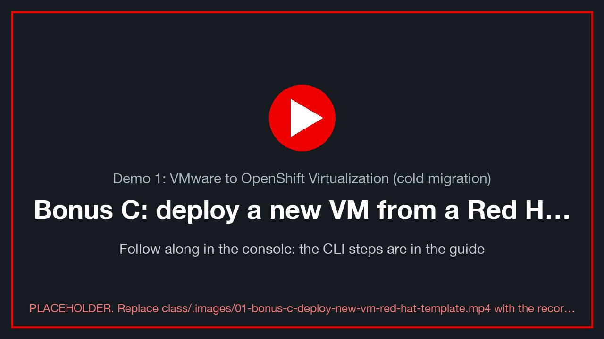](../.images/01-bonus-c-deploy-new-vm-red-hat-template.mp4)
<sub>🎬 *Bonus C: deploy a new VM from a Red Hat template, on your VLAN, with a data disk: a recording of this whole section, done in the console (placeholder until recorded: `class/.images/01-bonus-c-deploy-new-vm-red-hat-template.mp4`).*</sub>

Section 1.3 showed the **replatform** path: rather than moving an old VM, build a new one from a Red Hat-supplied
template and boot source, then move the application onto it. Here you do that: a CentOS Stream 9 server in your
namespace, attached to your VLAN's bridge (like your migrated VM), plus a data disk. Red Hat:
[Creating VMs from templates](https://docs.redhat.com/en/documentation/openshift_container_platform/4.19/html/virtualization/creating-a-virtual-machine) [verify link] ·
[Networking for VMs](https://docs.redhat.com/en/documentation/openshift_container_platform/4.19/html/virtualization/networking) [verify link] ·
[Storage for VMs](https://docs.redhat.com/en/documentation/openshift_container_platform/4.19/html/virtualization/storage) [verify link].

### 1 · Pick the template, then Customize

Console, site A, **project = your namespace** (`$VMNS`, top of the page) → **Virtualization → Catalog → Template catalog**
→ **CentOS Stream 9 VM** (`centos-stream9-server-small`, ✓ Source available).

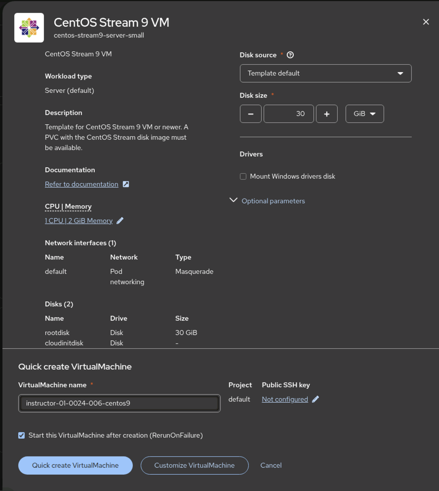
*The template's quick-create panel. Name it `<your class ID>-centos9`. ⚠ Check **Project** says your namespace, not
`default` (switch the project at the top of the page first). Click **Customize VirtualMachine**, not Quick create, so you
can change the network and add a disk.*

### 2 · Put the NIC on your VLAN's bridge

**Customize → Network interfaces → `default` → ⋮ Edit.** Change **Network** from *Pod networking* to your VLAN's bridge
**`vmnet<22+N>`** (e.g. `vmnet23` for lz1), keep **Model: virtio**, **Save**.

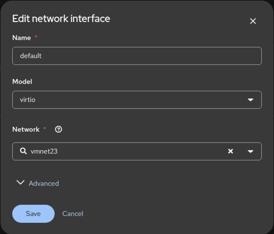
*The template's NIC moved from the pod network to the VLAN bridge `vmnet23`: the VM is now on the same layer-2 network
as the vSphere VMs and your migrated VM.*

> ⚠️ **No DHCP on the lab VLANs** (BL-D12). On the bridge your VM needs a **static address**. Set it in **Customize →
> Scripts → Cloud-init → Network data** (or the YAML below): `10.101.<22+N>.<150+NN>/24`, gateway `10.101.<22+N>.1`,
> DNS `10.101.6.201, 10.101.6.202`. Use **your** `NN` so no two students collide.

### 3 · Add a data disk

**Customize → Disks → Add disk → Empty disk (blank)**: name `<your class ID>-centos9-data`, **10 GiB**, Type **Disk**,
Interface **VirtIO**, StorageClass this site's class (`nfs-csi`, or `ocs-storagecluster-ceph-rbd-virtualization` on an
ODF site). **Save**.

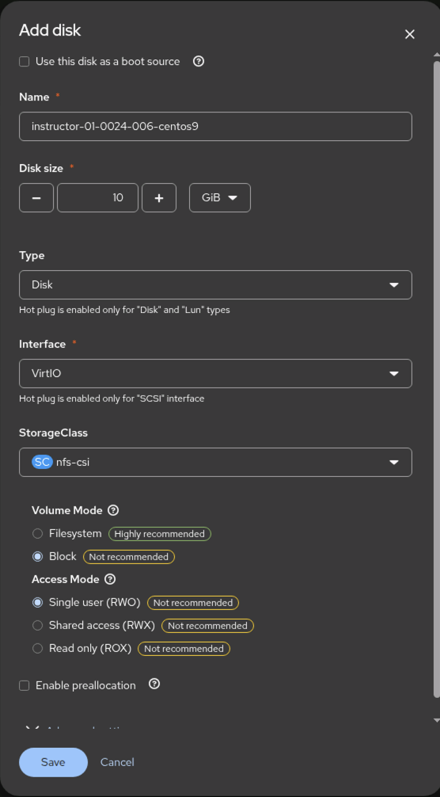
*The Add disk dialog. On `nfs-csi`, choose **Volume Mode: Filesystem** (marked *Highly recommended*) and **Access Mode:
Shared access (RWX)**, so the VM can live-migrate (Bonus A); the dialog's defaults (Block, RWO) are flagged
*Not recommended* for this class. On ODF, Block + RWX is the recommended pair.*

Then **Create VirtualMachine**. It boots in under a minute (the boot source is already on the cluster).

### The same from the command line

Everything in steps 1-3 is one VirtualMachine manifest:
**[`centos9-vm-from-template.yaml`](../downloads/centos9-vm-from-template.yaml)** (also on the [Downloads](../downloads.md) page). It was exported from
the console after the steps above, with the cluster-generated fields and the password removed. Each part is commented
with the console step it replaces: the root disk cloned from Red Hat's boot source, the blank data disk, the NIC on
your VLAN's bridge, and cloud-init for the `centos` login and your static address. In your browser terminal, it is
fetched from the class site, filled in and applied (or paste it into **+ → Import YAML** in the console, with your
values in place of each `${…}`).

```bash
export NAME="$VMNS-centos9" VLAN=$((22 + N)) SC=nfs-csi       # SC: ocs-storagecluster-ceph-rbd-virtualization on an ODF site
export VIP="10.101.$VLAN.$((150 + 10#${WINUSER#student-}))"   # your static address on the VLAN (no lab DHCP)
read -rsp 'Password for user centos: ' CENTOS_PASSWORD; echo; export CENTOS_PASSWORD   # typed, never in a file
curl -sSf https://paragonmicro-lab.github.io/demo-0024-public/downloads/centos9-vm-from-template.yaml \
  | envsubst | oc --context site-a -n "$VMNS" apply -f -
oc --context site-a -n "$VMNS" get vm,dv "$NAME" "$NAME-data"                   # DataVolumes clone/create, then the VM runs
oc --context site-a -n "$VMNS" wait vmi/"$NAME" --for=jsonpath='{.status.phase}'=Running --timeout=10m
oc --context site-a -n "$VMNS" get vmi "$NAME" -o jsonpath='{.status.interfaces[0].ipAddresses}{"\n"}'   # your address
```

### 4 · Use the data disk, and prove it

Log in on the VM's **Console** tab: as `centos` with the password you typed if you used the YAML, or with the user and
password the template generated (on the VM's **Overview → Details**) if you used the console:

```bash
lsblk                                   # the 10 GiB disk with no partitions is your data disk (vdc from the YAML, vdb from the console)
DATA=/dev/vdc                           # ← the one lsblk showed
sudo mkfs.xfs "$DATA" && sudo mkdir -p /data && sudo mount "$DATA" /data
echo "$(date -Is) bonus-c $(hostname)" | sudo tee /data/hello.txt
ip -4 addr show                         # your static address on the VLAN
ping -c 2 10.101.<22+N>.1               # the VLAN gateway answers: you are on the bridge, not the pod network
```

The replatform story: the new server reaches the old one (your migrated Windows VM) directly on the same VLAN. In the
CentOS VM:

```bash
timeout 3 bash -c '</dev/tcp/<your VM_IP>/5432' && echo "PostgreSQL on the migrated VM: reachable from the new VM"
```

📸 `01-template-vm-running`: the new VM's Overview, Running, with its VLAN address.

✍️ **Row 1.C:** the new VM's name, its VLAN address, and that it reached your migrated VM's PostgreSQL port.

---

## Proof table: Demo 1

| Row | Stage | Mark id | `chain_ok` | Fingerprint | Notes |
|---|---|---|---|---|---|
| 1.1 | d1-before | | | | VLAN of `vm-network`: |
| 1.2 | d1-before-migration | | | | |
| 1.3 | migration | — | — | — | start → end: |
| 1.4 | d1-after-migration | | | | outage (gap): |
| 1.5 | d1-end | | | | |
| 1.A | d1-bonusA-after | | | | node → node, max gap: |
| 1.B | d1-bonusB-restored | | | | last surviving mark: |
| 1.C | Bonus C: VM from a template | | | | new VM address: |
