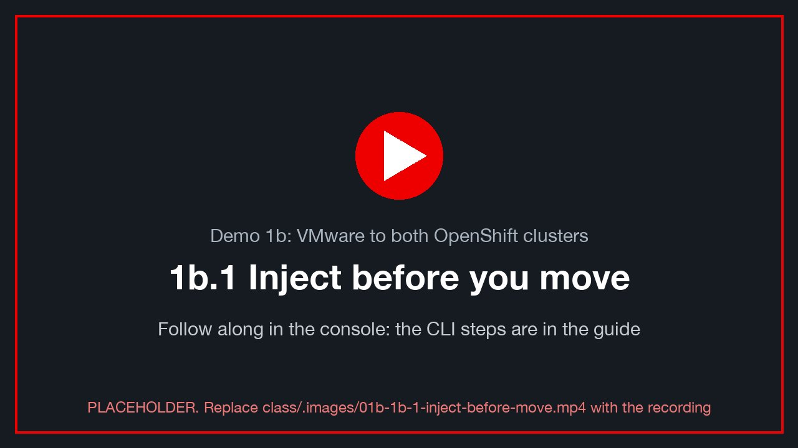
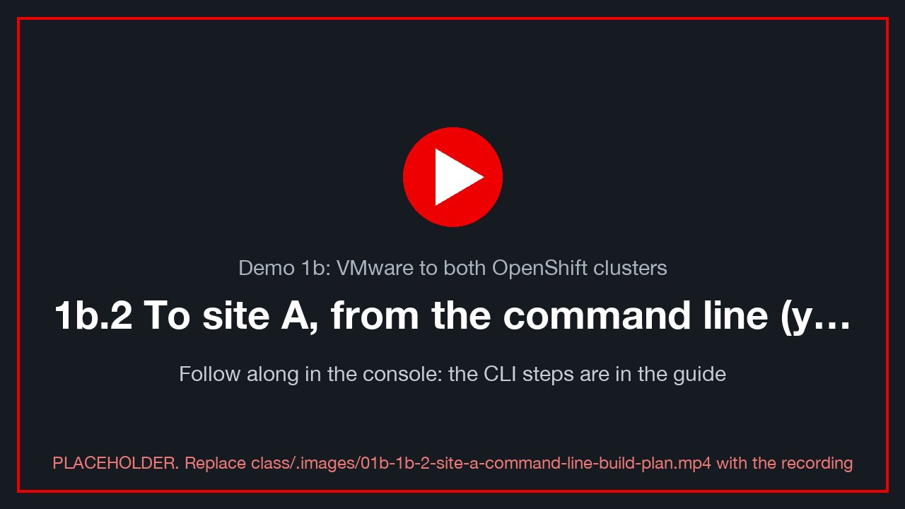
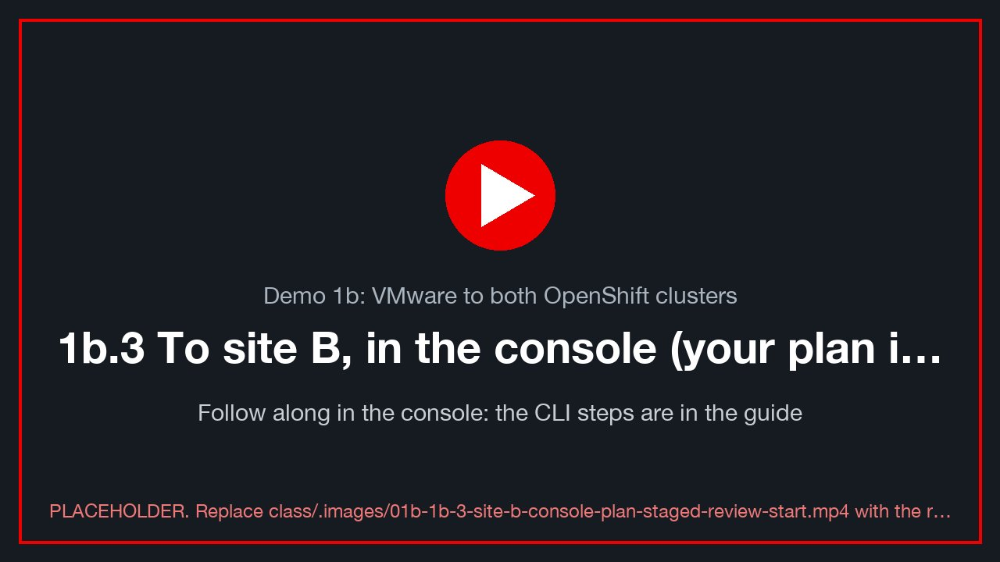
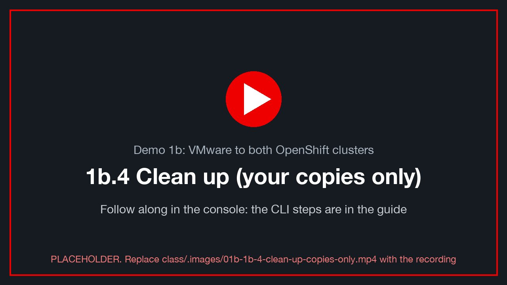

# Demo 1b: VMware to both OpenShift clusters

> **Version 0.4.0 · draft · 2026-10-12** · class/demos/01b-vmware-to-both-sites.md

## What you will learn

You migrate one VMware VM to **two** different OpenShift clusters, first site A and then site B, using the
Migration Toolkit for Virtualization (MTV) installed on each. You do it twice: once from the **command line**
(you build the Plan and Migration objects) and once in the **console**, where the lab has **staged your site B plan**
and your task is to review it and start it. That shows the console is a front end to the same objects. At each landing you prove the database arrived intact and that the VMware Tools were replaced by
the OpenShift guest agent. **CI runs exactly these command-line steps** (`action=test-migration`,
`automation/test/migrate_both.sh`), so a green CI run means they work on this booking.

## How the lab is set up for this demo

Each row points at the [Lab S](setup-how-the-lab-is-built.md) section that shows how it was built (CLI and console), with Red Hat docs.

| Prepared by CI | Where | Check | How it was built · docs |
|---|---|---|---|
| Your VM `win-pg-s<NN>` on vSphere, in your folder `vms/students/<class ID>`, at its own address `10.101.<22+N>.<100+NN>`, PostgreSQL WAL on `L:` and data on `D:`, validated | vSphere `lzN` | `alive` (Lab 0) | [S.11](setup-how-the-lab-is-built.md) |
| MTV on **both** sites (`migration_tools=both`), with its console menu and provider `ovedr-vcenter0<N>` Ready | site A and site B | `oc --context site-a -n openshift-mtv get provider` | [S.5](setup-how-the-lab-is-built.md) · [S.6](setup-how-the-lab-is-built.md) · [MTV 2.11](https://docs.redhat.com/en/documentation/migration_toolkit_for_virtualization/2.11) |
| Network maps `ovedr-vcenter0<N>-net` (pod) and `…-net-bridge` (the VM's VLAN, NAD `vmnet<22+N>`) | both sites | `oc -n openshift-mtv get networkmap` | [S.3](setup-how-the-lab-is-built.md) · [S.8](setup-how-the-lab-is-built.md) |
| Storage map `ovedr-vcenter0<N>-storage`: datastore → **ODF** (`ocs-storagecluster-ceph-rbd-virtualization`) on site A, **NFS** (`nfs-csi`) on site B | both sites | `oc -n openshift-mtv get storagemap` | [S.4](setup-how-the-lab-is-built.md) · [S.8](setup-how-the-lab-is-built.md) |
| **Staged plans, not started:** `d1-<your VM>` on site A (Demo 1) and **`d1b-<your VM>-to-<B>` on site B (this demo)** | both sites | `oc -n openshift-mtv get plan -l ovedr/vm=$VM` | [S.12](setup-how-the-lab-is-built.md) |
| Your namespace `$VMNS` (admin) with your `win-pg-s<NN>-sql` Service and your browser terminal `sql-client` | both sites | `oc -n "$VMNS" get svc,deploy` | [S.9](setup-how-the-lab-is-built.md) |
| You can create and run Plans and Migrations, but not change providers, maps or secrets | `openshift-mtv` | `oc auth can-i create plans.forklift.konveyor.io -n openshift-mtv` | [S.9](setup-how-the-lab-is-built.md) |

Picture: [lab diagram](lab-diagram.md). **The rule for this demo:** only **one copy** of your VM may run on the VLAN at a
time. The bridge map keeps the VM's own address, so a second running copy would collide. Stop each copy before the next move.
Because every copy keeps `$VM_IP`, the helpers work unchanged on both sites, and Lab 0 §0.6 is not needed.

> **Already ran Demo 1?** Then your VM is already on site A (named `$VM` in your namespace `$VMNS`). Skip 1b.2, stop that copy
> (one copy on the VLAN), power the vSphere original back on, and go straight to 1b.3.

> 🖥️ **Where you type the commands: your browser terminal.** Every `bash` block in this guide runs in **your own
> terminal pod**, in the browser: in the site A console, project **`<your class ID>`** → **Workloads → Pods →
> `sql-client` → Terminal** ([Lab 0 §0.3](00-access-and-tools.md)). Nothing is installed on your computer. It already
> knows your VM and its address (type `ovedr`); `dblogin` and `oclogin` from Lab 0 stay signed in while the pod runs.
> Variables you `export` last until you close that Terminal tab: if you reopen it, re-run the guide's `export` lines.
> Paste with **right-click → Paste** (or Ctrl+Shift+V / ⌘V). `powershell` blocks run **inside your Windows VM**, from its
> console (vCenter **Launch Web Console**, or the VM's **Console** tab in OpenShift).

---

## 1b.1 Inject before you move

<!-- 🎬 video slot 01b-1b-1-inject-before-move -->
[](../.images/01b-1b-1-inject-before-move.mp4)
<sub>🎬 *1b.1 Inject before you move: a recording of this whole section, done in the console (placeholder until recorded: `class/.images/01b-1b-1-inject-before-move.mp4`).*</sub>

```bash
mark d1b-before                        # your row, over the network, to the VM still on vSphere
verify                                 # chain_ok = t
export FP=$(sql -Atc "SELECT fingerprint FROM ovedr_checksum()"); echo "fingerprint before: $FP"
```

In the VM (vCenter → your VM → **Launch Web Console**, as `.\student-NN`):

```powershell
Add-Content "C:\Users\Public\ovedr\$env:USERNAME.txt" "$(Get-Date -Format o)  d1b-before (vSphere)"
```

---

## 1b.2 To site A, from the command line (you build the plan)

<!-- 🎬 video slot 01b-1b-2-site-a-command-line-build-plan -->
[](../.images/01b-1b-2-site-a-command-line-build-plan.mp4)
<sub>🎬 *1b.2 To site A, from the command line (you build the plan): a recording of this whole section, done in the console (placeholder until recorded: `class/.images/01b-1b-2-site-a-command-line-build-plan.mp4`).*</sub>

How each object is built, field by field: [Lab S §S.8 and §S.12](setup-how-the-lab-is-built.md). Red Hat:
[Creating and running a migration plan from the CLI](https://docs.redhat.com/en/documentation/migration_toolkit_for_virtualization/2.11/html/installing_and_using_the_migration_toolkit_for_virtualization/index) [verify link].

```bash
CTX=site-a; SLOT=$A; PLAN="d1b-$VM-to-${SLOT}"; PROV="ovedr-vcenter0$N"
oc --context $CTX -n openshift-mtv get provider "$PROV" \
  -o jsonpath='{.status.conditions[?(@.type=="Ready")].status}{"\n"}'          # True
oc --context $CTX -n openshift-mtv get networkmap "$PROV-net-bridge" >/dev/null && NET="$PROV-net-bridge" || NET="$PROV-net"
echo "plan=$PLAN network-map=$NET"

oc --context $CTX apply -f - <<YAML
apiVersion: forklift.konveyor.io/v1beta1
kind: Plan
metadata: { name: $PLAN, namespace: openshift-mtv }
spec:
  warm: false
  targetNamespace: $VMNS
  provider:
    source:      { name: $PROV, namespace: openshift-mtv }
    destination: { name: host,  namespace: openshift-mtv }
  map:
    network: { name: $NET,          namespace: openshift-mtv }
    storage: { name: $PROV-storage, namespace: openshift-mtv }
  vms: [ { name: $VM } ]
YAML
oc --context $CTX -n openshift-mtv wait plan/$PLAN --for=condition=Ready --timeout=15m       # MTV found your VM
```

Start it, then watch:

```bash
oc --context $CTX apply -f - <<YAML
apiVersion: forklift.konveyor.io/v1beta1
kind: Migration
metadata: { name: $PLAN, namespace: openshift-mtv }
spec: { plan: { name: $PLAN, namespace: openshift-mtv } }
YAML
watch -n 20 "oc --context $CTX -n openshift-mtv get migration $PLAN \
  -o jsonpath='{range .status.vms[*].pipeline[*]}{.name}{\"\\t\"}{.phase}{\"\\t\"}{.progress.completed}/{.progress.total}{\"\\n\"}{end}'"
oc --context $CTX -n openshift-mtv wait plan/$PLAN --for=condition=Succeeded --timeout=90m
```

The pipeline runs **Initialize → DiskTransfer (3 disks) → ImageConversion (virt-v2v: virtio drivers in, VMware Tools
out) → VirtualMachineCreation**. Then start the VM, if MTV left it stopped:

```bash
oc --context $CTX -n "$VMNS" patch vm $VM --type merge -p '{"spec":{"runStrategy":"Always"}}'   # or: virtctl start $VM
oc --context $CTX -n "$VMNS" wait vmi/$VM --for=jsonpath='{.status.phase}'=Running --timeout=15m
oc --context $CTX -n "$VMNS" get vmi $VM \
  -o jsonpath='{.status.nodeName}{"  agent="}{.status.conditions[?(@.type=="AgentConnected")].status}{"\n"}'
```

### Check on site A

```bash
alive                                  # heartbeat live again (staleness < 10 s), postgres_started is new
verify                                 # chain_ok = t, your d1b-before row is there
sql -Atc "SELECT fingerprint FROM ovedr_checksum()"            # = $FP: every mark arrived, unchanged
mark d1b-after-site-a
```

In the VM (**Virtualization → VirtualMachines → your VM → Console**): read the file back, then add a line:

```powershell
Get-Content "C:\Users\Public\ovedr\$env:USERNAME.txt"
Add-Content "C:\Users\Public\ovedr\$env:USERNAME.txt" "$(Get-Date -Format o)  d1b-after (site A)"
```

✍️ **Row 1b.A:** migration minutes, heartbeat gap, `chain_ok`, fingerprint equal (yes/no).

**Stop this copy before the next move** (one copy on the VLAN at a time):

```bash
oc --context site-a -n "$VMNS" patch vm $VM --type merge -p '{"spec":{"runStrategy":"Halted"}}'   # or: virtctl stop $VM
```

---

## 1b.3 To site B, in the console (your plan is staged: review it, then start it)

<!-- 🎬 video slot 01b-1b-3-site-b-console-plan-staged-review-start -->
[](../.images/01b-1b-3-site-b-console-plan-staged-review-start.mp4)
<sub>🎬 *1b.3 To site B, in the console (your plan is staged: review it, then start it): a recording of this whole section, done in the console (placeholder until recorded: `class/.images/01b-1b-3-site-b-console-plan-staged-review-start.mp4`).*</sub>

MTV powered your source VM off on vSphere. **Power it back on first** (vCenter → your VM → **Power On**). MTV
copies a VM in the power state it finds it in.

📸 `01b-vsphere-power-on`: vCenter, your VM powered on again after the site A move.

Site B console (`https://console-openshift-console.apps.<B>.demo.lab-paragonmicro.com`, SSO). The lab staged your
plan **`d1b-<your VM>-to-<B>`**; it is **Ready** and **not started**. Review it screen by screen; the last step, Start,
is yours. (To build it yourself instead, use **Create plan** with the values below and a different name, and start only
one of the two.)

1. **Migration for Virtualization → Migration plans** → your plan `d1b-<your VM>-to-<B>`.
   📸 `01b-ui-plans-list`: the Plans page on site B, your staged plan *Ready*, not started.
2. **Source provider** `ovedr-vcenter0<N>`; **Virtual machines** tab: **your** VM only.
   📸 `01b-ui-select-vm`: the plan's VM list with your VM.
3. **Target provider** `host`; **target namespace** your own, `<your class ID>` (`$VMNS`).
   📸 `01b-ui-plan-details`: the plan's details: target provider and namespace.
4. **Network map** **`ovedr-vcenter0<N>-net-bridge`** (your VM's VLAN, so it keeps its address); **storage map**
   `ovedr-vcenter0<N>-storage` (datastore → `nfs-csi` on site B).
   📸 `01b-ui-maps`: both maps on the plan.
5. **Migration type:** **Cold**. Your task: **Start** → confirm.
   📸 `01b-ui-plan-ready`: the plan page showing *Ready*, with the Start button.
6. Watch the pipeline: Initialize → DiskTransfer → ImageConversion → VirtualMachineCreation.
   📸 `01b-ui-pipeline`: the migration in progress, with disk transfer percentages.
   📸 `01b-ui-succeeded`: the plan *Succeeded*.
7. **Virtualization → VirtualMachines →** your VM → **Start** (if stopped) → **Overview**: node, IP and guest agent.
   📸 `01b-ui-vm-overview`: your VM Running on site B, with *Guest agent: connected*.

**The same, from the command line** (review, then start the staged plan; CI's test runs 1b.2's full build):

```bash
CTX=site-b; SLOT=$B; PLAN="d1b-$VM-to-${SLOT}"
oc --context $CTX -n openshift-mtv get plan "$PLAN" \
  -o jsonpath='{.spec.map.network.name}{"  "}{.spec.map.storage.name}{"  ready="}{.status.conditions[?(@.type=="Ready")].status}{"\n"}'
oc --context $CTX apply -f - <<YAML
apiVersion: forklift.konveyor.io/v1beta1
kind: Migration
metadata: { name: $PLAN, namespace: openshift-mtv }
spec: { plan: { name: $PLAN, namespace: openshift-mtv } }
YAML
oc --context $CTX -n openshift-mtv wait plan/$PLAN --for=condition=Succeeded --timeout=90m
oc --context $CTX -n "$VMNS" patch vm $VM --type merge -p '{"spec":{"runStrategy":"Always"}}'
oc --context $CTX -n "$VMNS" wait vmi/$VM --for=jsonpath='{.status.phase}'=Running --timeout=15m
```

### Check on site B

```bash
alive
verify                                 # d1b-before is there; d1b-after-site-a is NOT (that row lives only in the site A copy)
sql -Atc "SELECT fingerprint FROM ovedr_checksum()"            # = $FP again
mark d1b-after-site-b
```

> 💡 **Why is `d1b-after-site-a` missing on B?** Both migrations copied the VM **from vSphere**, and the site A copy
> added that row after its own move. Two migrations of one source give two independent copies. To carry site A's
> changes to B, you move the VM **from A to B** (Demo 3), or replicate it (Demo 4).

✍️ **Row 1b.B:** the same measurements on site B.

📸 `01b-ui-console-file`: the site B VM console showing your file, with the vSphere and site A lines in it.

---

## 1b.4 Clean up (your copies only)

<!-- 🎬 video slot 01b-1b-4-clean-up-copies-only -->
[](../.images/01b-1b-4-clean-up-copies-only.mp4)
<sub>🎬 *1b.4 Clean up (your copies only): a recording of this whole section, done in the console (placeholder until recorded: `class/.images/01b-1b-4-clean-up-copies-only.mp4`).*</sub>

```bash
oc --context site-b -n "$VMNS" patch vm $VM --type merge -p '{"spec":{"runStrategy":"Halted"}}'
# Keep the copies for Demo 3, or delete them (their disks go with them):
#   oc --context site-a -n "$VMNS" delete vm $VM ;  oc --context site-b -n "$VMNS" delete vm $VM
oc --context site-a -n openshift-mtv delete migration,plan "d1b-$VM-to-$A" --ignore-not-found
oc --context site-b -n openshift-mtv delete migration,plan "d1b-$VM-to-$B" --ignore-not-found
```

---

## Thank you

Thank you for working through Demo 1b. You moved one VMware VM onto two OpenShift clusters, from the command line
and from the console, and proved each copy kept every row of your data. More:

- [Lab S — how this lab was built](setup-how-the-lab-is-built.md): providers, maps and the staged plans, from the CLI and in the console
- [Migration Toolkit for Virtualization 2.11 documentation](https://docs.redhat.com/en/documentation/migration_toolkit_for_virtualization/2.11): plans, network and storage maps, cold migration
- [MTV: planning your migration (network and storage mapping)](https://docs.redhat.com/en/documentation/migration_toolkit_for_virtualization/2.11/html/planning_your_migration_to_red_hat_openshift_virtualization/index) [verify link]
- [OpenShift Virtualization: connecting a VM to a Linux bridge network](https://docs.redhat.com/en/documentation/openshift_container_platform/4.19/html/virtualization/networking) [verify link]
- [OpenShift Data Foundation 4.19](https://docs.redhat.com/en/documentation/red_hat_openshift_data_foundation/4.19): the storage site A lands on
- [OpenShift Virtualization 4.19 documentation](https://docs.redhat.com/en/documentation/openshift_container_platform/4.19/html/virtualization/index)
- [Red Hat OpenShift Virtualization](https://www.redhat.com/en/technologies/cloud-computing/openshift/virtualization)
- [DO316: Managing Virtual Machines with Red Hat OpenShift Virtualization](https://www.redhat.com/en/services/training/do316-managing-virtual-machines-red-hat-openshift-virtualization)
- [Red Hat interactive labs](https://www.redhat.com/en/interactive-labs)

---

## Proof table (continues Lab 0 and Demo 1)

| Row | Stage | Minutes | Heartbeat gap | `chain_ok` | Fingerprint = before? | Notes |
|---|---|---|---|---|---|---|
| 1b.A | vSphere → site A (CLI) | | | | | |
| 1b.B | vSphere → site B (console) | | | | | |
