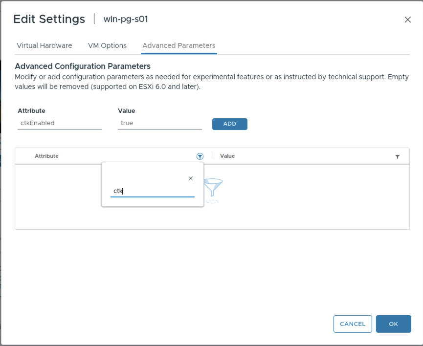
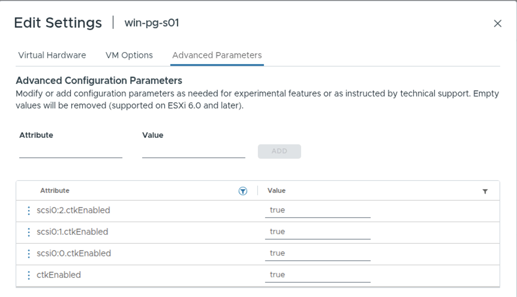

# Demo 2: VMware to OpenShift Virtualization (warm migration, storage copy offload)

> **Version 3.2.0 · draft · 2026-10-19** · class/demos/02-vmware-to-ove-warm.md

> 🚧 **Coming soon. You can't run this demo in this lab yet.**
>
> ⛔ **Blocked: the VDDK path is closed for good.** The lab can't obtain VDDK and won't again, so warm migration
> here waits on a **SAN with CSI** (below) and Red Hat's storage copy offload path. Until then this page is a
> placeholder to read.
>
> This demo is written for a lab that has a **supported SAN array** with its **CSI driver** and **snapshot**
> support on OpenShift. This lab doesn't have one yet: its vSphere datastore is NFS and its OpenShift storage is ODF
> and NFS. Read it to learn how a warm migration works when the array copies the disks; it runs once the SAN is in.
>
> **What changed:** the earlier Demo 2 used VMware's VDDK library. VDDK is no longer available to this lab, and this
> lab won't demo it again ([why](#why-this-lab-does-not-demo-vddk)). Demo 2 now follows the path Red Hat points to:
> [**storage copy offload** in MTV](https://docs.redhat.com/en/documentation/migration_toolkit_for_virtualization/2.11/html/planning_your_migration_to_red_hat_openshift_virtualization/assembly_planning-migration-vmware_mtv#con_about-storage-copy-offload_vmware),
> with the VDDK-independent transfer Red Hat has in **preview** ([status](#where-red-hat-is-with-this-2026-10-14)).
>
> **In class today:** do [Demo 1](01-vmware-to-ove-cold.md) (cold migration, no VDDK needed) and its bonus labs,
> then Demos 1c, 1d and 4.

## Why this lab does not demo VDDK

The **Virtual Disk Development Kit (VDDK)** is VMware's library for reading a VM's disks straight from ESXi. MTV used
it to copy disks, and for a warm migration to copy only the blocks that changed while the VM ran. This lab built
Demo 2 on it, and has stopped:

1. **We can't get it.** Broadcom pulled the old VMware download links. VDDK now sits behind a Broadcom sign-in and
   entitlement, and the lab couldn't obtain the kit it was built for (`vmware-vix-disklib-8.0.3`).
2. **Nobody may hand it out.** VDDK's licence doesn't let Red Hat, Paragon Micro or a class redistribute it. Each
   customer must download it under their own entitlement. A class built on it teaches a step most students can't
   repeat at home.
3. **Red Hat no longer leads with it.** Red Hat's position (2026-10-14): a customer who **already has** a VDDK copy
   matching their VMware environment may still use it, once **they** confirm their right to keep and use the software;
   Red Hat then assesses its technical suitability. That's a bridge for existing customers, not a path to teach.
4. **There's a better path.** MTV can have the **storage array** copy the disks (storage copy offload), and Red Hat is
   building a VDDK-independent transfer for both warm and cold migration. That is what this demo now teaches.

**What still works without VDDK:** cold migration. MTV reads the disks over vCenter/ESXi HTTPS instead: it's slower,
and the VM is down for its whole disk copy. That's [Demo 1](01-vmware-to-ove-cold.md), and it runs in this lab today.

<details markdown="1">
<summary>With and without VDDK: what it does to the copy time, and to your VM's downtime</summary>

**VDDK** (VMware's *Virtual Disk Development Kit*) is VMware's own library for reading a VM's disks. MTV can use it,
but this lab has no VDDK (above), so [Demo 1](01-vmware-to-ove-cold.md)'s cold copy takes the path without it, and
this demo waits on storage copy offload instead.

| | **Without VDDK** (this lab) | **With VDDK** |
|---|---|---|
| How the disks are read | `virt-v2v` reads each disk as a **file over HTTPS through vCenter** (its datastore file service). vCenter stays in the data path for every read | vCenter only hands out an access ticket. The disk is read **from the ESXi host directly**, over VMware's block protocol (NBD/NBDSSL) |
| What is copied | the **whole** disk, empty space included (34 GB for `win-pg-sNN`) | only the blocks that **hold data**; empty space is skipped |
| **ImageConversion** (inspect Windows, add the virtio drivers) | slow: thousands of small reads, each one an HTTPS round trip through vCenter | much faster: each read is a short block request to the host |
| Retries and failures | vCenter's file service sometimes answers `HTTP 500`; most are retried (a stall of a few minutes), and one can fail the plan | no vCenter file service, so not this class of error |
| **Your VM's downtime** | **the whole copy**: a cold migration only | cold, **or warm**: VDDK reads VMware's Changed Block Tracking, so MTV copies while the VM runs and stops it only for a short final cutover |
| Red Hat's guidance | supported, but *"not recommended"* | *"strongly recommended … A VDDK image accelerates migration and reduces the risk of a plan failing"* |

**Measured in this lab, without VDDK:** 0002-007 (vSphere 9, local SSD, one copy running) took **45 min**:
ImageConversion 31 min, then DiskTransferV2v 13 min for 34 GB (about 43 MB/s). Earlier runs on vSphere 8 took
1 h 06 – 1 h 16. Most of the time is the conversion's reads through vCenter, not the bytes themselves.

**With VDDK, an estimate (not measured here):** the same VM would copy in a fraction of that, roughly 10–20 min, and
a **warm** migration would keep the VM running for all but the few minutes of cutover. How much faster depends on
how full the disks are and on the network to the ESXi hosts.

**Read more:**

- Red Hat MTV 2.11, [VMware prerequisites: creating a VDDK image](https://docs.redhat.com/en/documentation/migration_toolkit_for_virtualization/2.11/html/planning_your_migration_to_red_hat_openshift_virtualization/assembly_planning-migration-vmware_mtv): why VDDK is recommended, and that a VM on vSAN can't migrate without it
- Red Hat MTV 2.11, [Cold and warm migration, and the migration speed comparison](https://docs.redhat.com/en/documentation/migration_toolkit_for_virtualization/2.11/html/planning_your_migration_to_red_hat_openshift_virtualization/assembly_cold-warm-migration_mtv): precopy with Changed Block Tracking, cutover, and what each costs in downtime
- Broadcom, [VDDK: virtual disk transport methods](https://developer.broadcom.com/xapis/virtual-disk-api/latest/vddkDataStruct.5.5.html): NBD, NBDSSL, SAN and HotAdd, the ways VDDK reads a disk

</details>

The VDDK version of this guide (2.2.0) stays in the repository's history. The lab's VDDK automation (job `vddk`,
[Lab S §S.15](setup-how-the-lab-is-built.md)) is retired.

## Where Red Hat is with this (2026-10-14)

| Path | Status | Source |
|---|---|---|
| **Storage copy offload, cold** | generally available since MTV 2.11, with supported arrays and configurations | [MTV 2.11 planning guide](https://docs.redhat.com/en/documentation/migration_toolkit_for_virtualization/2.11/html/planning_your_migration_to_red_hat_openshift_virtualization/assembly_planning-migration-vmware_mtv#con_about-storage-copy-offload_vmware) |
| **Storage copy offload, warm** | Technology Preview in MTV 2.11; "fully supported" in MTV 2.12 (MTV-4562) | [MTV 2.12 release notes](https://docs.redhat.com/en/documentation/migration_toolkit_for_virtualization/2.12/html/release_notes/ref_rn-2-12_release-notes) |
| **Warm migration without VDDK** | **Developer Preview**: Red Hat is testing a VDDK-independent transfer for warm and cold, "for controlled evaluation and not yet for production use" | Red Hat, 2026-10-14 |
| **CSI volume import** (the array clones VVol/RDM disks itself) | Developer Preview in MTV 2.12.2 (MTV-5483) | MTV 2.12 release notes |
| **An existing VDDK copy** | may remain a technical option; the customer confirms the right to use it | Red Hat, 2026-10-14 |

**[verify] before this demo ships:** which of these the lab's MTV version gives, and whether a warm offload migration
still needs VDDK for any step (for example the changed-block rounds). Confirm both with Red Hat for the chosen array.

## What you will learn

You move your Windows Server + PostgreSQL VM off VMware vSphere and onto OpenShift Virtualization while it keeps
**running**. This time the **SAN array** does the copying: MTV asks the array, through its API and its CSI driver, to
copy each disk into a new OpenShift volume on the **same array**, so the data never crosses the network. vSphere's
**Changed Block Tracking** (CBT) and snapshots tell MTV what changed between rounds. The VM stops only for the
**cutover**. Then you snapshot the migrated VM **on the array**, through OpenShift.

| Phase | Your VM | What happens |
|---|---|---|
| **Pre-copy 1** | running | MTV snapshots each disk on vSphere; ESXi sends **XCOPY** and the array copies the whole disk into the new volume |
| **Pre-copy 2, 3, …** | running | every 5 minutes, only the blocks changed since the last round (CBT) |
| **Cutover** | **stopped** | one last snapshot and copy, the drivers converted, the VM started on OpenShift |
| **After** | running on OpenShift | a VM snapshot, taken by the array through the CSI driver |

## What this demo needs (this lab doesn't have it yet)

| Piece | What it must be | In this lab today |
|---|---|---|
| **The SAN array** | one MTV supports for offload: Hitachi Vantara, NetApp ONTAP, Pure FlashArray, Dell PowerMax, PowerFlex or PowerStore, HPE 3PAR or Primera, Infinidat InfiniBox, IBM FlashSystem | none (coresan01 is a Linux iSCSI/NFS appliance: no offload plugin) |
| **The source datastore** | **VMFS** on a LUN from that array, over **iSCSI or FC**, on every ESXi host | `coresan01_data00`, **NFS** |
| **The CSI driver** | the array vendor's driver on site A, with a StorageClass on the **same** array (block volumes) | ODF and `nfs-csi` |
| **Snapshots** | a **VolumeSnapshotClass** for that driver, so OpenShift VM snapshots are array snapshots | ODF's only |
| **Array API credentials** | a Secret MTV uses to map new volumes to the ESXi hosts | — |
| **vSphere privileges** | MTV's role plus Red Hat's `StorageOffloader` privileges (datastore browse and low-level file operations; host advanced settings, query patch, storage partition configuration; global settings) | MTV's role only |
| **ESXi clone method** | **SSH** (Red Hat's recommendation; MTV makes the key) or the **VIB** on every host | — |
| **MTV** | `feature_copy_offload` on (the default), and a version with warm offload (see above) | MTV 2.11 |

The example below uses **NetApp ONTAP** with its **Trident** CSI driver. Any array in the list works the same way,
with its own product name and Secret keys.

**Before you start (once the SAN is in):** do [Lab 0](00-access-and-tools.md). You are signed in to the **site A**
console, and every command runs in the console's **Web Terminal** (`>_`). Your VM must be **running on vSphere**,
with its disks on the SAN datastore.

> ⚠ **The commands are an example. Change these values to yours before you run them:**
>
> | In the example | Is the example's | Replace with yours |
> |---|---|---|
> | `student-01-0024-012` | class ID and project (`student-01` on booking `0024-012`) | your class ID |
> | `win-pg-s01` | your VM (`s` + your student number); on OpenShift it lands as `win-pg-s01-warm` | your VM |
> | `10.101.23.101` | your VM's address, the SQL server (it keeps it on OpenShift) | your VM's address, from Lab 0.1 |
> | `vcenter01` / VLAN `23` | your booking's vCenter (`N` = 1) and VLAN (`22 + N`) | from your instructor's `N` |
> | `san_vmfs01` · `ontap-san` · `ontap-snapclass` | the SAN datastore, its StorageClass and VolumeSnapshotClass | from your instructor |

<!-- 🎬 video slot 02-vmware-to-ove-warm: one walk-through of the whole demo in the console, once the SAN is in -->

---

## 2.0 Inject: the demo has started

```bash
oc exec -n student-01-0024-012 deploy/sql-client -- sql -h 10.101.23.101 -c "SELECT * FROM ovedr_mark('student-01-0024-012', 'demo-started', 'Demo 2: warm migration, storage copy offload');"
oc exec -n student-01-0024-012 deploy/sql-client -- sql -h 10.101.23.101 -c "SELECT id, ts, stage, payload FROM marks ORDER BY id;"   # read back: your rows so far, oldest first
```

✅ One row, `stage = demo-started`.

---

## 2.1 Check the link to vCenter, the offload storage map, and your warm plan

The lab staged a **warm** plan for you, ready but not started: **`d2-win-pg-s01`** (`d2-<your VM>`). It lands your
VM on site A as **`win-pg-s01-warm`**. What makes it an offload plan is its **storage map**.

**Console (site A):** **Migration for Virtualization → Providers → `ovedr-vcenter01`**. ✅ **Ready** and **Connected**.

**Console:** **Migration for Virtualization → Storage maps → `ovedr-vcenter01-offload`**.

✅ One row: source `san_vmfs01` → target `ontap-san`, **Offload plugin** `vSphere XCOPY`, **Storage product** `ontap`,
and a **Storage secret**. Every row of a plan's storage map must use offload or none may: MTV won't mix the two.

**Console:** **Migration plans → `d2-win-pg-s01`**. ✅ Type **Warm**, your VM, the storage map
`ovedr-vcenter01-offload`. The status is **not** Ready yet: expand your VM to see why.

| Concern | What it means | Who fixes it |
|---|---|---|
| **VMMissingChangedBlockTracking** | your VM's disks don't have CBT on, so MTV can't find the changes | **you**, in 2.2 |

The same from the Web Terminal **[verify]**:

```bash
oc -n openshift-mtv get storagemap ovedr-vcenter01-offload -o jsonpath='{range .spec.map[*]}{.source.name}{" -> "}{.destination.storageClass}{"  "}{.offloadPlugin.vsphereXcopyConfig.storageVendorProduct}{"\n"}{end}'   # san_vmfs01 -> ontap-san  ontap
oc -n openshift-mtv get plan d2-win-pg-s01 -o jsonpath='{range .status.conditions[*]}{.type}={.status}{"\n"}{end}'
```

---

## 2.2 Turn on Changed Block Tracking, and clear old snapshots

CBT is one switch for the VM (`ctkEnabled`) **plus** one for each disk (`scsi0:N.ctkEnabled`). vCenter accepts them
only while the VM is **off**.

**Shut it down.** **vCenter:** **`win-pg-s01` → Actions → Power → Shut Down Guest OS**. Wait for **Powered Off**.

**Delete old snapshots.** **`win-pg-s01` → Snapshots → Manage Snapshots** → delete any you find. A VM that already has
snapshots leaves a delta chain that stops the array from doing the copy (ESXi falls back to a slower software copy).
The snapshots MTV takes during the warm rounds don't matter.

**Add the four parameters.** **`win-pg-s01` → Edit Settings → Advanced Parameters**. For each row, type the
**Attribute** and **Value**, then click **ADD**:

| Attribute | Value |
|---|---|
| `ctkEnabled` | `true` |
| `scsi0:0.ctkEnabled` | `true` |
| `scsi0:1.ctkEnabled` | `true` |
| `scsi0:2.ctkEnabled` | `true` |


*Adding a row: Attribute `ctkEnabled`, Value `true`, then **ADD**.*


*All four rows set: the VM, plus `scsi0:0`, `scsi0:1` and `scsi0:2` for its three disks. Click **OK**.*

**Power it back on:** **Actions → Power → Power On**.

✅ Within a minute or two the plan `d2-win-pg-s01` shows **Ready**:

```bash
oc -n openshift-mtv get plan d2-win-pg-s01 -o jsonpath='{range .status.conditions[*]}{.type}={.status}{"\n"}{end}'   # Ready=True
```

Give Windows a minute to start PostgreSQL, then check that the shutdown lost nothing:

```bash
oc exec -n student-01-0024-012 deploy/sql-client -- sql -h 10.101.23.101 -c "SELECT * FROM ovedr_verify('student-01-0024-012');"
```

✅ `chain_ok = t`.

---

## 2.3 Start the warm migration, and keep writing

**Console (site A):** **Migration plans → `d2-win-pg-s01`** → **Start** → confirm.

Your VM **keeps running on vSphere**. For each disk MTV creates a volume on `ontap-san` and a **populator** pod that
asks ESXi to clone the disk into it; the array does the copy. The plan's page shows the transfer method as **storage
copy offload**, not VDDK.

```bash
oc -n openshift-mtv get plan d2-win-pg-s01 -w                                   # EXECUTING True (Ctrl-C)
oc -n student-01-0024-012 get pvc                                               # three volumes on ontap-san [verify]
oc -n openshift-mtv get plan d2-win-pg-s01 -o yaml | grep -i xcopy              # xcopyUsed: the array did the copy [verify]
```

**Give it something to copy.** Write 500 rows while the disks copy:

```bash
oc exec -n student-01-0024-012 deploy/sql-client -- sql -h 10.101.23.101 -c "SELECT * FROM ovedr_load('student-01-0024-012', 'warm-precopy-load', 500);"
```

✅ `rows_written = 500`. Your VM is still serving its database in the middle of the migration.

**Count the pre-copies:**

```bash
oc -n openshift-mtv get plan d2-win-pg-s01 -o jsonpath='pre-copies done: {.status.migration.vms[0].warm.successes}  next: {.status.migration.vms[0].warm.nextPrecopyAt}{"\n"}'
```

✅ Wait for **at least two**. Compare how long the first took with a cold copy over the network in Demo 1.

<details markdown="1">
<summary>Or: create and start your own warm offload plan from the CLI (instead of the staged one)</summary>

A **new** plan, so the staged one stays as the lab built it. Use **one** of them: a VM can be in only one running plan.

```bash
# your class ID: MTV creates your VM in this project on site A
CLASS_ID=student-01-0024-012
# your VM's name in vCenter
VM=win-pg-s01
# the provider that links site A to your booking's vCenter ("ovedr-vcenter0" + N)
SRC=ovedr-vcenter01
# a NEW plan name, so this never touches the staged d2-win-pg-s01
PLAN=$CLASS_ID-warm-cli
```

The plan is a normal warm plan; the **offload** storage map is what makes the array do the copy:

```bash
oc apply -f - <<EOT
apiVersion: forklift.konveyor.io/v1beta1
kind: Plan
metadata: { name: $PLAN, namespace: openshift-mtv }
spec:
  warm: true
  targetNamespace: $CLASS_ID
  provider:
    source:      { name: $SRC, namespace: openshift-mtv }
    destination: { name: host, namespace: openshift-mtv }
  map:
    network: { name: $SRC-net-bridge, namespace: openshift-mtv }
    storage: { name: $SRC-offload,    namespace: openshift-mtv }
  vms:
    - { name: $VM, targetName: $VM-warm-cli }
EOT
oc -n openshift-mtv get plan $PLAN -w                # READY True (Ctrl-C)
oc apply -f - <<EOT
apiVersion: forklift.konveyor.io/v1beta1
kind: Migration
metadata: { name: $PLAN-run1, namespace: openshift-mtv }
spec: { plan: { name: $PLAN, namespace: openshift-mtv } }
EOT
```

In 2.4, after your `start-warm-migration` row, cut over now:

```bash
oc -n openshift-mtv patch migration $PLAN-run1 --type merge -p "{\"spec\":{\"cutover\":\"$(date -u +%Y-%m-%dT%H:%M:%SZ)\"}}"
oc -n openshift-mtv get plan $PLAN -w                # SUCCEEDED True (Ctrl-C)
```

</details>

---

## 2.4 Inject, then cut over

Write the "start" row while your VM still runs on vSphere. It must survive the cutover:

```bash
oc exec -n student-01-0024-012 deploy/sql-client -- sql -h 10.101.23.101 -c "SELECT * FROM ovedr_mark('student-01-0024-012', 'start-warm-migration', 'on vSphere, before cutover');"
oc exec -n student-01-0024-012 deploy/sql-client -- sql -h 10.101.23.101 -c "SELECT id, ts, stage, payload FROM marks ORDER BY id;"   # read back: your rows so far, oldest first
```

**Console (site A):** **Migration plans → `d2-win-pg-s01`** → **Cutover** → keep **now** → **Set cutover**.

MTV shuts your VM down on vSphere, takes one last snapshot, copies the last change, converts the drivers (`virt-v2v`
installs virtio and the QEMU guest agent, and removes VMware Tools) and creates your VM on OpenShift.

```bash
oc -n openshift-mtv get plan d2-win-pg-s01 -w                        # SUCCEEDED True (Ctrl-C)
```

✅ **Succeeded**.

---

## 2.5 Review your VM on OpenShift, and snapshot it on the array

**Console (site A):** **Virtualization → VirtualMachines**, project **`student-01-0024-012`** → **`win-pg-s01-warm`**.

| Tab | What you see |
|---|---|
| **Configuration → Network** | one NIC on **`default/vmnet23`**, so it keeps its address |
| **Configuration → Storage** | **three** disks on **`ontap-san`**: the SAN volumes the array copied into |

✅ Running, guest agent connected, address `10.101.23.101`.

**Snapshot it, on the array.** **Snapshots → Take snapshot** → name `after-warm` → **Save**. OpenShift asks the CSI
driver, and the array takes the snapshot of each disk in place.

```bash
oc -n student-01-0024-012 get vmsnapshot                              # after-warm  Succeeded [verify]
oc -n student-01-0024-012 get volumesnapshot -o custom-columns=NAME:.metadata.name,CLASS:.spec.volumeSnapshotClassName,READY:.status.readyToUse   # ontap-snapclass  true
```

✅ Three volume snapshots, class `ontap-snapclass`, ready. [Demo 1a](01a-snapshot-restore.md) shows what you can do
with one.

---

## 2.6 Inject: the migration is complete, read back, and measure the outage

```bash
oc exec -n student-01-0024-012 deploy/sql-client -- sql -h 10.101.23.101 -c "SELECT * FROM ovedr_mark('student-01-0024-012', 'warm-migration-complete', 'on OpenShift site A, SAN');"
oc exec -n student-01-0024-012 deploy/sql-client -- sql -h 10.101.23.101 -c "SELECT id, ts, stage, payload FROM marks ORDER BY id;"
oc exec -n student-01-0024-012 deploy/sql-client -- sql -h 10.101.23.101 -c "SELECT * FROM ovedr_verify('student-01-0024-012');"
```

✅ The read-back ends with `demo-started`, the 500 `warm-precopy-load` rows, `start-warm-migration` and
`warm-migration-complete`. `chain_ok = t`: nothing written during the copy was lost, changed or reordered.

**The real outage**, from your VM's heartbeat (a row every 5 seconds):

```bash
oc exec -n student-01-0024-012 deploy/sql-client -- sql -h 10.101.23.101 -c "SELECT ts AS back_at, date_trunc('second', gap) AS outage FROM (SELECT ts, ts - lag(ts) OVER (ORDER BY id) AS gap FROM heartbeat) g WHERE gap > interval '10 seconds' AND ts > (SELECT max(ts) FROM marks WHERE student = 'student-01-0024-012' AND stage = 'start-warm-migration') ORDER BY ts;"
```

✅ One row: the cutover outage, minutes rather than the whole copy.

**The guest tools were swapped:**

```bash
oc exec -n student-01-0024-012 deploy/sql-client -- sql -h 10.101.23.101 -x -c "SELECT ts, platform, vmtools, qemu_ga, virtio FROM guest_tools ORDER BY id DESC LIMIT 1;"
```

✅ `qemu_ga` **Running**, `virtio` drivers listed, `vmtools` not running.

**That is the end of Demo 2.** Your VM moved while it kept writing, the array did the copying, and the array holds
its first snapshot on OpenShift.

---

## Bonus labs (optional)

The Demo 1 bonus labs work on this VM too: use **`win-pg-s01-warm`** wherever they say `win-pg-s01`.

| Bonus | What you do |
|---|---|
| [Demo 1a: snapshot and restore](01a-snapshot-restore.md) | snapshot, destroy the database, restore |
| [Demo 1b: live migration and storage migration](01b-live-and-storage-migration.md) | move the running VM to another node, then to another storage class |
| [Demo 1c: cross-cluster migration](01c-ocp-vm-cross-cluster-migration.md) | site A → site B in ACM |

**Back to:** [Demo 1](01-vmware-to-ove-cold.md) · [Student guide](../student-guide.md).

## Addendum: how the lab will stage this demo, as code

Not built yet: it waits on the SAN. The provider, the network map and the CI pipeline stay as Demo 1's
([Demo 1 addendum](01-vmware-to-ove-cold.md#addendum-how-the-lab-staged-this-demo-as-code)). Offload adds:

| Piece | What it declares |
|---|---|
| the SAN fabric | a VMFS datastore on an array LUN for every ESXi host; the vendor's CSI driver, StorageClass and VolumeSnapshotClass on site A |
| `mtv-install` | the 5-minute pre-copy interval, and `feature_copy_offload` on |
| `mtv-fabric` | the `StorageOffloader` privileges on MTV's vSphere role; `esxiCloneMethod: ssh` on the provider; the array Secret; the **offload storage map** |
| `stage` | the warm plan `d2-<vm>` on the offload map, landing as `<vm>-warm` |

```yaml
# the array's API credentials, which MTV uses to map new volumes to ESXi (keys vary by vendor)
apiVersion: v1
kind: Secret
metadata: { name: ovedr-san-offload, namespace: openshift-mtv }
stringData:
  GOVMOMI_HOSTNAME: vcenter01.demo.lab-paragonmicro.com
  GOVMOMI_USERNAME: ovedr-mtv@vsphere.local
  GOVMOMI_PASSWORD: <from the lab's secret store>
  STORAGE_HOSTNAME: <the array's management address>
  STORAGE_USERNAME: <array user>
  STORAGE_PASSWORD: <from the lab's secret store>
  ONTAP_SVM: <the SVM that serves the LUNs>          # NetApp only
---
# the provider: the clone method is the only change from Demo 1's
apiVersion: forklift.konveyor.io/v1beta1
kind: Provider
metadata: { name: ovedr-vcenter01, namespace: openshift-mtv }
spec:
  type: vsphere
  url: https://vcenter01.demo.lab-paragonmicro.com/sdk
  secret: { name: ovedr-vcenter01, namespace: openshift-mtv }
  settings:
    esxiCloneMethod: ssh                              # or vib; no vddkInitImage
---
# the offload storage map: the SAN datastore -> the SAN's StorageClass, copied by the array
apiVersion: forklift.konveyor.io/v1beta1
kind: StorageMap
metadata: { name: ovedr-vcenter01-offload, namespace: openshift-mtv }
spec:
  provider:
    source:      { name: ovedr-vcenter01, namespace: openshift-mtv }
    destination: { name: host, namespace: openshift-mtv }
  map:
    - source: { name: san_vmfs01 }
      destination: { storageClass: ontap-san }
      offloadPlugin:
        vsphereXcopyConfig: { secretRef: ovedr-san-offload, storageVendorProduct: ontap }
---
# the staged warm plan, on the offload map
apiVersion: forklift.konveyor.io/v1beta1
kind: Plan
metadata: { name: d2-win-pg-s01, namespace: openshift-mtv, labels: { ovedr/stage: plan, ovedr/type: warm } }
spec:
  warm: true
  targetNamespace: student-01-0024-012
  provider: { source: { name: ovedr-vcenter01, namespace: openshift-mtv }, destination: { name: host, namespace: openshift-mtv } }
  map:
    network: { name: ovedr-vcenter01-net-bridge, namespace: openshift-mtv }
    storage: { name: ovedr-vcenter01-offload,    namespace: openshift-mtv }
  vms: [ { name: win-pg-s01, targetName: win-pg-s01-warm } ]
```

The Secret, StorageMap and Provider fields follow Red Hat's guide and MTV's upstream populator; **[verify]** each one
on the lab's MTV version and array.

What stays hands-on, on purpose: **CBT** and clearing old snapshots (2.2), starting the plan and the **cutover**
(2.3, 2.4), and the snapshot on the array (2.5).

## Thank you

- [MTV 2.11: Planning VMware migrations, storage copy offload](https://docs.redhat.com/en/documentation/migration_toolkit_for_virtualization/2.11/html/planning_your_migration_to_red_hat_openshift_virtualization/assembly_planning-migration-vmware_mtv#con_about-storage-copy-offload_vmware): how it works, the supported arrays, setup
- [MTV 2.12 release notes](https://docs.redhat.com/en/documentation/migration_toolkit_for_virtualization/2.12/html/release_notes/ref_rn-2-12_release-notes): warm offload, CSI volume import (Developer Preview)
- [MTV 2.11 release notes](https://docs.redhat.com/en/documentation/migration_toolkit_for_virtualization/2.11/html/release_notes/rn-2-11_release-notes)
- [MTV upstream: the copy-offload populator](https://github.com/kubev2v/forklift/blob/main/cmd/vsphere-copy-offload-populator/README.md): the Secret keys per vendor, the SSH and VIB clone methods
- [VMware Virtual Disk Development Kit overview (Broadcom)](https://developer.broadcom.com/sdks/vmware-virtual-disk-development-kit-vddk/latest)
- Red Hat Customer Portal: *Unable to download VMware VDDK images for MTV* **[verify link]**
- [OpenShift Virtualization documentation (4.19)](https://docs.redhat.com/en/documentation/openshift_container_platform/4.19/html/virtualization/index)
- [DO316: Managing Virtual Machines with Red Hat OpenShift Virtualization (course)](https://www.redhat.com/en/services/training/do316-managing-virtual-machines-red-hat-openshift-virtualization)
