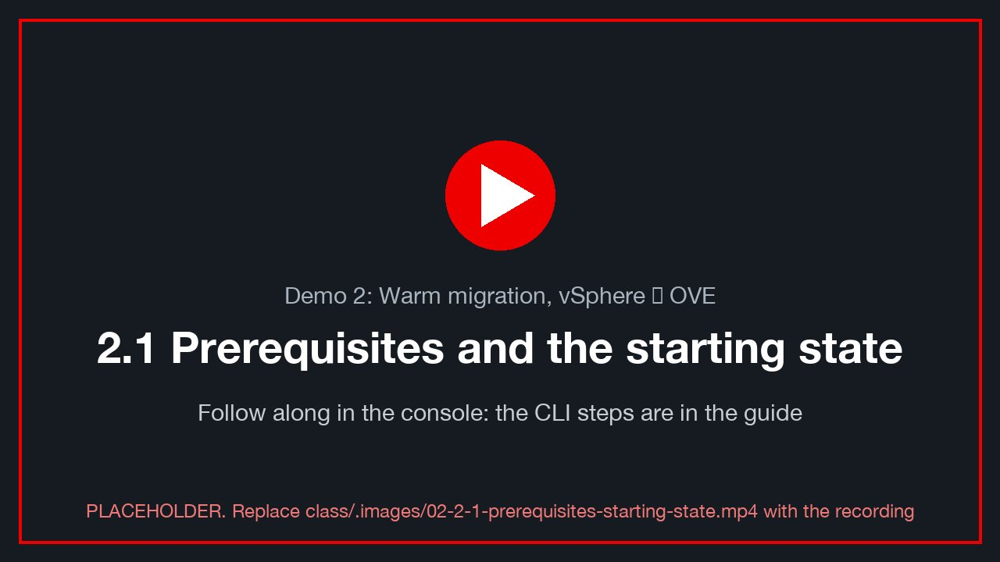
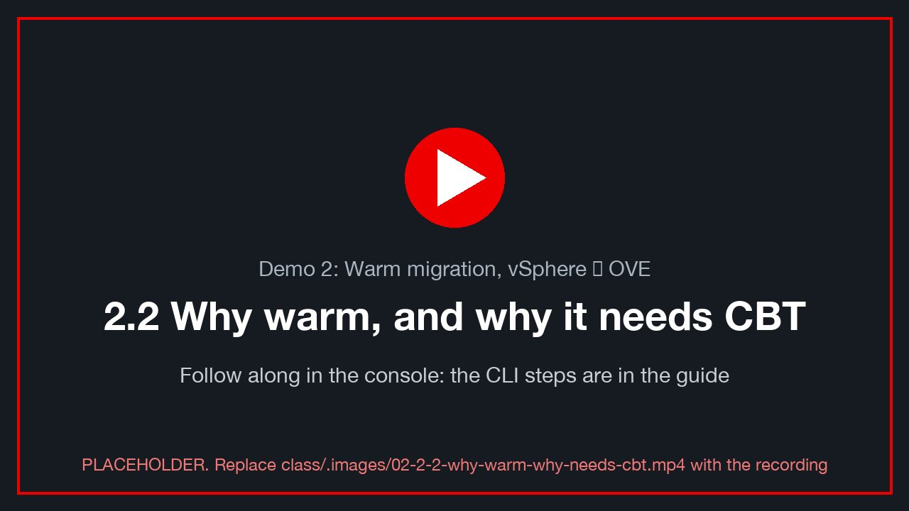
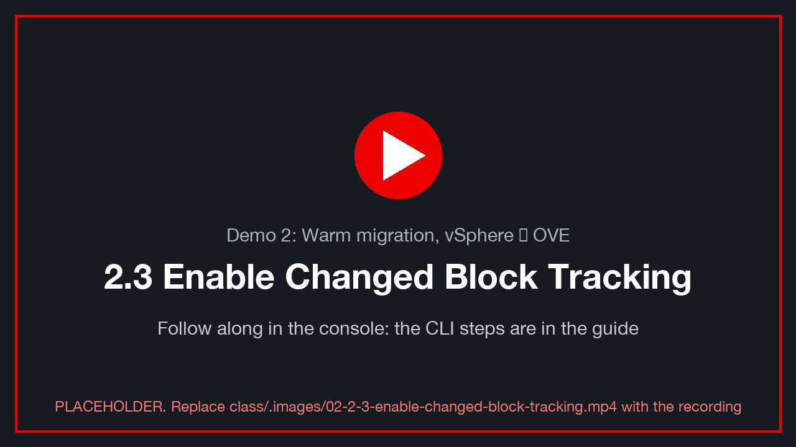
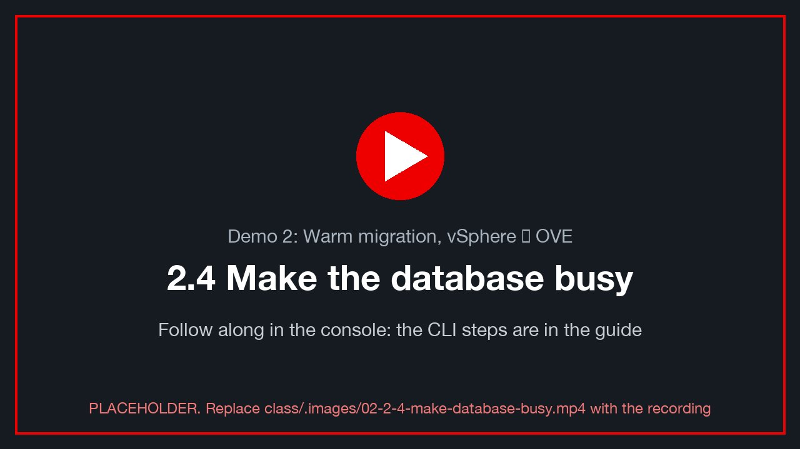
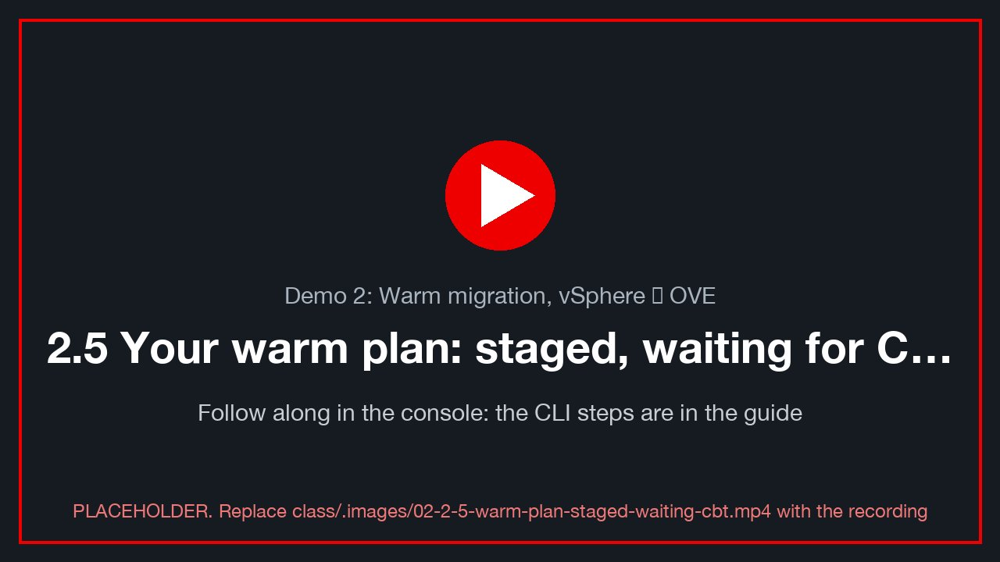
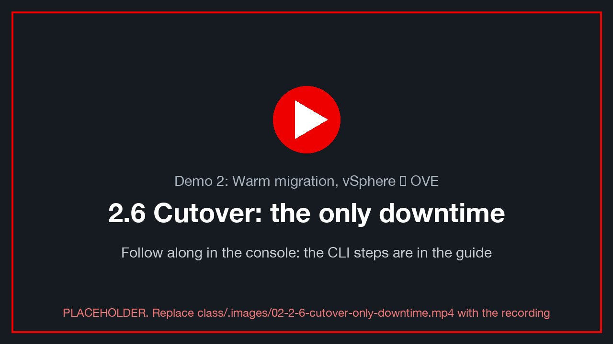
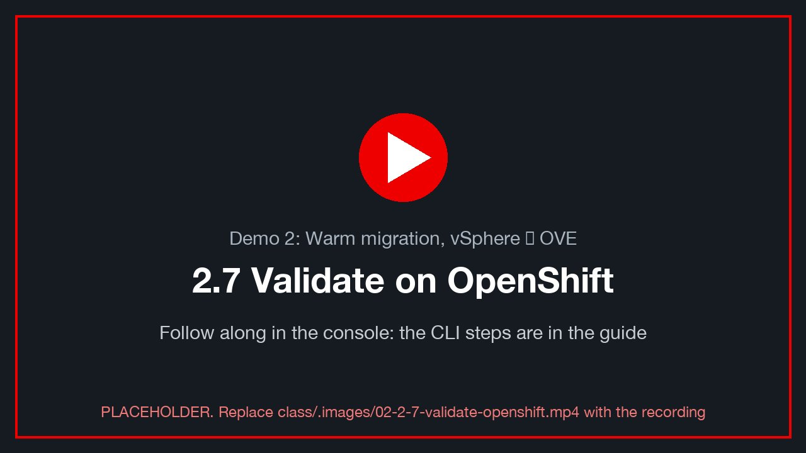
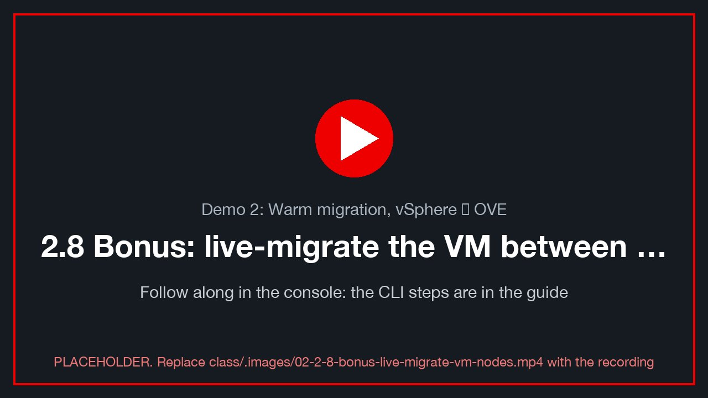
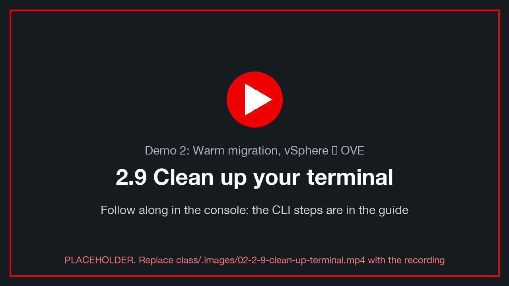

# Demo 2: Warm migration, vSphere → OVE

> **Version 0.5.0 · draft · 2026-10-12** · class/demos/02-vmware-to-ove-warm.md

## What you will learn

In this demo you migrate a running VMware VM to OpenShift Virtualization while it keeps serving its database.
The only outage is a short cutover. You will turn on vSphere Changed Block Tracking (CBT) for the VM and for each
of its disks, and see why MTV needs it to copy only what changed between rounds. You will load the database while
the disks pre-copy, cut over, and measure the real downtime from the VM's own heartbeat. Finally, you will prove
with your hash-chained rows that every write, including those made *during* the copy, arrived intact and in order.

---

## How the lab is set up for this demo

The class CI customization (the `customize` run that core-web starts after the three environments are built)
prepares everything below before you log in. See the [lab diagram](lab-diagram.md) for how the three environments
connect, and **[Lab S — how this lab was built](setup-how-the-lab-is-built.md)** for the CLI and console steps behind each row.

| Pre-built for you | Where | How it was built · Red Hat docs |
|---|---|---|
| OpenShift Virtualization (`ove: cnv`) | both clusters (the same operators on both) | [S.2](setup-how-the-lab-is-built.md) · [OpenShift Virtualization 4.19](https://docs.redhat.com/en/documentation/openshift_container_platform/4.19/html/virtualization/index) |
| ACM and cert-manager | both clusters (base `demo-openshift` build) | [S.10](setup-how-the-lab-is-built.md) · [ACM 2.13](https://docs.redhat.com/en/documentation/red_hat_advanced_cluster_management_for_kubernetes/2.13) |
| NMState bridges + VLAN NADs (`vmnet<VLAN>`) | both clusters | [S.3](setup-how-the-lab-is-built.md) · [Kubernetes NMState](https://docs.redhat.com/en/documentation/openshift_container_platform/4.19/html/kubernetes_nmstate/index) [verify link] |
| Storage | site A **ODF** (`ocs-storagecluster-ceph-rbd-virtualization`), site B **NFS** (`nfs-csi`): one ODF site today, the lab's SSDs fit one | [S.4](setup-how-the-lab-is-built.md) · [ODF 4.19](https://docs.redhat.com/en/documentation/red_hat_openshift_data_foundation/4.19) |
| MTV (Migration Toolkit for Virtualization) | both tooled sites, with its console menu | provider `ovedr-vcenter0<N>` with network maps (pod + bridge) and storage map, **Ready**. [S.5](setup-how-the-lab-is-built.md) · [S.6](setup-how-the-lab-is-built.md) · [S.8](setup-how-the-lab-is-built.md) · [MTV 2.11](https://docs.redhat.com/en/documentation/migration_toolkit_for_virtualization/2.11) |
| **VDDK image** on that provider | site A | **prerequisite for warm migration** (repo variable `MTV_VDDK_IMAGE`). Without it, MTV can only migrate cold. The `demo-prep` readiness table says whether this booking has it. [S.6](setup-how-the-lab-is-built.md) · [Creating a VDDK image](https://docs.redhat.com/en/documentation/migration_toolkit_for_virtualization/2.11/html/installing_and_using_the_migration_toolkit_for_virtualization/index) [verify link] |
| **Pre-copy interval** shortened to 5 min | both tooled sites | the MTV default is 60 min between rounds, too slow for a class. [S.10](setup-how-the-lab-is-built.md) |
| Staged **cold** plans `d1-<VM>` / `d1b-<VM>-to-<B>` | both sites | for Demos 1 and 1b. Demo 2's **warm** plan is the one **you** build here. [S.12](setup-how-the-lab-is-built.md) |
| **Your namespace** `$VMNS` (your class ID, you are **admin**) with your `Service/<VM>-sql` and your browser terminal `sql-client` | both clusters | your VM lands in your namespace. [S.9](setup-how-the-lab-is-built.md) |
| Student rights | both clusters | read MTV objects, bridges, storage classes; **create and run your own plans and migrations**. [S.9](setup-how-the-lab-is-built.md) |
| **Your own VM**, `win-pg-s<NN>` | vSphere `vcenter0<N>`, in your folder `vms/students/<class ID>` | a full clone of `win-pg-i01` at its own address `.100+NN`: Windows Server 2022 + PostgreSQL 16 (WAL on `L:`, data on `D:`), heartbeat writer, the `marks` toolkit, your Windows login. You can power it, open its console and Edit Settings yourself. [S.11](setup-how-the-lab-is-built.md) |

**State at the start of this demo:** your VM is **powered on and writing on vSphere**, at its own address
`$VM_IP`. If you ran Demo 1 first, MTV left the vSphere original powered off. Power it back on in vCenter
(**Actions → Power → Power On**; your `ovedr-student-vm` role allows it on your own VM).

> ⚠️ **One copy on the VLAN at a time.** The warm plan uses the **bridge** map, so the migrated VM keeps `$VM_IP`.
> If your Demo 1 copy is still **running** on OpenShift, stop it first (it holds the same address):
> `oc --context site-a -n "$VMNS" patch vm "$VM" --type merge -p '{"spec":{"runStrategy":"Halted"}}'`.

**What you do yourself:** enable CBT, build and start the warm plan, cut over, and verify. Your VM keeps its own
address on OpenShift, so Lab 0 §0.6 is not needed.

> **Before you start:** do [Lab 0](00-access-and-tools.md) in this terminal. You need `site-a` / `site-b`
> contexts, the variables (`ME`, `N`, `A`, `B`, `VM`, `VM_IP`, `WINUSER`) and the helpers (`sql`, `mark`, `load`,
> `verify`, `alive`, `where`).

> 🖥️ **Where you type the commands: your browser terminal.** Every `bash` block in this guide runs in **your own
> terminal pod**, in the browser: in the site A console, project **`<your class ID>`** → **Workloads → Pods →
> `sql-client` → Terminal** ([Lab 0 §0.3](00-access-and-tools.md)). Nothing is installed on your computer. It already
> knows your VM and its address (type `ovedr`); `dblogin` and `oclogin` from Lab 0 stay signed in while the pod runs.
> Variables you `export` last until you close that Terminal tab: if you reopen it, re-run the guide's `export` lines.
> Paste with **right-click → Paste** (or Ctrl+Shift+V / ⌘V). `powershell` blocks run **inside your Windows VM**, from its
> console (vCenter **Launch Web Console**, or the VM's **Console** tab in OpenShift).

---

## 2.1 Prerequisites and the starting state

<!-- 🎬 video slot 02-2-1-prerequisites-starting-state -->
[](../.images/02-2-1-prerequisites-starting-state.mp4)
<sub>🎬 *2.1 Prerequisites and the starting state: a recording of this whole section, done in the console (placeholder until recorded: `class/.images/02-2-1-prerequisites-starting-state.mp4`).*</sub>

### The name your VM gets on OpenShift

Your **staged warm plan** `d2-<VM>` lands your VM on site A, in your namespace, as **`<VM>-warm`**. That way it never
collides with your Demo 1 copy (`<VM>`), whether or not that copy still exists.

```bash
export TARGET="$VM-warm" PLAN="d2-$VM"
echo "vSphere VM=$VM  →  OpenShift name=$TARGET (namespace $VMNS)  plan=$PLAN"
```

> 💡 **Your chain continues on the vSphere copy.** If you ran Demo 1, its OpenShift copy and the vSphere original
> split at Demo 1's cutover. Rows you wrote on OpenShift in Demo 1 are **not** on the vSphere original, and that's
> expected. Your chain on the original carries on from your last pre-migration row.

### Check: the provider can do warm

```bash
oc --context site-a -n openshift-mtv get provider ovedr-vcenter0$N \
  -o jsonpath='{.status.phase}{"  vddk="}{.spec.settings.vddkInitImage}{"\n"}'     # Ready, and a vddk image [verify]
oc --context site-a -n openshift-mtv get forkliftcontroller forklift-controller \
  -o jsonpath='{"precopy interval (min): "}{.spec.controller_precopy_interval}{"\n"}'  # 5 [verify]
```

> ⚠️ **No VDDK image, no warm migration.** If `vddk=` is empty, tell the instructor and stop here. The warm plan will
> either refuse to start, or fall back to behaviour this guide doesn't describe.

#### 🧑‍🏫 Instructor only: if CI did not set them

```bash
oc --context site-a -n openshift-mtv patch forkliftcontroller forklift-controller --type merge \
  -p '{"spec":{"controller_precopy_interval":5}}'          # minutes between pre-copies [verify]
```

### Check: your VM is up and writing on vSphere

Your VM still runs on vSphere, and your browser terminal reaches it at its own address, `$VM_IP`:

```bash
export PGHOST=$VM_IP            # your VM's own address (the terminal's default)
alive                           # staleness < 10 s
mark d2-start                   # ✍️ note the id
verify                          # chain_ok = t
```

📸 `02-start-alive` — `alive` and `verify` output, with the VM on vSphere.

---

## 2.2 Why warm, and why it needs CBT

<!-- 🎬 video slot 02-2-2-why-warm-why-needs-cbt -->
[](../.images/02-2-2-why-warm-why-needs-cbt.mp4)
<sub>🎬 *2.2 Why warm, and why it needs CBT: a recording of this whole section, done in the console (placeholder until recorded: `class/.images/02-2-2-why-warm-why-needs-cbt.mp4`).*</sub>

A **cold** migration (Demo 1) powers the VM off, copies every block of every disk, then boots it on
OpenShift. The outage is the whole copy.

A **warm** migration works in rounds:

| Phase | VM state | What MTV does |
|---|---|---|
| **Pre-copy 1** | running | snapshots each disk on vSphere and copies the **whole** disk to a PVC |
| **Pre-copy 2…n** | running | every interval, takes a new snapshot and copies **only the blocks changed** since the previous one |
| **Cutover** | **stopped** | one last snapshot, copies the last small delta, converts drivers, boots on OpenShift |

The question *"which blocks changed since the last snapshot?"* is answered by vSphere **Changed Block Tracking**.
Without CBT, every round would be a full copy. That's why MTV refuses a warm plan for a VM whose disks don't have
CBT enabled.

---

## 2.3 Enable Changed Block Tracking

<!-- 🎬 video slot 02-2-3-enable-changed-block-tracking -->
[](../.images/02-2-3-enable-changed-block-tracking.mp4)
<sub>🎬 *2.3 Enable Changed Block Tracking: a recording of this whole section, done in the console (placeholder until recorded: `class/.images/02-2-3-enable-changed-block-tracking.mp4`).*</sub>

CBT is a per-VM switch (`ctkEnabled`) **plus** a per-disk switch for each virtual disk (`scsi0:N.ctkEnabled`).
It takes effect at the next power-on, so turn it on while the VM is **off**.

### Leave a mark, then shut your VM down cleanly

```bash
mark d2-before-cbt
```

In your VM's web console (vCenter → `<VM>` → **Launch Web Console**, log in as `.\<WINUSER>`), in PowerShell:

```powershell
Add-Content "C:\Users\Public\ovedr\$env:USERNAME.txt" "$(Get-Date -Format o)  d2-before-cbt"
Stop-Computer -Force          # a clean guest shutdown of YOUR VM [verify: Users may shut down this server]
```

Or, from vCenter: **Actions → Power → Shut Down Guest OS**.

### Find the exact disk keys first

The VM's three disks sit on one LSI Logic SAS controller, so their keys are `scsi0:<unit>`. **Read** the units
rather than guessing.

**vCenter UI:** VM → **Edit Settings → Virtual Hardware**. Expand each **Hard disk** and note its
**Virtual Device Node**, for example `SCSI controller 0 : SCSI(0:0)`.

| Disk | Size | Holds | Device node (fill in) |
|---|---|---|---|
| Hard disk 1 | 60 GB | `C:` Windows | `scsi0:__` |
| Hard disk 2 | 5 GB | `L:` PostgreSQL WAL | `scsi0:__` |
| Hard disk 3 | 10 GB | `D:` PostgreSQL data | `scsi0:__` |

📸 `02-disk-device-nodes` — Edit Settings, with the three hard disks' Virtual Device Node expanded.

**🧑‍🏫 Instructor alternative (govc):**

```bash
govc device.info -vm "$VM" 'disk-*' | grep -E 'Name:|Label:|Unit number|Controller|Summary'
```

### Set the parameters (VM powered **off**)

> ⚠️ **Your VM must be shut down.** vCenter only accepts these parameters on a powered-off VM, and CBT takes effect at
> the next power-on. With CBT on, MTV can copy only the blocks that changed since the last pre-copy, which is what
> makes the warm ("hot") migration in this demo possible.

**vCenter UI:** your VM → **Edit Settings → Advanced Parameters** (vSphere 8; older UIs: *VM Options → Advanced →
Edit Configuration*). For each row below, type the **Attribute** and **Value**, then click **ADD**:

| Attribute | Value |
|---|---|
| `ctkEnabled` | `true` |
| `scsi0:0.ctkEnabled` | `true` |
| `scsi0:1.ctkEnabled` | `true` |
| `scsi0:2.ctkEnabled` | `true` |

(Use the device nodes you found above if they differ from `0`, `1` and `2`.)


*Adding a row: Attribute `ctkEnabled`, Value `true`, then **ADD**. The list's filter (funnel icon) set to `ctk` shows only
the CBT rows.*

When all four are added, the list (filtered on `ctk`) shows them. Click **OK**:


*All four rows set: `ctkEnabled` for the VM, plus `scsi0:0`, `scsi0:1` and `scsi0:2` for its three disks.*

**🧑‍🏫 Instructor alternative (govc):**

```bash
govc vm.info "$VM" | grep 'Power state'                                                   # poweredOff
govc vm.change -vm "$VM" \
  -e ctkEnabled=TRUE \
  -e scsi0:0.ctkEnabled=TRUE -e scsi0:1.ctkEnabled=TRUE -e scsi0:2.ctkEnabled=TRUE
govc vm.info -e "$VM" | grep -i ctkEnabled                                                # four rows, TRUE
```

### Power your VM back on

vCenter: **Actions → Power → Power On**.

### Check: CBT is active

When a VM powers on with CBT enabled, vSphere creates a **change-tracking file** (`*-ctk.vmdk`) next to each disk.

- **vCenter UI:** **Storage → `coresan01_data00` → Files → `ovedr-lz<N>-<VM>/`** (each class VM's folder carries
  its zone, because every zone shares this datastore). There should be one `…-ctk.vmdk` per disk, three in all.
- **🧑‍🏫 govc:**

  ```bash
  govc datastore.ls -ds coresan01_data00 "ovedr-lz$N-$VM/" | grep -- '-ctk.vmdk'            # 3 files
  ```

📸 `02-ctk-files` — the datastore browser listing three `-ctk.vmdk` files.

Wait for the database to come back, then prove nothing was lost across the shutdown:

```bash
until alive 2>/dev/null | grep -q 'beats'; do sleep 10; done
alive                                # postgres_started is new: the VM rebooted
mark d2-cbt-on
verify                               # chain_ok = t — the reboot lost nothing
```

✍️ **Row 2.1:** CBT on (yes/no), the number of `-ctk.vmdk` files, and your `d2-cbt-on` id.

---

## 2.4 Make the database busy

<!-- 🎬 video slot 02-2-4-make-database-busy -->
[](../.images/02-2-4-make-database-busy.mp4)
<sub>🎬 *2.4 Make the database busy: a recording of this whole section, done in the console (placeholder until recorded: `class/.images/02-2-4-make-database-busy.mp4`).*</sub>

Warm migration matters when the VM is **changing** while it copies. Give it something to copy.

### In the guest

```powershell
Add-Content "C:\Users\Public\ovedr\$env:USERNAME.txt" "$(Get-Date -Format o)  d2-precopy-started"
```

### From your terminal

A burst now, then a small burst every minute in the background, so each pre-copy round has new blocks to ship:

```bash
load d2-precopy 500                                            # 500 hash-chained rows, right now
( for i in $(seq 1 30); do load "d2-precopy-$i" 50 >/dev/null 2>&1; sleep 60; done ) &
export LOADER=$!                                               # stop it before cutover (2.6)
verify
```

✍️ **Row 2.2:** your `marks` count after the 500-row burst.

---

## 2.5 Your warm plan: staged, waiting for CBT

<!-- 🎬 video slot 02-2-5-warm-plan-staged-waiting-cbt -->
[](../.images/02-2-5-warm-plan-staged-waiting-cbt.mp4)
<sub>🎬 *2.5 Your warm plan: staged, waiting for CBT: a recording of this whole section, done in the console (placeholder until recorded: `class/.images/02-2-5-warm-plan-staged-waiting-cbt.mp4`).*</sub>

The lab **staged** a warm plan for every class VM on **both** sites: **`d2-<VM>`** on site A (and `d2b-<VM>-to-<B>` on site B, the same
plan to the other cluster) (type **Warm**, target name `<VM>-warm`, target
namespace yours, the class's bridge network map and storage map), **not started**. How it was built: Lab S
[§S.12](setup-how-the-lab-is-built.md). Red Hat: [Warm migration](https://docs.redhat.com/en/documentation/migration_toolkit_for_virtualization/2.11/html/planning_your_migration_to_red_hat_openshift_virtualization/index) [verify link].

### Before 2.3: the plan flags CBT (expected)

Open **Migration for Virtualization → Migration plans → `d2-<VM>` → Virtual machines** and expand your VM. Until you
enable Changed Block Tracking, MTV flags it, and the plan can't start: **this is the point of 2.3**. Once your VM
has CBT on all four keys and has been powered on again, the concern clears and the plan shows *Ready*.

📸 `02-plan-warm-cbt-concern`: your `d2-<VM>` plan, the VM row expanded, with the CBT concern (before 2.3).

```bash
oc --context site-a -n openshift-mtv get plan "$PLAN" \
  -o jsonpath='{range .status.conditions[*]}{.type}={.status} {.category} {.message}{"\n"}{end}'
```

Expected conditions **before** 2.3: `VMMissingChangedBlockTracking` (yours to fix in 2.3). If you also see
`VDDKInitImageUnavailable`, the lab has no VDDK image yet: that one is the instructor's, not yours (BL-B27). Stop and tell them.

✅ After 2.3: `Ready=True`, and no CBT concern. If the plan still says CBT isn't enabled on a disk, go back to 2.3: a disk
is missing its `scsi0:N.ctkEnabled`, or the VM hasn't been power-cycled since you set it.

### Build it yourself (learning path, optional)

To see every field, build your own warm plan with a **different name**, e.g. `<your class ID>-warm-migration-plan`. Start
**either** the staged `d2-<VM>` **or** yours, never both. **Console**, site A → **Migration for Virtualization →
Migration plans → Create plan**, as in Demo 1 (same General step, same class maps), with **Migration type: Warm**:

| Field | Value |
|---|---|
| Plan name | `<your class ID>-warm-migration-plan` |
| Source provider / Target provider / Target project | `ovedr-vcenter0<N>` / `host` / your namespace (`$VMNS`) |
| VM | your `<VM>` |
| Network map | `ovedr-vcenter0<N>-net-bridge` (use the existing map; keeps `$VM_IP`) |
| Storage map | `ovedr-vcenter0<N>-storage` (use the existing map) |
| Migration type | **Warm** |

**Or as YAML:**

```bash
oc --context site-a apply -f - <<EOF
apiVersion: forklift.konveyor.io/v1beta1
kind: Plan
metadata: { name: $VMNS-warm-migration-plan, namespace: openshift-mtv }
spec:
  warm: true
  targetNamespace: $VMNS
  provider:
    source:      { name: ovedr-vcenter0$N, namespace: openshift-mtv }
    destination: { name: host,             namespace: openshift-mtv }
  map:
    network: { name: ovedr-vcenter0$N-net-bridge, namespace: openshift-mtv }
    storage: { name: ovedr-vcenter0$N-storage,    namespace: openshift-mtv }
  vms:
    - name: $VM
      targetName: $TARGET-mine                # [verify: Plan.spec.vms[].targetName in MTV 2.11]
EOF
```

### Start it

Your task, the last step, once CBT is on and the plan is *Ready*: console **Migration plans → `d2-<VM>` → Start**. Or:

```bash
oc --context site-a apply -f - <<EOF
apiVersion: forklift.konveyor.io/v1beta1
kind: Migration
metadata: { name: $PLAN, namespace: openshift-mtv }
spec: { plan: { name: $PLAN, namespace: openshift-mtv } }
EOF
```

### Check: watch the pre-copies

```bash
precopies() { oc --context site-a -n openshift-mtv get migration "$PLAN" -o json \
  | jq -r '.status.vms[0] | "phase=\(.phase)  precopies=\(.warm.precopies | length)  ok=\(.warm.successes // 0)  failures=\(.warm.failures // 0)  next=\(.warm.nextPrecopyAt // "-")",
           (.warm.precopies[]? | "  #\(.snapshot // "-")  start=\(.start)  end=\(.end // "running")")'; }
precopies
watch -n 30 "oc --context site-a -n openshift-mtv get migration $PLAN -o jsonpath='{.status.vms[0].phase}{\"  precopies=\"}{.status.vms[0].warm.successes}{\"\n\"}'"
```

While pre-copies run:

```bash
alive                             # STILL writing: the VM is up during pre-copy
mark d2-during-precopy
oc --context site-a -n "$VMNS" get pvc | grep "$TARGET"      # three PVCs filling for your VM
```

In vCenter, open your VM → **Snapshots**. MTV creates a snapshot for each round and removes the previous one.

📸 `02-precopy-snapshots` — the VM's snapshot manager during a pre-copy round.
📸 `02-precopy-status` — the plan page showing completed pre-copies.

> 💡 **Watch the round sizes.** The first pre-copy carries the whole disks. Every round after it carries only the
> blocks your `load` loop and the heartbeat changed. That shrink is CBT at work.

✍️ **Row 2.3:** the number of successful pre-copies before cutover, and how long the first one took versus a
later one.

---

## 2.6 Cutover: the only downtime

<!-- 🎬 video slot 02-2-6-cutover-only-downtime -->
[](../.images/02-2-6-cutover-only-downtime.mp4)
<sub>🎬 *2.6 Cutover: the only downtime: a recording of this whole section, done in the console (placeholder until recorded: `class/.images/02-2-6-cutover-only-downtime.mp4`).*</sub>

Let at least **two** pre-copies complete, then stop the background load and leave a last mark on vSphere:

```bash
kill "$LOADER" 2>/dev/null; wait "$LOADER" 2>/dev/null
mark d2-before-cutover                  # ✍️ note this id: it must survive the cutover
export CUTOVER_AT=$(date -u +%Y-%m-%dT%H:%M:%SZ); echo "cutover requested at $CUTOVER_AT"
```

In the guest:

```powershell
Add-Content "C:\Users\Public\ovedr\$env:USERNAME.txt" "$(Get-Date -Format o)  d2-before-cutover"
```

### Cut over now

Console: **Plans → `d2-<VM>` → Cutover → now**. Or set the Migration's cutover time:

```bash
oc --context site-a -n openshift-mtv patch migration "$PLAN" --type merge \
  -p "{\"spec\":{\"cutover\":\"$CUTOVER_AT\"}}"
```

MTV then shuts your source VM down, takes one last snapshot, copies the final delta, converts the drivers for
KVM, and starts `<TARGET>` on site A.

```bash
precopies                                                            # phase moves past the copy
oc --context site-a -n openshift-mtv get migration "$PLAN" -w        # Ctrl-C at Succeeded
```

📸 `02-cutover-done` — the plan showing **Succeeded**, with the cutover timestamps.

---

## 2.7 Validate on OpenShift

<!-- 🎬 video slot 02-2-7-validate-openshift -->
[](../.images/02-2-7-validate-openshift.mp4)
<sub>🎬 *2.7 Validate on OpenShift: a recording of this whole section, done in the console (placeholder until recorded: `class/.images/02-2-7-validate-openshift.mp4`).*</sub>

### Your VM keeps its address

The warm plan used the **bridge** map, so `<TARGET>` answers at your own `$VM_IP`, and the helpers keep working.
(Only if you chose the **pod** map: follow [Lab 0 §0.6](00-access-and-tools.md#06-optional-give-your-vm-a-pod-network-address-on-openshift)
with `CTX=site-a` and `VM=$TARGET`.)

```bash
VM=$TARGET where                                   # site-a Running, and the node it landed on
oc --context site-a -n "$VMNS" get vm,vmi "$TARGET"
pg_isready -h "${PGHOST:-$VM_IP}" -p 5432
```

### Check: every row arrived, in order, unaltered

```bash
until alive 2>/dev/null | grep -q beats; do sleep 10; done           # Windows boot + PostgreSQL start
alive                            # writing again, postgres_started = after cutover
verify                           # chain_ok = t; last_stage = d2-before-cutover (or later)
mark d2-after-cutover
verify
```

✅ `chain_ok = t`. Every row from `d2-start`, the 500-row burst, every background round and `d2-before-cutover`
is present and in order.
✅ `last_stage` before your new mark was `d2-before-cutover` or a background round written after it. The last
pre-copy didn't lose the tail, because the cutover copied it.

### Check: the real downtime

The heartbeat writer runs every 5 s, so the outage is the gap in it around the cutover:

```bash
sql -c "
SELECT ts AS resumed_at, date_trunc('second', gap) AS outage
FROM (SELECT ts, ts - lag(ts) OVER (ORDER BY id) AS gap FROM heartbeat) g
WHERE gap > interval '10 seconds' AND ts > timestamptz '$CUTOVER_AT' - interval '5 minutes'
ORDER BY ts;"
```

The **first** gap after `$CUTOVER_AT` is the cutover. Compare the cutover gap with Demo 1's cold outage (your proof table, row 1.x), which was the whole copy.

📸 `02-outage-sql` — the gap query result next to Demo 1's.

### Check: your file came across too

Console, site A → **Virtualization → VirtualMachines → `<TARGET>` → Console**. Log in as `.\<WINUSER>`:

```powershell
Get-Content "C:\Users\Public\ovedr\$env:USERNAME.txt"          # lab0 … d2-before-cutover, all there
Add-Content "C:\Users\Public\ovedr\$env:USERNAME.txt" "$(Get-Date -Format o)  d2-on-ove"
Get-Service | Where-Object Name -match 'qemu-ga|vmtools' | Format-Table Name, Status   # guest agent vs VMware Tools [verify]
```

📸 `02-ove-console-file` — the OVE VNC console showing your file's lines.

✍️ **Row 2.4:** cutover downtime (heartbeat gap) versus Demo 1's outage, `chain_ok`, and the fingerprint.

---

## Thank you

Thank you for working through Demo 2. You moved a live, busy database VM off VMware with an outage measured in
minutes, and proved with your own hash-chained rows that nothing written during the copy was lost. The bonus round
below shows what OpenShift Virtualization does once the VM is on it: moves between nodes with **no** outage.

To go further:

- [Lab S — how this lab was built](setup-how-the-lab-is-built.md): the provider, VDDK, maps and plans, from the CLI and in the console
- [Migration Toolkit for Virtualization 2.11 documentation](https://docs.redhat.com/en/documentation/migration_toolkit_for_virtualization/2.11): warm migration, VDDK, and the precopy settings
- [MTV: planning your migration (warm migration, CBT prerequisites)](https://docs.redhat.com/en/documentation/migration_toolkit_for_virtualization/2.11/html/planning_your_migration_to_red_hat_openshift_virtualization/index) [verify link]
- [OpenShift Virtualization: live migration](https://docs.redhat.com/en/documentation/openshift_container_platform/4.19/html/virtualization/live-migration) [verify link]
- [OpenShift Virtualization (OpenShift 4.19) documentation](https://docs.redhat.com/en/documentation/openshift_container_platform/4.19/html/virtualization/index): live migration, storage, networking
- [Red Hat OpenShift Virtualization product page](https://www.redhat.com/en/technologies/cloud-computing/openshift/virtualization)
- [DO316: Managing Virtual Machines with Red Hat OpenShift Virtualization](https://www.redhat.com/en/services/training/do316-managing-virtual-machines-red-hat-openshift-virtualization): Red Hat Training
- [Red Hat interactive labs](https://www.redhat.com/en/interactive-labs): try OpenShift Virtualization in your browser
- [Red Hat Developer: OpenShift](https://developers.redhat.com/products/openshift/overview)

---

## 2.8 Bonus: live-migrate the VM between nodes

<!-- 🎬 video slot 02-2-8-bonus-live-migrate-vm-nodes -->
[](../.images/02-2-8-bonus-live-migrate-vm-nodes.mp4)
<sub>🎬 *2.8 Bonus: live-migrate the VM between nodes: a recording of this whole section, done in the console (placeholder until recorded: `class/.images/02-2-8-bonus-live-migrate-vm-nodes.mp4`).*</sub>

The VM is on OpenShift now, so moving it to another **node** in the same cluster doesn't stop it at all. KubeVirt
copies its memory while it runs. (This is in-cluster live migration, not MTV.)

### Is it live-migratable?

```bash
oc --context site-a -n "$VMNS" get vmi "$TARGET" \
  -o jsonpath='{range .status.conditions[*]}{.type}={.status} {.message}{"\n"}{end}' | grep -i migrat
```

✅ `LiveMigratable=True`. That needs ReadWriteMany disks: true on the NFS class, and on ODF's virtualization class
with RWX block. If it says `False`, read the message (usually the access mode) and tell the instructor **[verify]**.

### Inject, migrate, verify

```bash
mark d2-before-livemig
oc --context site-a -n "$VMNS" get vmi "$TARGET" -o jsonpath='{.status.nodeName}{"\n"}'     # ✍️ node before
export LM_AT=$(date -u +%Y-%m-%dT%H:%M:%SZ)
```

**Console:** **VirtualMachines → `<TARGET>` → Actions → Migrate** (Compute). Or **virtctl**:

```bash
virtctl --context site-a -n "$VMNS" migrate "$TARGET"
```

Or as a resource, which is what `virtctl` creates:

```bash
oc --context site-a create -f - <<EOF
apiVersion: kubevirt.io/v1
kind: VirtualMachineInstanceMigration
metadata: { generateName: $TARGET-move-, namespace: $VMNS }
spec: { vmiName: $TARGET }
EOF
```

Watch it, then prove the data. A live migration keeps the VM's address: on the bridge it stays `$VM_IP`.

```bash
oc --context site-a -n "$VMNS" get vmim -w                         # Ctrl-C at Succeeded
oc --context site-a -n "$VMNS" get vmi "$TARGET" -o jsonpath='{.status.nodeName}{"  "}{.status.migrationState.endTimestamp}{"\n"}'
mark d2-after-livemig
verify                                                               # chain_ok = t
sql -c "
SELECT max(gap) AS worst_gap FROM (SELECT ts - lag(ts) OVER (ORDER BY id) AS gap
FROM heartbeat WHERE ts > timestamptz '$LM_AT' - interval '1 minute') g;"   # ≈ 5 s: no outage
```

✅ A different node, `chain_ok = t`, and the worst heartbeat gap is about the 5 s write interval, so there was no outage.
PostgreSQL's `postgres_started` (from `alive`) is **unchanged**, because the database never restarted.

📸 `02-livemig-node` — the VM's overview page before and after, showing two different nodes.

✍️ **Row 2.5:** node before → after, the worst heartbeat gap, and `chain_ok`.

---

## 2.9 Clean up your terminal

<!-- 🎬 video slot 02-2-9-clean-up-terminal -->
[](../.images/02-2-9-clean-up-terminal.mp4)
<sub>🎬 *2.9 Clean up your terminal: a recording of this whole section, done in the console (placeholder until recorded: `class/.images/02-2-9-clean-up-terminal.mp4`).*</sub>

```bash
kill "$LOADER" 2>/dev/null; unset LOADER LM_AT
# keep TARGET and PGHOST if your next demo continues with this VM
```

---

## Proof table: Demo 2

| Row | Stage | Your last mark id | `chain_ok` | Fingerprint | Notes |
|---|---|---|---|---|---|
| 2.1 | `d2-cbt-on` | | | | CBT on? number of `-ctk.vmdk` files: |
| 2.2 | `d2-precopy` burst | | | | marks count after 500 rows: |
| 2.3 | pre-copies | — | — | — | successful pre-copies: ___ · first took ___ · a later one took ___ |
| 2.4 | `d2-after-cutover` | | | | **cutover downtime ___ s** vs Demo 1 cold outage ___ s · your VM's pod IP: ___ |
| 2.5 | `d2-after-livemig` (bonus) | | | | node ___ → ___ · worst heartbeat gap ___ s |

> **The claim this table proves:** with CBT, the VM ran and wrote through every pre-copy round, and the only
> outage was the cutover. The hash chain proves that nothing written before the cutover, including during the
> copy, was lost, altered or reordered.
