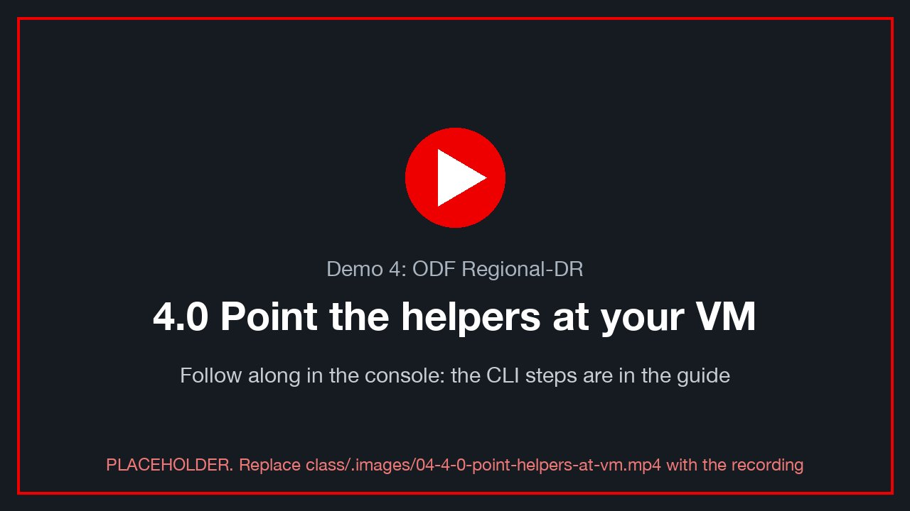
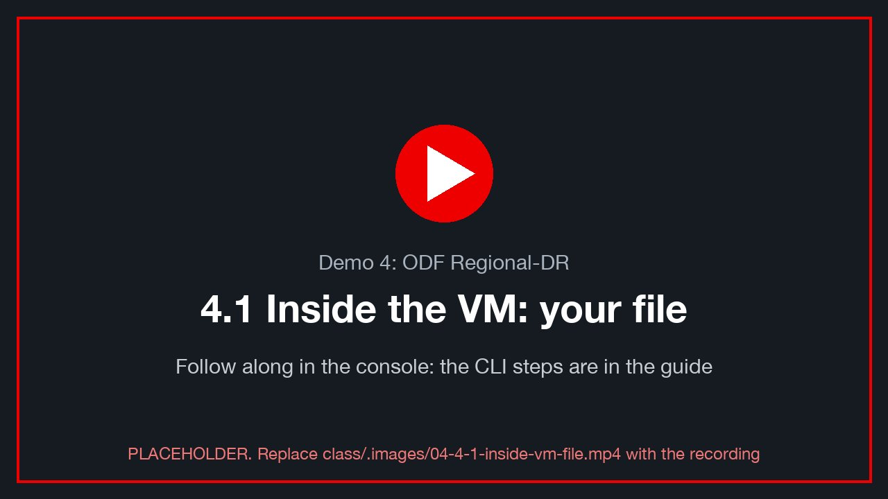
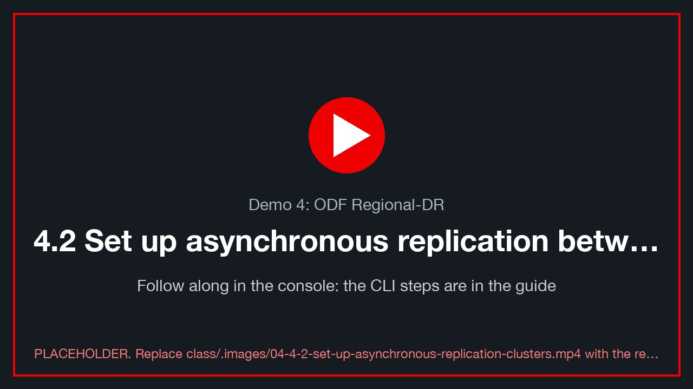
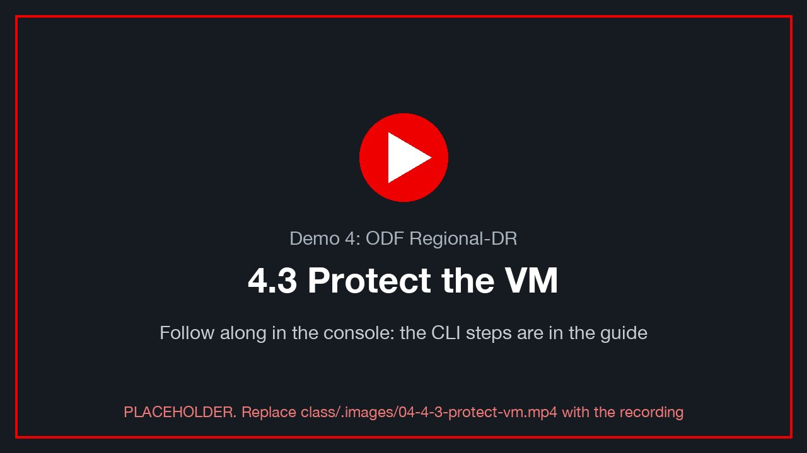
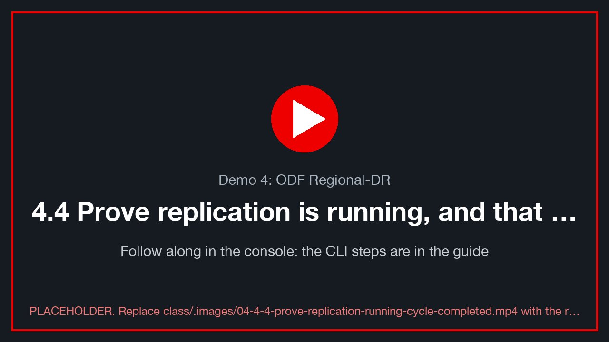
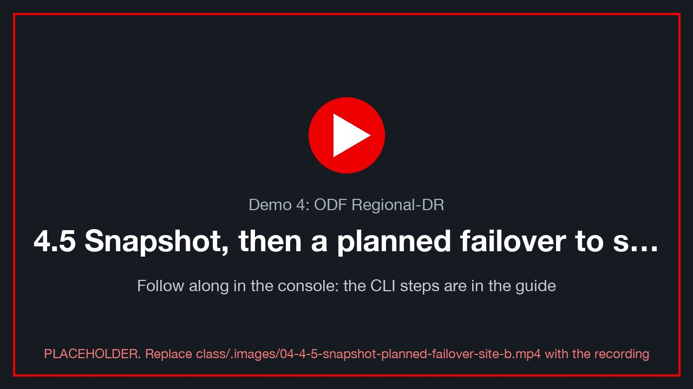
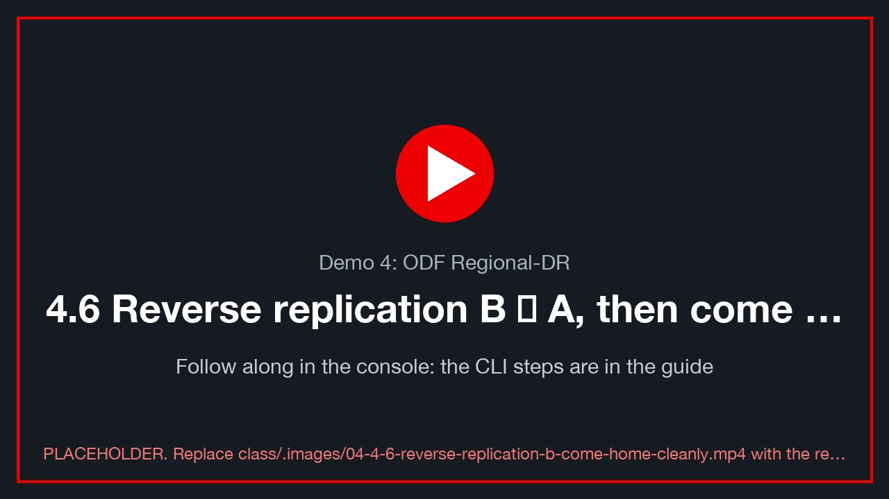
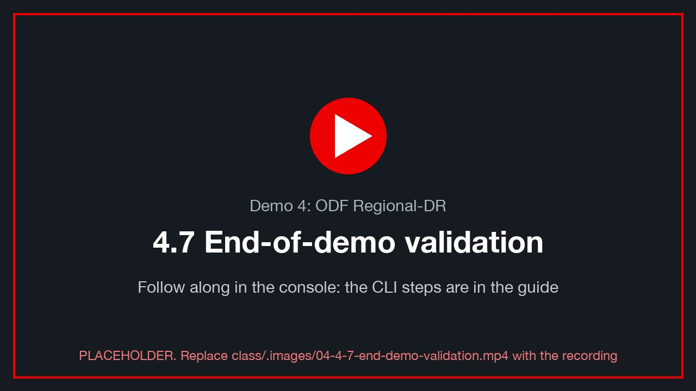
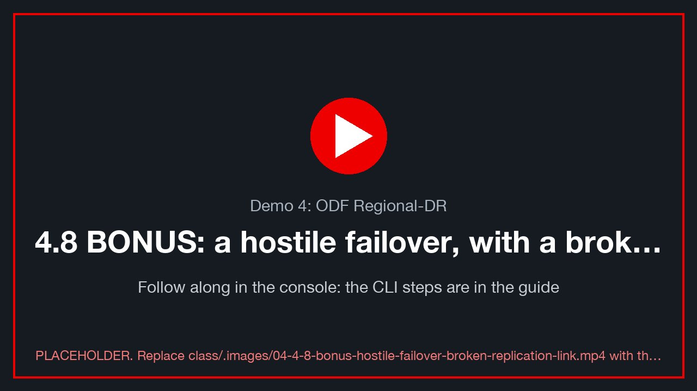

# Demo 4: ODF Regional-DR

> **Version 0.3.1 · draft · 2026-10-06** · class/demos/04-odf-regional-dr.md

## What you will learn

You will protect running virtual machines with OpenShift Data Foundation (ODF) Regional-DR, which replicates their
disks asynchronously from site A to site B every 15 minutes. You will prove that a replication cycle really
completed, by injecting rows into PostgreSQL and watching them reach the other site. You will move the VMs to site
B and home again **without losing a single row**, and you will see that only the changes travel, not whole disks.
In the bonus round you break the replication link, force a failover and measure exactly what an unplanned
disaster costs (the RPO).

## How the lab is set up for this demo

> **How the two clusters are joined** (ACM hub, Submariner with Globalnet, then ODF's MirrorPeer/DRPolicy), what this lab
> has today and what CI automates: [Lab S §S.14](setup-how-the-lab-is-built.md). Read it first: this demo depends on all three layers.

The booking's CI customization (the `dr-fabric` and `dr-policy` jobs, which run when DR is on) built all of this
before class. See the [lab diagram](lab-diagram.md), and [Lab S — how this lab was built](setup-how-the-lab-is-built.md) for the CLI and
console steps behind the shared pieces.

| Pre-built | Where | How to check | How it was built · Red Hat docs |
|---|---|---|---|
| **ODF on BOTH sites** (`storage: odf` on site A **and** site B, an operator toggle on the booking) | site A, site B | `oc --context site-X -n openshift-storage get storagecluster` → `Ready` on both | [S.4](setup-how-the-lab-is-built.md) · [ODF 4.19](https://docs.redhat.com/en/documentation/red_hat_openshift_data_foundation/4.19) |
| ACM and cert-manager on both clusters (demo-openshift's base build, the same operators on both). DR runs from **site B's hub**, with site A imported as a managed cluster | site B | `oc --context site-b get managedclusters` | [S.10](setup-how-the-lab-is-built.md) · [ACM 2.13](https://docs.redhat.com/en/documentation/red_hat_advanced_cluster_management_for_kubernetes/2.13) **[verify: BL-D11]** |
| ODF Multicluster Orchestrator and the DR hub operator (Ramen) on the hub, and the DR cluster operator on both sites | site B / both | §4.2 | [ODF DR guide](https://docs.redhat.com/en/documentation/red_hat_openshift_data_foundation/4.19/html/configuring_openshift_data_foundation_disaster_recovery_for_openshift_workloads/index) |
| Submariner (the network tunnel Ceph mirrors over), the `MirrorPeer`, both `DRCluster`s | both | §4.2 | [ODF DR guide: Regional-DR](https://docs.redhat.com/en/documentation/red_hat_openshift_data_foundation/4.19/html/configuring_openshift_data_foundation_disaster_recovery_for_openshift_workloads/index) |
| The **15-minute** `DRPolicy` (`sync_interval=15m`) | site B | §4.2 | §4.2 |
| `ovedr-app` with `sql-client` and a Service per class VM (`<VM>-sql`), on **both** sites | both | `oc --context site-b -n ovedr-app get deploy,svc` | [S.9](setup-how-the-lab-is-built.md) |
| **Your own VM** (`$VM`, e.g. `win-pg-s03`) running on site A, on ODF storage (`ocs-storagecluster-ceph-rbd-virtualization`), at **its own address `$VM_IP`** on the VLAN bridge (Demo 1's staged plan) | site A | `where` → `site-a Running` | [S.11](setup-how-the-lab-is-built.md) · [S.12](setup-how-the-lab-is-built.md) |
| Your Windows login (`.\<WINUSER>`) and the PostgreSQL toolkit (`marks`, `ovedr_*`) inside your VM | your VM | `verify site-a` | [S.11](setup-how-the-lab-is-built.md) |

**What you do yourself:** inspect every DR layer, inject and verify data at every stage, read replication
status at three levels, and run the moves when you are the driver.

> ⚠ **Capacity, stated plainly.** Each ODF cluster takes **all 4** scratch SSDs, one on each demosvr host. Today the
> lab has 4, so it can run **one** ODF site. Every other demo runs with site A on ODF and site B on NFS. **Demo 4
> needs a booking with ODF on both sites**, which becomes possible when the additional drives are installed. Until
> then, run this demo from the 📸 screenshots only.

> **One protection unit for the whole class.** Each student's VM lives in that student's own namespace (their class
> ID), the instructor's in `ovedr-app`. The default is **one DRPC protecting all of them**: `ovedr-app` plus every
> student namespace **[verify: a discovered-app DRPC with several protectedNamespaces]**. Every Relocate or Failover moves **every** student's VM
> together, so 🧑‍🏫 the driver runs the DR actions, and **each of you verifies your own VM**. Per-VM protection (one
> DRPC per student VM, selecting that VM's disks by label) is possible but not built here **[verify]**.

> **Before you start:** do [Lab 0](00-access-and-tools.md) in this terminal. You need the variables (`ME N A B VM`),
> the two contexts (`site-a`, `site-b`) and the helpers (`sql mark load verify alive where`).

---

## 4.0 Point the helpers at your VM

<!-- 🎬 video slot 04-4-0-point-helpers-at-vm -->
[](../.images/04-4-0-point-helpers-at-vm.mp4)
<sub>🎬 *4.0 Point the helpers at your VM: a recording of this whole section, done in the console (placeholder until recorded: `class/.images/04-4-0-point-helpers-at-vm.mp4`).*</sub>

Use **your VM's own address**, `$VM_IP`, for every connection test. Your VM sits on the VLAN bridge (`vmnet<VLAN>`),
which exists with the same name on both sites, so after a Relocate or Failover it comes up with the **same** address on
the other site. (Only a VM on the pod network gets a new pod IP per site: then refresh it with Lab 0 §0.6 after every
move.) Your VM's Service (`$VM-sql`) also follows the VM between sites.

```bash
export PGHOST=$VM_IP                                  # or: export PGHOST=$VM-sql
export DRPC=ovedr-app                                 # the class's one DRPC (ovedr-app + every student namespace)
# the DR state of the class's protected namespace, read from the hub (site B)
drpc() { oc --context site-b -n openshift-dr-ops get drpc "$DRPC" \
           -o jsonpath='{"phase="}{.status.phase}{"  progression="}{.status.progression}{"  lastSync="}{.status.lastGroupSyncTime}{"  dur="}{.status.lastGroupSyncDuration}{"  bytes="}{.status.lastGroupSyncBytes}{"\n"}'; }
# Ceph's own view of mirroring, on one site (needs rsh into the tools pod: instructor screen if your role cannot)
rbdmirror() { oc --context "$1" -n openshift-storage rsh deploy/rook-ceph-tools \
                rbd mirror pool status ocs-storagecluster-cephblockpool --verbose; }

where; alive site-a
mark site-a d4-start
verify site-a
```

✍️ **Row 4.0:** your `d4-start` mark id and the `fingerprint`.

---

## 4.1 Inside the VM: your file

<!-- 🎬 video slot 04-4-1-inside-vm-file -->
[](../.images/04-4-1-inside-vm-file.mp4)
<sub>🎬 *4.1 Inside the VM: your file: a recording of this whole section, done in the console (placeholder until recorded: `class/.images/04-4-1-inside-vm-file.mp4`).*</sub>

In your VM's console on site A (**Virtualization → VirtualMachines → `<your VM>` → Console**), log in as `.\<WINUSER>`,
then run:

```powershell
Add-Content "C:\Users\Public\ovedr\$env:USERNAME.txt" "$(Get-Date -Format o)  d4-start on site A"
Get-Content "C:\Users\Public\ovedr\$env:USERNAME.txt" -Tail 3
```

📸 `04-touch-start`: the last three lines of your file, on site A.

---

## 4.2 Set up asynchronous replication between the clusters

<!-- 🎬 video slot 04-4-2-set-up-asynchronous-replication-clusters -->
[](../.images/04-4-2-set-up-asynchronous-replication-clusters.mp4)
<sub>🎬 *4.2 Set up asynchronous replication between the clusters: a recording of this whole section, done in the console (placeholder until recorded: `class/.images/04-4-2-set-up-asynchronous-replication-clusters.mp4`).*</sub>

Regional-DR is built in layers. The lab stages the lower ones (`dr-fabric`); you inspect each one and see what
it is for.

| Layer | Object (on the hub unless noted) | What it does |
|---|---|---|
| Cluster set | `ManagedClusterSet`, both `ManagedCluster`s | ACM knows both sites |
| Network | Submariner `Broker` + add-on on each cluster | a tunnel between the clusters' networks, which carries Ceph's mirror traffic |
| Storage peering | `MirrorPeer` (ODF Multicluster Orchestrator) | turns on RBD mirroring between the two Ceph clusters and exchanges their keys and S3 stores |
| DR clusters | `DRCluster` ×2 (created by the MirrorPeer) | Ramen's view of each site and its S3 store |
| Policy | `DRPolicy` | **which** two clusters pair up, and **how often** to checkpoint |

```bash
oc --context site-b get managedclusters                                   # ocp-lzX, ocp-lzY (+ local-cluster): JOINED, AVAILABLE
oc --context site-b get managedclusteraddons -A | grep -E 'submariner|NAME'
oc --context site-b get mirrorpeer -o custom-columns=NAME:.metadata.name,TYPE:.spec.type,PHASE:.status.phase
oc --context site-b get drcluster \
  -o custom-columns=NAME:.metadata.name,S3:.spec.s3ProfileName,VALIDATED:'.status.conditions[?(@.type=="Validated")].status'
```

**[verify]** On ODF 4.19, check whether Submariner is deployed with **Globalnet** off (the clusters' pod and service
CIDRs must not overlap; demo-openshift gives each cluster unique CIDRs) or on:

```bash
oc --context site-b -n "$(oc --context site-b get broker -A -o jsonpath='{.items[0].metadata.namespace}')" \
  get broker submariner-broker -o jsonpath='{.spec.globalnetEnabled}{"\n"}'
```

### 🧑‍🏫 Driver: the 15-minute DRPolicy

The user-facing promise of this demo is **"a checkpoint every 15 minutes"**. That is the `schedulingInterval`.

```bash
export POLICY=$A-$B-15m
cat <<YAML | oc --context site-b apply -f -
apiVersion: ramendr.openshift.io/v1alpha1
kind: DRPolicy
metadata: { name: $POLICY }
spec:
  drClusters: [ $A, $B ]
  schedulingInterval: 15m
  replicationClassSelector: {}
  volumeSnapshotClassSelector: {}
YAML
```

**[verify: dependency]** The interval must be one the `MirrorPeer` offers (`spec.schedulingIntervals`). The lab's
MirrorPeer offers `2m` and `5m` today, so `15m` has to be added to the MirrorPeer for this policy to validate.

### Check

```bash
oc --context site-b get drpolicy "$POLICY" \
  -o jsonpath='{.spec.schedulingInterval}{"  validated="}{.status.conditions[?(@.type=="Validated")].status}{"\n"}'
# the per-interval replication classes the MirrorPeer created on each site
for s in site-a site-b; do echo "== $s"; oc --context $s get volumereplicationclass; done
```

✅ `15m  validated=True`. ✅ Each site has a `VolumeReplicationClass` whose `schedulingInterval` is `15m`
**[verify: class naming, e.g. `rbd-volumereplicationclass-…`]**.

📸 `04-drpolicy`: the DRPolicy validated at 15m.

---

## 4.3 Protect the VM

<!-- 🎬 video slot 04-4-3-protect-vm -->
[](../.images/04-4-3-protect-vm.mp4)
<sub>🎬 *4.3 Protect the VM: a recording of this whole section, done in the console (placeholder until recorded: `class/.images/04-4-3-protect-vm.mp4`).*</sub>

```bash
mark site-a d4-before-protect
```

### 🧑‍🏫 Driver: enrol the VM

The VMs were created by MTV, not by a GitOps application, so they are a **discovered application**. Protect
`ovedr-app` (the instructor's VM and `sql-client`) **and every student namespace** (each student's VM, its disks and its
Service), so a move carries everything the class uses.

Console, site B (hub): **All Clusters → Data Services → Disaster recovery → Protected applications → Enroll
discovered application** **[verify: BL-T07]**:
- cluster `$A`
- namespaces `ovedr-app` and every `student-NN-<booking>` namespace
- policy `$POLICY`
- resources: **all in namespace**
- kube-object capture interval `15m`

That creates the `Placement` and the `DRPlacementControl` (DRPC) on the hub. As YAML, roughly **[verify]**:

```yaml
apiVersion: ramendr.openshift.io/v1alpha1
kind: DRPlacementControl
metadata: { name: ovedr-app, namespace: openshift-dr-ops }
spec:
  preferredCluster: <A>
  drPolicyRef: { name: <A>-<B>-15m }
  placementRef: { kind: Placement, name: ovedr-app-placement, namespace: openshift-dr-ops }
  protectedNamespaces: [ ovedr-app, student-01-<booking>, student-02-<booking> ]   # one entry per student namespace [verify]
  pvcSelector: {}
  kubeObjectProtection: { captureInterval: 15m, kubeObjectSelector: {} }
```

### Check: the first sync is a FULL copy

```bash
oc --context site-b -n openshift-dr-ops get drpc "$DRPC" -o wide -w          # Ctrl-C at Deployed / Protected
drpc
oc --context site-a -n "$VMNS" get volumereplicationgroup                 # one VRG, state Primary
oc --context site-a -n "$VMNS" get volumereplicationgroup "$DRPC" \
  -o jsonpath='{range .status.conditions[*]}{.type}={.status} {.reason}{"\n"}{end}'
```

✅ The VRG reports `DataReady=True`, `DataProtected=True` and `ClusterDataProtected=True` **[verify: condition
names on ODF 4.19]**.
✍️ **Row 4.3:** the first `lastGroupSyncBytes` and `lastGroupSyncDuration`. This is the **only** full copy in the
demo. Compare it with the VM's disk usage (`oc --context site-a -n "$VMNS" get pvc`).

📸 `04-protected`: the Protected applications page showing `ovedr-app` Healthy.

---

## 4.4 Prove replication is running, and that a cycle completed

<!-- 🎬 video slot 04-4-4-prove-replication-running-cycle-completed -->
[](../.images/04-4-4-prove-replication-running-cycle-completed.mp4)
<sub>🎬 *4.4 Prove replication is running, and that a cycle completed: a recording of this whole section, done in the console (placeholder until recorded: `class/.images/04-4-4-prove-replication-running-cycle-completed.mp4`).*</sub>

### What "running" looks like, at three levels

```bash
drpc                                                           # 1 · Ramen: the last group sync
oc --context site-a -n "$VMNS" get volumereplication          # 2 · CSI: one VolumeReplication per disk
oc --context site-a -n "$VMNS" get volumereplication \
  -o custom-columns=PVC:.spec.dataSource.name,STATE:.status.state,LASTSYNC:.status.lastSyncTime
rbdmirror site-a                                               # 3 · Ceph: images up+stopped (primary), health OK
rbdmirror site-b                                               #     images up+replaying (secondary)
```

To see one image's mirror snapshots, which are the checkpoints themselves:

```bash
oc --context site-a -n "$VMNS" get pvc | grep "$VM"              # your VM's three disks: pick one
PVC='<one of your VM pvcs>'
IMG=$(oc --context site-a get pv "$(oc --context site-a -n "$VMNS" get pvc "$PVC" -o jsonpath='{.spec.volumeName}')" \
        -o jsonpath='{.spec.csi.volumeAttributes.imageName}')
oc --context site-a -n openshift-storage rsh deploy/rook-ceph-tools \
  rbd mirror image status "ocs-storagecluster-cephblockpool/$IMG"
oc --context site-a -n openshift-storage rsh deploy/rook-ceph-tools \
  rbd snap ls --all "ocs-storagecluster-cephblockpool/$IMG" | grep -i mirror
```

✅ Primary: `state: up+stopped`, with `description` showing the last mirror snapshot. Secondary: `up+replaying`.

### Inject, then wait for ONE complete sync that contains your row

```bash
load site-a d4-busy 200                          # a burst: the database is busy
mark site-a d4-wait-for-sync                     # the row that must reach site B
T=$(sql site-a -Atc "SELECT max(ts) FROM marks WHERE student = '$ME'")
echo "my row's time: $T"
# poll the hub until a group sync STARTED after your row's time (each sync is a crash-consistent snapshot)
until [ "$(date -d "$(oc --context site-b -n openshift-dr-ops get drpc "$DRPC" -o jsonpath='{.status.lastGroupSyncTime}')" +%s 2>/dev/null || echo 0)" \
        -gt "$(date -d "$T" +%s)" ]; do
  printf '%s  waiting… ' "$(date +%T)"; drpc; sleep 60
done
echo "✅ a sync completed after your row"; drpc
```

> ⚠ The loop uses GNU `date -d`. On macOS, run it from the lab's Linux shell, or install `coreutils` and use `gdate`.
>
> 💡 With a 15-minute interval this can take up to 15 minutes. That wait **is** the RPO you are buying. The
> instructor may use a 5-minute policy in a short session.

✅ `lastGroupSyncTime` is later than your row, so your `d4-wait-for-sync` row is now on site B's disks.
✍️ **Row 4.4:** a typical checkpoint's `bytes` and `dur`. Compare them with row 4.3: it should be a small fraction.

📸 `04-sync-complete`: the `drpc` line after the loop ends.

---

## 4.5 Snapshot, then a planned failover to site B

<!-- 🎬 video slot 04-4-5-snapshot-planned-failover-site-b -->
[](../.images/04-4-5-snapshot-planned-failover-site-b.mp4)
<sub>🎬 *4.5 Snapshot, then a planned failover to site B: a recording of this whole section, done in the console (placeholder until recorded: `class/.images/04-4-5-snapshot-planned-failover-site-b.mp4`).*</sub>

### A snapshot as a local safety net

```bash
cat <<YAML | oc --context site-a apply -f -
apiVersion: snapshot.kubevirt.io/v1beta1
kind: VirtualMachineSnapshot
metadata: { name: $VM-d4-pre-move, namespace: $VMNS }
spec:
  source: { apiGroup: kubevirt.io, kind: VirtualMachine, name: $VM }
YAML
oc --context site-a -n "$VMNS" get vmsnapshot "$VM-d4-pre-move" -w        # Ctrl-C at readyToUse=true
```

**[verify]** `snapshot.kubevirt.io/v1beta1` is the served version on OpenShift Virtualization 4.19 (`v1alpha1` on older
releases).

> 💡 **A snapshot is not DR.** It lives on the **same** Ceph cluster as the VM. It protects against a bad change
> (Demo 1's bonus round), not against losing the site. Replication is what protects the site.

### Relocate vs Failover

| | **Relocate** (planned) | **Failover** (unplanned) |
|---|---|---|
| When | both sites healthy: maintenance, evacuation, a test | the primary is gone or unreachable |
| Order | stop the VM on A → **final sync** → demote A → promote B → start on B | promote B from the **last completed** sync → start on B |
| Data loss | **none** | up to one interval (the RPO) |

A "clean migration" between sites is a **Relocate**. The bonus round does a real Failover.

### 🧑‍🏫 Driver: Relocate to site B

```bash
mark site-a d4-before-relocate
oc --context site-b -n openshift-dr-ops patch drpc "$DRPC" --type merge \
  -p "{\"spec\":{\"action\":\"Relocate\",\"preferredCluster\":\"$B\"}}"
```

(Console: *Protected applications → `ovedr-app` → ⋮ → Relocate*.)

### Check: on site B, nothing lost

Your VM came up on site B with the same address (`$PGHOST`), so the helpers work unchanged:

```bash
oc --context site-b -n openshift-dr-ops get drpc "$DRPC" -o wide -w           # Relocating → Relocated
where                                                                        # site-b Running
oc --context site-b -n "$VMNS" get vm,vmi,pvc,svc,deploy                   # everything came with it
alive  site-b
verify site-b
sql    site-b -c "SELECT id, ts, stage FROM marks WHERE student = '$ME' ORDER BY id DESC LIMIT 5;"
```

✅ `d4-before-relocate` is present on site B, so a planned move loses nothing.
✅ `chain_ok = t`. The `fingerprint` equals the one you would get on A at the moment it stopped.
✍️ **Row 4.5:** Relocate duration (DRPC `lastGroupSyncDuration`, plus the heartbeat gap from `alive`) and rows lost (0).

Your file, in the console on **site B**:

```powershell
Get-Content "C:\Users\Public\ovedr\$env:USERNAME.txt" -Tail 3        # d4-start is there
Add-Content "C:\Users\Public\ovedr\$env:USERNAME.txt" "$(Get-Date -Format o)  d4 on site B"
```

📸 `04-on-site-b`: `where` showing site-b, and the file's tail.

---

## 4.6 Reverse replication B → A, then come home cleanly

<!-- 🎬 video slot 04-4-6-reverse-replication-b-come-home-cleanly -->
[](../.images/04-4-6-reverse-replication-b-come-home-cleanly.mp4)
<sub>🎬 *4.6 Reverse replication B → A, then come home cleanly: a recording of this whole section, done in the console (placeholder until recorded: `class/.images/04-4-6-reverse-replication-b-come-home-cleanly.mp4`).*</sub>

The VM now runs on B, and B is the **primary**. Before you move it again, check that protection has
**reversed**: B replicates back to A, and A's images are the secondaries.

```bash
mark site-b d4-on-b
drpc
oc --context site-b -n openshift-dr-ops get drpc "$DRPC" \
  -o jsonpath='{range .status.conditions[*]}{.type}={.status} {.reason}{"\n"}{end}'
rbdmirror site-b            # B: up+stopped (primary)
rbdmirror site-a            # A: up+replaying (secondary): the reverse direction is live
```

✅ `PeerReady=True` and `Protected=True`. ✅ A's images are `up+replaying`.
Wait for one sync after `d4-on-b`, using the same loop as §4.4, with `site-b` in place of `site-a` in the `sql` call.

### 🧑‍🏫 Driver: Relocate home to site A

```bash
mark site-b d4-before-home
oc --context site-b -n openshift-dr-ops patch drpc "$DRPC" --type merge \
  -p "{\"spec\":{\"action\":\"Relocate\",\"preferredCluster\":\"$A\"}}"
oc --context site-b -n openshift-dr-ops get drpc "$DRPC" -o wide -w
```

### Check: the VM is home, and the data made the full round trip

Same address again, now on site A:

```bash
where                                            # site-a Running
alive  site-a
verify site-a
sql site-a -c "SELECT stage, count(*), min(id), max(id) FROM marks WHERE student = '$ME' GROUP BY stage ORDER BY min(id);"
drpc                                             # Relocated; protection A → B again
```

✅ Every stage is present: `d4-start`, `d4-busy` (200 rows), `d4-wait-for-sync`, `d4-before-protect`,
`d4-before-relocate`, `d4-on-b` and `d4-before-home`.
✅ `chain_ok = t`.
✍️ **Row 4.6:** the bytes of the return sync. It is a **delta** (what changed on B), not the whole disk.

Console on site A:

```powershell
Get-Content "C:\Users\Public\ovedr\$env:USERNAME.txt" -Tail 4        # both "site A" and "site B" lines
```

📸 `04-home`: `verify site-a` with `chain_ok = t`, and the file's tail.

---

## 4.7 End-of-demo validation

<!-- 🎬 video slot 04-4-7-end-demo-validation -->
[](../.images/04-4-7-end-demo-validation.mp4)
<sub>🎬 *4.7 End-of-demo validation: a recording of this whole section, done in the console (placeholder until recorded: `class/.images/04-4-7-end-demo-validation.mp4`).*</sub>

```bash
alive  site-a
verify site-a
sql site-a -c "SELECT * FROM ovedr_verify();"                 # the whole class: every student's chain_ok
sql site-a -c "SELECT id, ts, date_trunc('second', gap) AS outage FROM (
                 SELECT id, ts, ts - lag(ts) OVER (ORDER BY id) AS gap FROM heartbeat) g
               WHERE gap > interval '10 seconds' ORDER BY id DESC LIMIT 5;"   # each move's outage (RTO)
```

| Row | Stage | Bytes | Duration | Rows lost | Your last mark id | `chain_ok` | Fingerprint |
|---|---|---|---|---|---|---|---|
| 4.0 | start | — | — | — | | | |
| 4.3 | **first sync (full)** | | | — | | | |
| 4.4 | typical 15-min checkpoint | | | — | | | |
| 4.5 | Relocate A → B | | | 0 | | | |
| 4.6 | Relocate B → A (home) | | | 0 | | | |

**The claim holds if** rows 4.4, 4.5 and 4.6 are each a small fraction of row 4.3, and every planned move lost
**zero** rows.

🧑‍🏫 Optional cleanup: `oc --context site-a -n "$VMNS" delete vmsnapshot "$VM-d4-pre-move"`.

---

## Thank you

Thank you for working through Demo 4. You protected live VMs across two clusters, proved that each checkpoint
reached the DR site, and moved the whole application there and back with every row intact. To go further:

- **Lab S — how this lab was built:** [the shared pieces, from the CLI and in the console](setup-how-the-lab-is-built.md)
- **ODF disaster recovery for OpenShift workloads (4.19):** <https://docs.redhat.com/en/documentation/red_hat_openshift_data_foundation/4.19/html/configuring_openshift_data_foundation_disaster_recovery_for_openshift_workloads/index>
- **Red Hat OpenShift Data Foundation 4.19 documentation:** <https://docs.redhat.com/en/documentation/red_hat_openshift_data_foundation/4.19>
- **Red Hat Advanced Cluster Management 2.13:** <https://docs.redhat.com/en/documentation/red_hat_advanced_cluster_management_for_kubernetes/2.13>
- **OpenShift Virtualization (OpenShift 4.19):** <https://docs.redhat.com/en/documentation/openshift_container_platform/4.19/html/virtualization/index>
- **Training: DO316, Managing Virtual Machines with Red Hat OpenShift Virtualization:** <https://www.redhat.com/en/services/training/do316-managing-virtual-machines-red-hat-openshift-virtualization>
- **Red Hat interactive labs:** <https://www.redhat.com/en/interactive-labs>
- **OpenShift Data Foundation:** <https://www.redhat.com/en/technologies/cloud-computing/openshift-data-foundation>

Stay for the bonus round if time allows. It shows what the 15-minute interval costs when the link fails without warning.

---

## 4.8 BONUS: a hostile failover, with a broken replication link

<!-- 🎬 video slot 04-4-8-bonus-hostile-failover-broken-replication-link -->
[](../.images/04-4-8-bonus-hostile-failover-broken-replication-link.mp4)
<sub>🎬 *4.8 BONUS: a hostile failover, with a broken replication link: a recording of this whole section, done in the console (placeholder until recorded: `class/.images/04-4-8-bonus-hostile-failover-broken-replication-link.mp4`).*</sub>

Now the link fails, the business can't wait, and the class **forces** the VM onto site B from whatever the last
completed sync holds. Then it repairs the link and **forces the resync** back.

### How to break the link: options

| Option | What happens | Realism | Risk | Recovery |
|---|---|---|---|---|
| **A. Cut the Submariner tunnel** (recommended) 🧑‍🏫 | Ceph mirror traffic stops. **Both clusters stay up**, and ACM still talks to both | "the WAN link died" | low: one label on one node | put the label back |
| B. Power off all site-A nodes 🧑‍🏫 (`virsh destroy`, instructor guide §4.1) | site A vanishes entirely | "the site burned down" | medium: Ceph on A restarts from a crash | `virsh start`; wait for Ceph `HEALTH_OK` |
| C. Scale down `rbd-mirror` on site B | the secondary stops pulling | narrow: a storage fault | rook/ocs operators scale it back up unless they are paused too | scale the operators back up |
| D. Fence site A (`DRCluster spec.clusterFence: Fenced`) | **Metro-DR only.** Regional-DR does not fence **[verify]** | — | — | not used |

**Recommended: option A.** It matches "break the ODF sync link" exactly: replication fails while both sites
still run, so the class sees a link failure rather than a site loss. It is reversed with one command. Option B is
the scripted disaster in the classic M6 module.

### Step 1: inject, and note the last sync that got through

```bash
mark site-a d4h-before-break
until [ "$(date -d "$(oc --context site-b -n openshift-dr-ops get drpc "$DRPC" -o jsonpath='{.status.lastGroupSyncTime}')" +%s)" \
        -gt "$(date -d "$(sql site-a -Atc "SELECT max(ts) FROM marks WHERE student='$ME'")" +%s)" ]; do drpc; sleep 60; done
drpc                       # ✍️ lastSync = the last checkpoint that will reach B
sql site-a -Atc "SELECT max(id) FROM marks WHERE student = '$ME'"   # ✍️ your last SAFE id
```

### Step 2: 🧑‍🏫 break the link (option A) **[verify]**

```bash
# the gateway node(s) on site B carry the label submariner.io/gateway=true; removing it stops the tunnel
GW=$(oc --context site-b get nodes -l submariner.io/gateway=true -o name)
echo "$GW" > /tmp/ovedr-gw-site-b.txt
oc --context site-b label $GW submariner.io/gateway-
oc --context site-b -n submariner-operator get gateways -o wide      # no active gateway / connection error
```

### Step 3: keep writing on A. These rows will NOT reach B.

```bash
for n in 1 2 3; do mark site-a "d4h-after-break-$n"; sleep 20; done
sql site-a -c "SELECT id, ts, stage FROM marks WHERE student = '$ME' ORDER BY id DESC LIMIT 4;"
```

✍️ Write down these ids and the first 12 characters of each `sha`. They are the rows you are about to lose.

```powershell
# in your VM's console on site A
Add-Content "C:\Users\Public\ovedr\$env:USERNAME.txt" "$(Get-Date -Format o)  d4h written AFTER the link broke"
```

After one interval, the hub notices that syncs have stopped:

```bash
drpc                                                    # lastSync stops advancing
oc --context site-b -n openshift-dr-ops get drpc "$DRPC" \
  -o jsonpath='{range .status.conditions[*]}{.type}={.status} {.reason}{"\n"}{end}'
```

### Step 4: 🧑‍🏫 force Failover to site B

```bash
oc --context site-b -n openshift-dr-ops patch drpc "$DRPC" --type merge \
  -p "{\"spec\":{\"action\":\"Failover\",\"failoverCluster\":\"$B\"}}"
oc --context site-b -n openshift-dr-ops get drpc "$DRPC" -o wide -w        # FailingOver → FailedOver
```

ACM still reaches site A, so Ramen stops the VM there (it becomes the secondary) and starts it on B from the
**last completed sync**.

### Step 5: measure what was lost (the RPO)

Same address, on site B:

```bash
where                                                   # site-b Running
verify site-b
sql site-b -c "SELECT id, ts, stage, left(sha,12) AS sha FROM marks WHERE student = '$ME' ORDER BY id DESC LIMIT 4;"
```

What you should see, and why:
- The last row present is your **last SAFE id** from step 1. Every `d4h-after-break-*` row is **missing**.
- `chain_ok` is still **`t`**. A chain detects rows lost, changed or reordered **in the middle**. Losing the
  **tail** leaves a shorter chain that is still valid. That is why you wrote down your ids: your notes are the
  evidence of what the failover cost.
- Write a new mark on B. Its `id` may **reuse** one of the lost ids, because B's sequence continues from the
  replicated state. Its `sha` differs from your note, so it is a different row with the same number.

```bash
mark site-b d4h-on-b-after-failover
sql site-b -c "SELECT id, stage, left(sha,12) FROM marks WHERE student = '$ME' ORDER BY id DESC LIMIT 2;"
```

```powershell
# console on site B: the "AFTER the link broke" line is gone, because the disk is from the last sync
Get-Content "C:\Users\Public\ovedr\$env:USERNAME.txt" -Tail 3
```

✍️ **Row 4.8a:** rows lost (count of `d4h-after-break-*`), RPO (failover time minus the last `lastSync`), and the
outage (heartbeat gap on B).

📸 `04-hostile-lost-rows`: your noted ids beside B's `marks` tail.

### Step 6: 🧑‍🏫 restore the link and force the resync

```bash
oc --context site-b label $(cat /tmp/ovedr-gw-site-b.txt) submariner.io/gateway=true
oc --context site-b -n submariner-operator get gateways -o wide       # connected again
drpc                                                                  # progression moves on
```

If progression stops at **`WaitOnUserToCleanUp`**, the stale VM on site A must go before A can become the
secondary. That is the instructor's cleanup, in instructor guide §4.3 **[verify: BL-T09]**.

Then watch A's images become secondaries and **catch up from the last common snapshot**:

```bash
rbdmirror site-a          # A: syncing → up+replaying
rbdmirror site-b          # B: up+stopped (primary)
```

**[verify: BL-T09]** If an image stays in `split-brain` or `error`, Ceph needs an explicit resync of that image on
the **old primary (A)**. This copies the whole image, so use it only when Ramen does not recover by itself:

```bash
oc --context site-a -n openshift-storage rsh deploy/rook-ceph-tools \
  rbd mirror image resync "ocs-storagecluster-cephblockpool/<image>"
```

✍️ **Row 4.8b:** resync bytes and duration. A **delta** (from the last common checkpoint) proves the DESIGN's
claim. A **full** copy means the hostile path costs one full copy, and the guide says so honestly (DESIGN §6.4).

### Step 7: 🧑‍🏫 Relocate home, and verify the history

```bash
mark site-b d4h-before-home
# wait for one sync after that mark (§4.4 loop, site-b), then:
oc --context site-b -n openshift-dr-ops patch drpc "$DRPC" --type merge \
  -p "{\"spec\":{\"action\":\"Relocate\",\"preferredCluster\":\"$A\"}}"
oc --context site-b -n openshift-dr-ops get drpc "$DRPC" -o wide -w
where
verify site-a
sql site-a -c "SELECT id, stage, left(sha,12) AS sha FROM marks WHERE student = '$ME' AND stage LIKE 'd4h%' ORDER BY id;"
```

✅ Present: `d4h-before-break`, `d4h-on-b-after-failover` and `d4h-before-home`.
✅ Missing: every `d4h-after-break-*`. These were written only on A after the link broke, then discarded when A
was resynced from B. **That is exactly the data the hostile failover cost.**
✅ `chain_ok = t` on A. The chain continues from the last safe row, through B, and home.

| Row | Stage | Bytes | Duration | Rows lost | Notes |
|---|---|---|---|---|---|
| 4.8a | **forced** Failover A ✗ → B | — | | | RPO = |
| 4.8b | resync after the link returns | | | — | delta or full? |
| 4.8c | Relocate home | | | 0 | |

📸 `04-hostile-home`: the final `d4h%` query on site A.

---

## Glossary

| Term | Meaning |
|---|---|
| **Regional-DR** | asynchronous replication between two clusters. RPO is greater than 0, at most one `schedulingInterval` |
| **MirrorPeer** | ODF Multicluster Orchestrator's pairing of two Ceph clusters, which turns on RBD mirroring |
| **DRPolicy** | the two clusters, and the checkpoint interval (here 15m) |
| **DRPC** | DRPlacementControl: the DR state of one protected workload, and where you ask for Relocate or Failover |
| **VRG** | VolumeReplicationGroup: the per-cluster agent that makes the workload's disks primary or secondary |
| **Relocate** | planned move: final sync, zero loss |
| **Failover** | forced move from the last completed sync: loss up to one interval |
| **RPO / RTO** | how much data you can lose / how long you are down |
