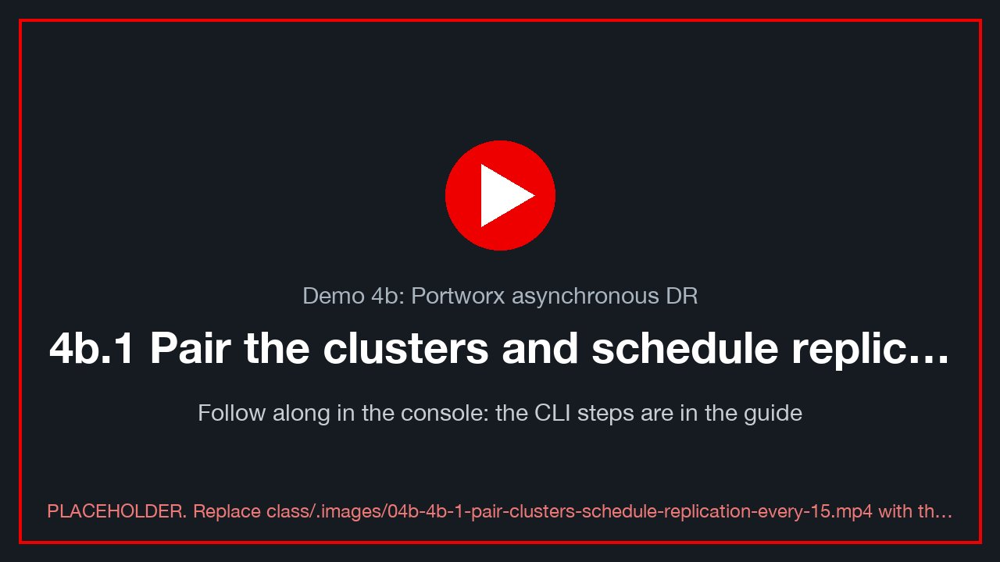
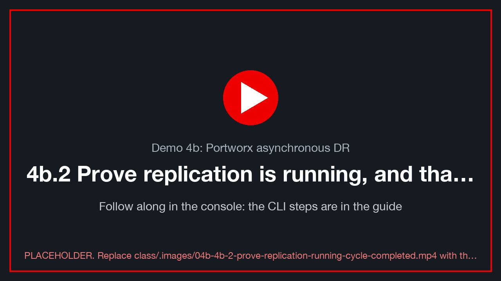
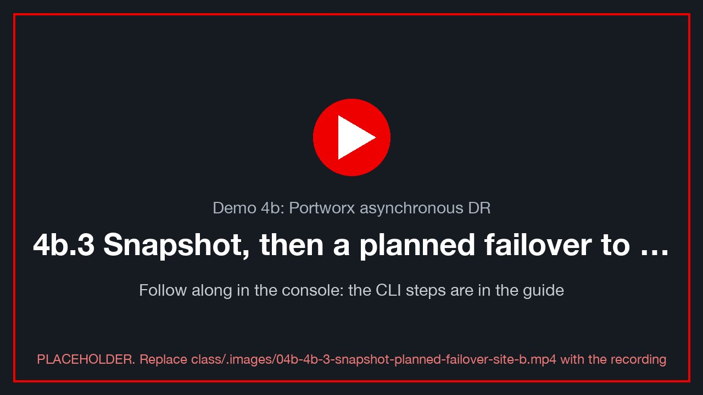
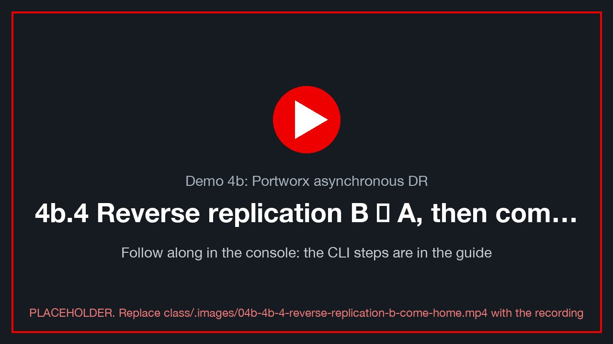
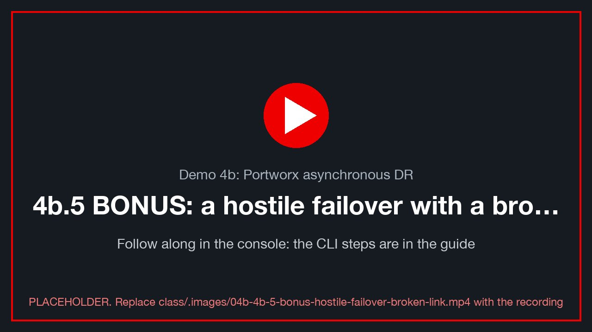

# Demo 4b: Portworx asynchronous DR

> **Version 0.0.1 · framework · 2026-10-05** · class/demos/04b-portworx-dr.md

> 🚧 **Framework: to be completed when Portworx is offered on the lab clusters.** This guide has the shape of the
> demo and the stages it will have, but not its final commands. Every stage lists what still needs to be written
> (**TODO**). The few command shapes kept here are unproven **[verify]**. For a class today, use
> [Demo 4 (ODF)](04-odf-regional-dr.md).

## What you will learn

You will protect running virtual machines with Portworx Enterprise and PX-DR, which replicates their volumes
asynchronously from site A to site B every 15 minutes. As in Demo 4, you will inject rows into PostgreSQL, prove
that a replication cycle carried them across, move the VMs to site B and home again without losing a row, and
compare how Portworx and ODF each run the same disaster-recovery story.

## How the lab is set up for this demo (TBD)

The CI customization will have to pre-build the following. None of it exists yet.

- **TODO:** Portworx Enterprise on **both** sites. This needs a demo-openshift `storage: portworx` option, which is not offered today, and a PX-DR licence.
- **TODO:** Stork and `storkctl` on both clusters, plus `storkctl` on the student workstation.
- **TODO:** an S3 object store reachable from both sites, for the ClusterPair.
- **TODO:** a Portworx StorageClass for VM disks, and the MTV storage map pointing at it.
- **TODO:** `ovedr-app`, `sql-client` and a Service per student VM on both sites, as in Demo 4.
- **TODO:** each student's VM (`$VM`) running on site A on Portworx volumes, with its own address ([Lab 0 §0.6](00-access-and-tools.md)).
- See the [lab diagram](lab-diagram.md).

> **Before you start:** do [Lab 0](00-access-and-tools.md) in this terminal (variables, contexts, helpers).

---

## 4b.1 Pair the clusters and schedule replication every 15 minutes

<!-- 🎬 video slot 04b-4b-1-pair-clusters-schedule-replication-every-15 -->
[](../.images/04b-4b-1-pair-clusters-schedule-replication-every-15.mp4)
<sub>🎬 *4b.1 Pair the clusters and schedule replication every 15 minutes: a recording of this whole section, done in the console (placeholder until recorded: `class/.images/04b-4b-1-pair-clusters-schedule-replication-every-15.mp4`).*</sub>

**Intent:** connect site A's Portworx to site B's, and replicate the `ovedr-app` namespace on a 15-minute schedule.

**TODO**
- Write the ClusterPair creation: `storkctl create clusterpair` from both kubeconfigs and the S3 credentials, then check that it reports Ready/Ready.
- Write the SchedulePolicy (15 min) and the MigrationSchedule for `ovedr-app`, with `startApplications: false`.
- Add the inject → verify checks and 📸 `04b-clusterpair`.

The probable command shapes **[verify: Stork 23.x+ flags and API versions]**:

```bash
storkctl create clusterpair ovedr-a-to-b --namespace ovedr-app \
  --src-kube-file '<site-a kubeconfig>' --dest-kube-file '<site-b kubeconfig>' \
  --provider s3 --s3-endpoint '<s3 endpoint>' --s3-access-key '<key>' --s3-secret-key '<secret>' \
  --s3-region us-east-1 --unidirectional
```

```yaml
apiVersion: stork.libopenstorage.org/v1alpha1
kind: SchedulePolicy
metadata: { name: ovedr-15m }
policy:
  interval: { intervalMinutes: 15 }
---
apiVersion: stork.libopenstorage.org/v1alpha1
kind: MigrationSchedule
metadata: { name: ovedr-a-to-b, namespace: ovedr-app }
spec:
  schedulePolicyName: ovedr-15m
  template:
    spec:
      clusterPair: ovedr-a-to-b
      namespaces: [ ovedr-app ]
      includeResources: true
      includeVolumes: true
      startApplications: false        # site B keeps a STOPPED copy until you fail over
```

---

## 4b.2 Prove replication is running, and that a cycle completed

<!-- 🎬 video slot 04b-4b-2-prove-replication-running-cycle-completed -->
[](../.images/04b-4b-2-prove-replication-running-cycle-completed.mp4)
<sub>🎬 *4b.2 Prove replication is running, and that a cycle completed: a recording of this whole section, done in the console (placeholder until recorded: `class/.images/04b-4b-2-prove-replication-running-cycle-completed.mp4`).*</sub>

**Intent:** the same proof as Demo 4 §4.4. Inject a row, then wait for a successful cycle that started after it.

**TODO**
- Status reads: the MigrationSchedule status, each Migration's stage and bytes, and `pxctl` volume status (the jsonpaths are **[verify]**).
- A poll loop like Demo 4's: `mark site-a d4b-wait-for-sync`, then poll until the last successful migration started after the mark's `ts`.
- 📸 `04b-cycle-complete`.

---

## 4b.3 Snapshot, then a planned failover to site B

<!-- 🎬 video slot 04b-4b-3-snapshot-planned-failover-site-b -->
[](../.images/04b-4b-3-snapshot-planned-failover-site-b.mp4)
<sub>🎬 *4b.3 Snapshot, then a planned failover to site B: a recording of this whole section, done in the console (placeholder until recorded: `class/.images/04b-4b-3-snapshot-planned-failover-site-b.mp4`).*</sub>

**Intent:** a clean, zero-loss move. Portworx has no single "Relocate". The move is stop → final migration → suspend → activate.

**TODO**
- Take a local snapshot first (a VirtualMachineSnapshot, or a Portworx snapshot).
- Write the four driver steps. The probable shapes **[verify]**:

```bash
virtctl --context site-a -n ovedr-app stop "$VM"
storkctl --context site-a create migration ovedr-final -n ovedr-app \
  --clusterPair ovedr-a-to-b --namespaces ovedr-app --includeResources --startApplications=false
storkctl --context site-a suspend migrationschedule ovedr-a-to-b -n ovedr-app
storkctl --context site-b activate migration -n ovedr-app
```

- Checks on site B: refresh your address (Lab 0 §0.6), then `verify site-b` with `chain_ok = t`, and read the touch file.

---

## 4b.4 Reverse replication B → A, then come home

<!-- 🎬 video slot 04b-4b-4-reverse-replication-b-come-home -->
[](../.images/04b-4b-4-reverse-replication-b-come-home.mp4)
<sub>🎬 *4b.4 Reverse replication B → A, then come home: a recording of this whole section, done in the console (placeholder until recorded: `class/.images/04b-4b-4-reverse-replication-b-come-home.mp4`).*</sub>

**Intent:** protect site B back to site A, then return home cleanly.

**TODO**
- A second ClusterPair plus a MigrationSchedule, B → A.
- The come-home sequence (the mirror of §4b.3), then resume the A → B schedule.
- End-of-demo validation: `verify`, `ovedr_checksum`, the touch file on each site, and proof table rows 4b.x.
- 📸 `04b-home`.

---

## Thank you

Thank you for working through the Portworx DR demo. You protected the same application as in Demo 4 with a
different storage platform, and you saw where the two approaches differ. To go further:

- **Portworx documentation:** <https://docs.portworx.com>
- **Portworx disaster recovery (PX-DR):** <https://docs.portworx.com/portworx-enterprise/operations/disaster-recovery>
- **OpenShift Virtualization (OpenShift 4.19):** <https://docs.redhat.com/en/documentation/openshift_container_platform/4.19/html/virtualization/index>
- **Training: DO316, Managing Virtual Machines with Red Hat OpenShift Virtualization:** <https://www.redhat.com/en/services/training/do316-managing-virtual-machines-red-hat-openshift-virtualization>
- **Red Hat interactive labs:** <https://www.redhat.com/en/interactive-labs>

---

## 4b.5 BONUS: a hostile failover with a broken link

<!-- 🎬 video slot 04b-4b-5-bonus-hostile-failover-broken-link -->
[](../.images/04b-4b-5-bonus-hostile-failover-broken-link.mp4)
<sub>🎬 *4b.5 BONUS: a hostile failover with a broken link: a recording of this whole section, done in the console (placeholder until recorded: `class/.images/04b-4b-5-bonus-hostile-failover-broken-link.mp4`).*</sub>

**Intent:** as in Demo 4 §4.8, break replication, force site B up from the last completed cycle, measure the
rows lost (the RPO), then repair the link and resync.

**TODO**
- Choose how to break the link. The candidates are: block site B's Portworx API from site A with a NetworkPolicy or firewall rule, or 🧑‍🏫 power off site A.
- The forced activation on site B. The probable shape is `storkctl --context site-b activate migration -n ovedr-app` **[verify]**.
- RPO evidence: the ids you noted against what B holds, then the touch file.
- Repair, reverse resync and come home.
- 📸 `04b-hostile-lost-rows`.

---

## How Demo 4b differs from Demo 4

| | ODF Regional-DR (Demo 4) | Portworx PX-DR (Demo 4b) |
|---|---|---|
| Orchestrator | ACM hub + Ramen (DRPolicy, DRPC) | Stork on each cluster (ClusterPair, MigrationSchedule) |
| Data path | Ceph RBD snapshot mirroring over Submariner | Portworx volume snapshots and diffs, pushed to the paired cluster |
| Reverse | automatic once the peer is ready | a second ClusterPair and schedule, B → A |
| Planned move | `Relocate` (one patch) | stop → final migration → suspend → activate |
