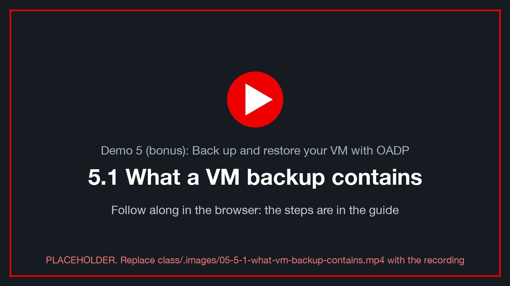
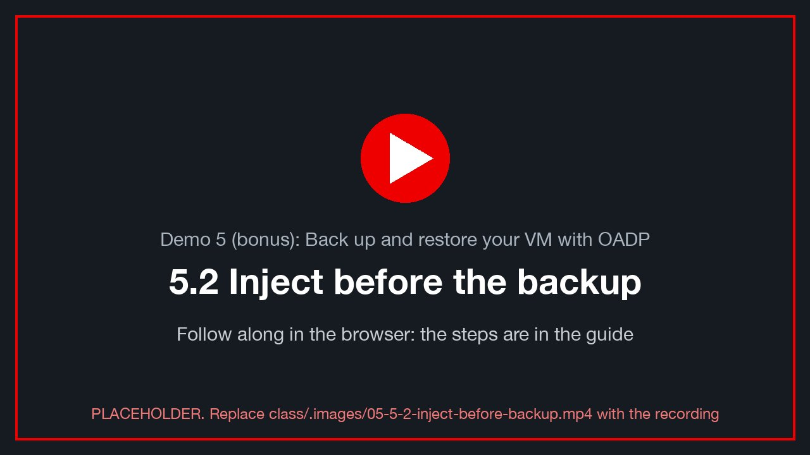
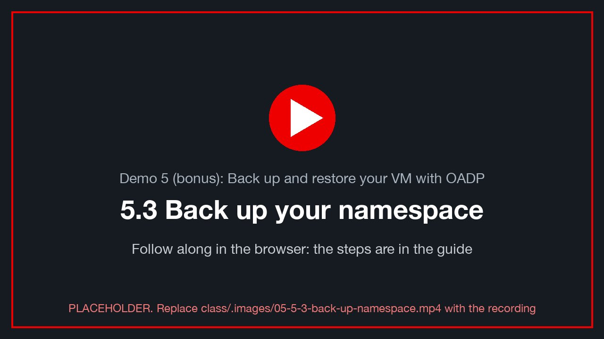
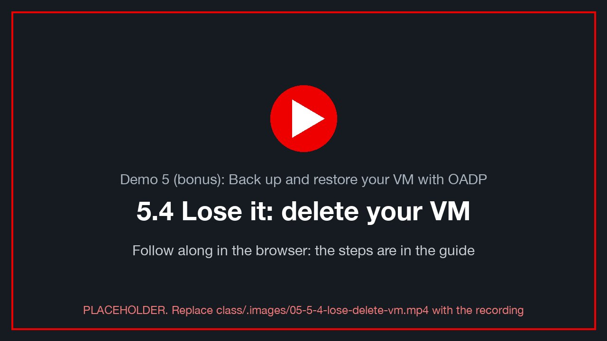
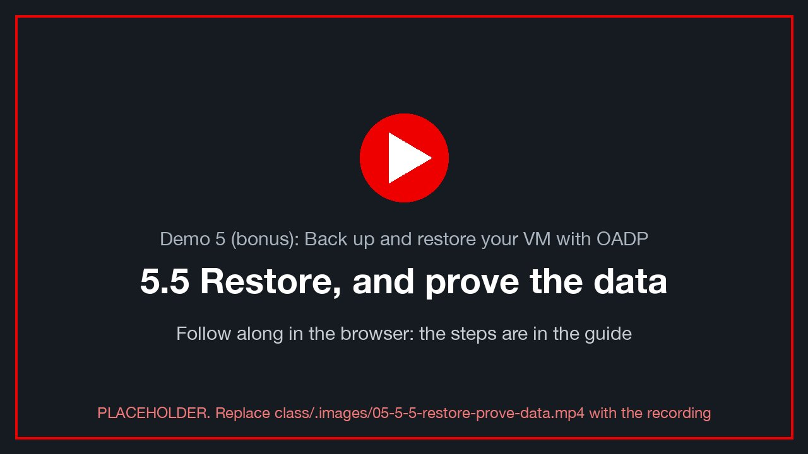

# Demo 5 (bonus): Back up and restore your VM with OADP

> **Version 0.2.0 · framework · 2026-10-12** · class/demos/05-oadp-vm-backup.md

> 🚧 **Bonus, framework.** OADP is now built by the lab when a class books it (option `backup: oadp`, the default for this
> class). The commands below are unproven **[verify]** until a booking has run them. Ask your instructor whether your
> lab has OADP before you start.

## What you will learn

Disaster recovery (Demo 4) keeps a running copy on another site. A **backup** is different: a point-in-time copy you
can restore after a mistake, a bad change or a ransomware event, even when every replica has the damage too. You will
back up your whole namespace with **OADP** (the OpenShift API for Data Protection, Red Hat's Velero-based operator): the
`VirtualMachine`, its disks and its Service. Then you delete it all, restore it, and prove with your own rows that the
restored VM holds exactly the data it had at backup time.

## How the lab is set up for this demo

| Where | What is pre-built (planned) | How it is built |
|---|---|---|
| Both sites (demo-openshift, `backup: oadp`) | the **OADP operator** (1.5) in `openshift-adp`, a `DataProtectionApplication` with the `openshift`, `aws`, `kubevirt` and `csi` plugins, the node agent and the **Data Mover** (disk snapshots copied off the cluster), and **non-admin backups**: you back up and restore your **own namespace** yourself | [OADP](https://docs.redhat.com/en/documentation/openshift_container_platform/4.19/html/backup_and_restore/index) [verify link] |
| Both sites | a **backup location** on the lab's object store (MinIO, outside the clusters), one bucket per cluster and a folder per booking: backups outlive the cluster | [Backup locations](https://docs.redhat.com/en/documentation/openshift_container_platform/4.19/html/backup_and_restore/index) [verify link] |
| You | your VM running on site A (after [Demo 1](01-vmware-to-ove-cold.md)), in your namespace | — |

**You do yourself:** inject data, request a backup of your namespace, delete your VM, restore it, and verify.

> 🖥️ **Where you type the commands: your browser terminal** ([Toolkit T.1](toolkit.md)), signed in on site A, with
> `dblogin` done. `powershell` blocks run inside your Windows VM, from its console.

---

## 5.1 What a VM backup contains

<!-- 🎬 video slot 05-5-1-what-vm-backup-contains -->
[](../.images/05-5-1-what-vm-backup-contains.mp4)
<sub>🎬 *5.1 What a VM backup contains: a recording of this whole section, done in the console (placeholder until recorded: `class/.images/05-5-1-what-vm-backup-contains.mp4`).*</sub>

A backup of your namespace captures its **objects** (the `VirtualMachine`, its `DataVolume`s and PVCs, the Service) and
its **data**: each disk is snapshotted, and the Data Mover copies the snapshot to object storage, so the backup
survives even if the cluster's storage is lost. A running Windows VM is backed up **crash-consistent** unless the guest
agent freezes it first: PostgreSQL recovers from that like from a power cut, and your hash chain proves it.

```bash
oc --context site-a -n "$VMNS" get vm,dv,pvc,svc               # what your backup will contain
oc --context site-a -n "$VMNS" get nonadminbackupstoragelocations 2>/dev/null || echo "(the class's location is the default one)"   # [verify]
```

---

## 5.2 Inject before the backup

<!-- 🎬 video slot 05-5-2-inject-before-backup -->
[](../.images/05-5-2-inject-before-backup.mp4)
<sub>🎬 *5.2 Inject before the backup: a recording of this whole section, done in the console (placeholder until recorded: `class/.images/05-5-2-inject-before-backup.mp4`).*</sub>

```bash
alive                              # your VM is writing
mark d5-in-backup                  # ✍️ note the id: this row MUST come back
verify                             # chain_ok = t
```

In the VM's console (PowerShell):

```powershell
Add-Content "C:\Users\Public\ovedr\$env:USERNAME.txt" "$(Get-Date -Format o)  d5-in-backup"
```

---

## 5.3 Back up your namespace

<!-- 🎬 video slot 05-5-3-back-up-namespace -->
[](../.images/05-5-3-back-up-namespace.mp4)
<sub>🎬 *5.3 Back up your namespace: a recording of this whole section, done in the console (placeholder until recorded: `class/.images/05-5-3-back-up-namespace.mp4`).*</sub>

You create a **`NonAdminBackup`** in your own namespace; OADP turns it into a backup of that namespace only.
**[verify: the NonAdminBackup fields and the student rights on OADP 1.5 (demo-openshift reports what the operator
grants)]**

```bash
oc --context site-a -n "$VMNS" apply -f - <<EOF
apiVersion: oadp.openshift.io/v1alpha1
kind: NonAdminBackup
metadata: { name: d5 }
spec:
  backupSpec:
    snapshotMoveData: true        # the Data Mover: your disks' data leaves the cluster's storage
    ttl: 24h0m0s
EOF
oc --context site-a -n "$VMNS" get nonadminbackup d5 -w            # Ctrl-C when its phase is Created and the backup Completed
mark d5-after-backup               # this row is NOT in the backup: it must be gone after the restore
```

**Console:** your project → **Operators → Installed Operators → OADP → NonAdminBackup → Create**.

✍️ **Row 5.3:** the backup's duration and size (`oc -n "$VMNS" get nonadminbackup d5 -o yaml`, under `status`).

---

## 5.4 Lose it: delete your VM

<!-- 🎬 video slot 05-5-4-lose-delete-vm -->
[](../.images/05-5-4-lose-delete-vm.mp4)
<sub>🎬 *5.4 Lose it: delete your VM: a recording of this whole section, done in the console (placeholder until recorded: `class/.images/05-5-4-lose-delete-vm.mp4`).*</sub>

```bash
oc --context site-a -n "$VMNS" delete vm "$VM"                     # the VM and its disks are gone
oc --context site-a -n "$VMNS" get vm,pvc                          # nothing left of your VM
alive                                                              # fails: that is the disaster
```

---

## 5.5 Restore, and prove the data

<!-- 🎬 video slot 05-5-5-restore-prove-data -->
[](../.images/05-5-5-restore-prove-data.mp4)
<sub>🎬 *5.5 Restore, and prove the data: a recording of this whole section, done in the console (placeholder until recorded: `class/.images/05-5-5-restore-prove-data.mp4`).*</sub>

```bash
oc --context site-a -n "$VMNS" apply -f - <<EOF
apiVersion: oadp.openshift.io/v1alpha1
kind: NonAdminRestore
metadata: { name: d5 }
spec:
  restoreSpec:
    backupName: d5                # your NonAdminBackup   [verify]
EOF
oc --context site-a -n "$VMNS" get nonadminrestore d5 -w           # Ctrl-C when the restore Completed
oc --context site-a -n "$VMNS" get vm "$VM" -w                      # Running again
until alive >/dev/null 2>&1; do sleep 10; done; alive              # Windows booted, PostgreSQL recovered
verify                                                             # chain_ok = t
sql -c "SELECT stage FROM marks WHERE student = '$ME' AND stage LIKE 'd5-%' ORDER BY id;"
```

✅ `d5-in-backup` is back and `chain_ok = t`. `d5-after-backup` is **gone**: it was written after the backup, which is
exactly what a restore means. Your file in the VM ends at `d5-in-backup` too.

✍️ **Row 5.5:** the restore's duration, `chain_ok`, and which of your rows came back.

---

## Thank you

You protected a VM the way a platform team protects any application on OpenShift: one backup of the namespace, its
objects and its disks, restored in place. To go deeper:

- [OADP: backup and restore on OpenShift (4.19)](https://docs.redhat.com/en/documentation/openshift_container_platform/4.19/html/backup_and_restore/index) [verify link]
- [Backing up and restoring virtual machines (OpenShift Virtualization 4.19)](https://docs.redhat.com/en/documentation/openshift_container_platform/4.19/html/virtualization/index) [verify link]
- [Velero, the upstream project](https://velero.io/docs/)

## Proof table: Demo 5

| Row | Stage | Duration | Size | Rows back | `chain_ok` |
|---|---|---|---|---|---|
| 5.3 | backup | | | — | |
| 5.5 | restore | | — | | |
