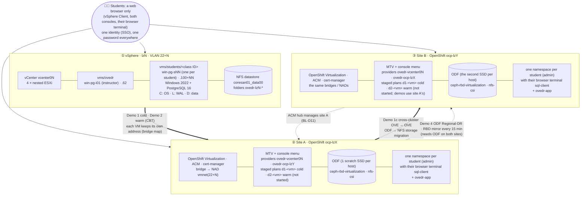

# Lab diagram

> **Version 0.5.5 · draft · 2026-10-17** · class/demos/lab-diagram.md

One booking reserves **three environments** together: a vSphere landing zone (`lzN`) and two OpenShift clusters
(`ocp-lzX` = **site A**, `ocp-lzY` = **site B**). They all run as VMs on the same four physical hosts
(`demosvr01`-`04`), each zone on its own VLAN. The numbers come from your booking (the instructor gives them out) and change from
booking to booking. How each piece was built, from the CLI and in the console: [Lab S](setup-how-the-lab-is-built.md).

Diagram source (Mermaid). The SVG above is rendered from this; edit here, then re-render.

**Shared underneath all three:** the four physical hosts `demosvr01`-`04` (two scratch SSDs each since 2026-10-15: one
per site's ODF), lab DNS (`dns01`/`dns02`), the NFS export `coresan01_data00` (shared by every vSphere zone,
so every class VM's folder carries its zone: `ovedr-lzN-<vm>`), and core-sso, which provisions the same roster and
password to vCenter, both clusters and the Windows VMs.

## What runs where

| | vSphere `lzN` | Site A `ocp-lzX` | Site B `ocp-lzY` |
|---|---|---|---|
| Built by | demo-vmware (core-web dispatches) | demo-openshift (`ove: cnv`, `storage: odf`, ACM, cert-manager) | demo-openshift (`ove: cnv`, `storage: odf`, ACM, cert-manager) |
| Customized by this demo | the instructor's `win-pg-i01` (`vms/ovedr`, `.62`) and **one full clone per student** `win-pg-sNN` in **that student's own folder** `vms/students/<class ID>` (`.100+NN`), each with PostgreSQL (WAL on `L:`, data on `D:`), the toolkit, Windows logins and WinRM; each student may power, open the console, Edit Settings (CBT) and snapshot **their own** VM | MTV with its console menu, providers + maps, **staged plans `d1-<vm>` (cold) and `d2-<vm>` (warm) per class VM (not started)** landing each student's VM in **that student's own namespace** (their class ID, where they are admin), `ovedr-app` with `sql-client` and the instructor's VM, a Service per VM, the demo prep (pre-copy interval, snapshot class) | the same as A without staged plans (Demo 1c builds its own from site A), plus the ACM hub role and DR (Demo 4) |
| Storage | by default (`vmware_storage: local`) each class VM on its own host's SSD datastore `esxi-lzN-NN-vmfs00` (student NN → host NN, wrapping after 4); NFS datastore `coresan01_data00` for the ISOs (and the VMs on an `na` booking); **vSAN** on a `vsan` booking | **ODF** on one scratch SSD per host (`ocs-storagecluster-ceph-rbd-virtualization`, the VM default), plus `nfs-csi` | **the same**: ODF on the second SSD per host, plus `nfs-csi` (demo-0024 only: the VMware Alternative class has no site B) |
| Network | port group `vm-network`, VLAN 22+N; every class VM its own static address | NMState bridge onto VLAN 22+N (`vmnet<VLAN>`), plus the pod network | the same VLAN bridges, plus the pod network |
| Demos | 1, 2 (source) | 1, 2 (target) · 1c (source) · 4 (primary) | 1c (target) · 4 (DR site, hub) |

The operators are the **same on both clusters**, storage included: ODF on both sites is the lab standard
(`storage: odf`), which is what lets Demo 4 mirror between them. A booking can still choose `odf-site-a` (ODF on site A
only, site B on `nfs-csi`, no Demo 4) or `na`. The customize healthcheck reports any other difference.
