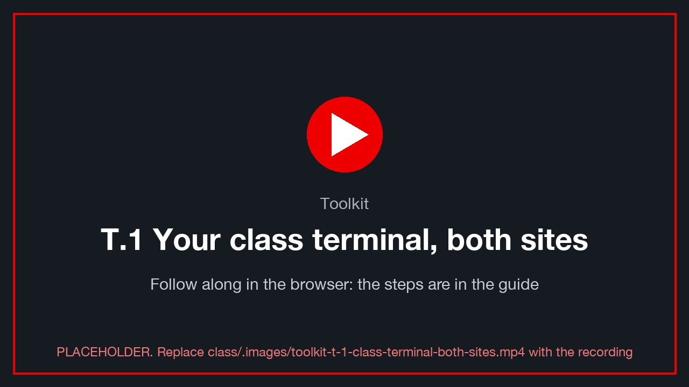
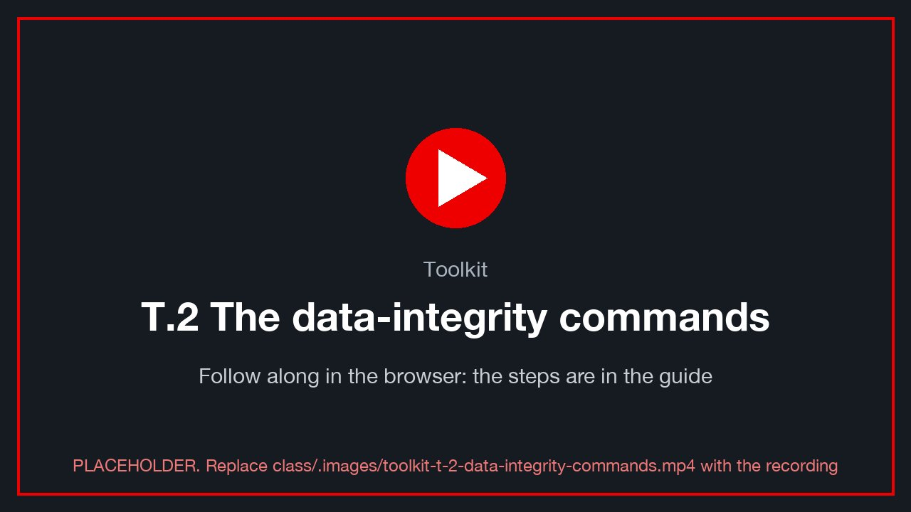
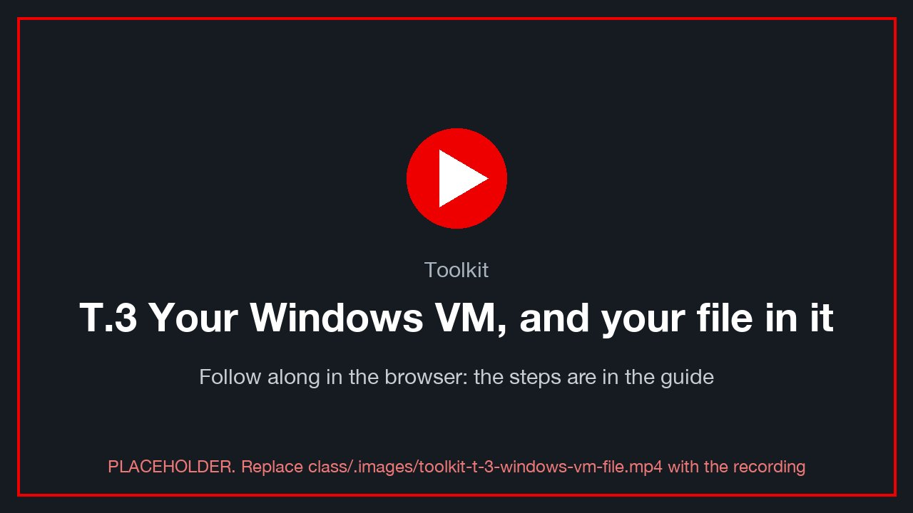
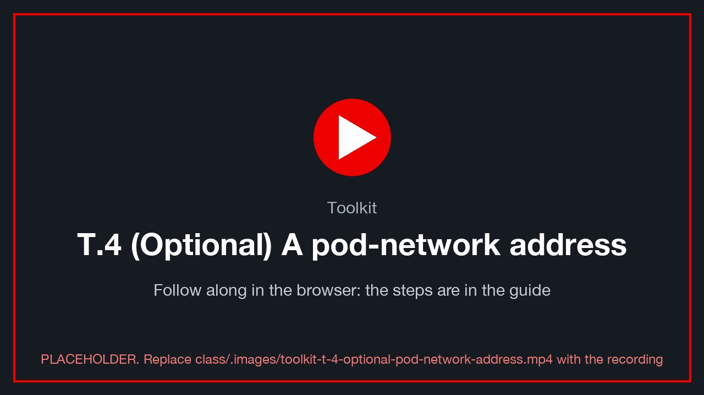

# Toolkit: your class terminal, your data and your VM

> **Version 0.1.0 · draft · 2026-10-12** · class/demos/toolkit.md

The reference every demo uses. [Lab 0](00-access-and-tools.md) signs you in and opens a command line; this page has
the rest: your class terminal on both sites, the commands that write and prove your data, your file in the VM, and
the proof table. Each demo points at the section it needs.

## T.1 Your class terminal, signed in on both sites

<!-- 🎬 video slot toolkit-t-1-class-terminal-both-sites -->
[](../.images/toolkit-t-1-class-terminal-both-sites.mp4)
<sub>🎬 *T.1 Your class terminal, signed in on both sites: a recording of this whole section, done in the console (placeholder until recorded: `class/.images/toolkit-t-1-class-terminal-both-sites.mp4`).*</sub>

### Open it

Every command in these guides runs in **your browser terminal**: a shell inside your own pod, `sql-client`, opened
from the OpenShift console. **Nothing is installed on your computer.** It has `psql`, the class commands (T.2), `oc`,
`virtctl` and `jq`, and it already knows who you are and where your VM is. You have one on each site; use the one on
site A unless a guide says otherwise.

1. In the **site A** console, open your project: **Home → Projects → `<your class ID>`** (or pick it in the
   **Project** list at the top of any page).
2. Go to **Workloads → Pods**, open the pod **`sql-client-…`**, and choose the **Terminal** tab.
3. Type `ovedr` and press Enter. It shows your class ID, your VM and its address, which site this terminal is on,
   and what is signed in yet.

> 📋 **Copy and paste.** The Terminal tab is a normal browser terminal:
> - **Paste** a command from these guides with **right-click → Paste**, or **Ctrl+Shift+V** (Windows/Linux) /
>   **⌘V** (Mac). The copy button on each command block in the class site copies it for you.
> - **Copy** output by selecting it with the mouse, then **right-click → Copy** (or **Ctrl+Shift+C** / **⌘C**). Plain
>   **Ctrl+C** stops the running command, as in any terminal.
> - Paste one block at a time and wait for the prompt. Most class commands are one short line you can also type.
>
> **[verify: paste and copy shortcuts in the 4.19 console terminal, per browser]**

> 💡 The terminal **keeps your sign-ins while the pod runs**, even if you close the tab or the browser. If the pod is
> ever restarted, run `dblogin` and `oclogin` again. Leaving a long command running? Keep its tab open.

### Sign its `oc` in, for both sites

With SSO, `oc` signs in with a **token** from the console, never a password. Do this once per site, in the **same**
terminal:

1. In the **site A** console, open your name (top right) → **Copy login command** → **Display Token**. Copy the line
   that starts with `oc login --token=…`.
2. In your terminal, type `oclogin` and a space, paste the line, and press Enter.
3. Repeat in the **site B** console: copy its login command and paste it after `oclogin` in the **same** terminal.

```bash
oclogin oc login --token=sha256~… --server=https://api.ocp-lz1.demo.lab-paragonmicro.com:6443   # ✓ site-a: signed in as …
oclogin oc login --token=sha256~… --server=https://api.ocp-lz2.demo.lab-paragonmicro.com:6443   # ✓ site-b: signed in as …
```

`oclogin` names each sign-in after its site, so every later command says which cluster it talks to
(`--context site-a` / `--context site-b`), and it sets your namespace as the default. Tokens last 24 hours: if `oc`
says *Unauthorized*, repeat the step for that site.

```bash
oc --context site-a whoami && oc --context site-b whoami   # both print your class ID
oc --context site-a get project "$VMNS"                    # yours, on site A …
oc --context site-b get project "$VMNS"                    # … and on site B
oc --context site-a auth can-i '*' '*' -n "$VMNS"          # yes: admin in your own namespace
```

### What it already knows

> ⚠️ **The landing zones change from booking to booking.** The scheduler picks whichever zones are free, so your
> vSphere zone can be `lz1`, `lz2` or `lz3`, and your two clusters any two of `ocp-lz1`, `ocp-lz2`, `ocp-lz3`, in any
> order (for example vSphere `lz2` with site A `ocp-lz3` and site B `ocp-lz1`). The examples in these guides use
> `lz1` / `ocp-lz1` / `ocp-lz2`. **Always use your booking's values** (the instructor gives them out), never the examples.

| Value | Example |
|---|---|
| `ME`: your class ID | `student-03-0024-005` 
| `N`: vSphere landing zone number | `1` (→ `vcenter01`) 
| `A`: site A cluster | `ocp-lz1` 
| `B`: site B cluster | `ocp-lz2` 

Your VM name and its vSphere address follow from your ID:

| You are | VM (`$VM`) | Address on vSphere (`$VM_IP`) |
|---|---|---|
| `student-NN-…` | `win-pg-sNN` (e.g. `student-03` → `win-pg-s03`) | `10.101.<22+N>.<100+NN>` (e.g. `10.101.23.103`) |
| the instructor | `win-pg-i01` (the instructor's VM, in `vms/ovedr`) | `10.101.<22+N>.62` |

**[verify: BL-D10, per-student clones and their address plan]**

**You don't type these in.** Your browser terminal (T.1) already holds all of them, and your VM's name and address,
as `$ME`, `$N`, `$A`, `$B`, `$VM`, `$VM_IP`, `$VMNS`, `$WINUSER`, `$VC` and `$DOMAIN`. Type `ovedr` there to see
them.

**Your namespace, `$VMNS`.** On **both** OpenShift clusters you have your own namespace (project), named exactly your
class ID in lower case, for example `student-03-0024-005`. It matches your vCenter folder. You are **admin** there:
full rights, scoped to that namespace only. Your migration plans land your VM there, and your VM's SQL Service
(`$VM-sql`) lives there, and so does **your browser terminal**, pod `sql-client` (T.1). Instructors get their own namespace too (their class ID, where `win-pg-i01` lands), are admin in every student
namespace, and are **cluster-admin** on both clusters, so they can help with any student, storage or operator issue.

---

## T.2 The data-integrity commands

<!-- 🎬 video slot toolkit-t-2-data-integrity-commands -->
[](../.images/toolkit-t-2-data-integrity-commands.mp4)
<sub>🎬 *T.2 The data-integrity commands: a recording of this whole section, done in the console (placeholder until recorded: `class/.images/toolkit-t-2-data-integrity-commands.mp4`).*</sub>

The database `bcdr` has two tables you will use:

| Table | Written by | What it proves |
|---|---|---|
| `heartbeat` | a writer in the VM, every 5 s | the VM is alive. Gaps in it are outages. |
| `marks` | **you**, at every stage | your data survived every move, unchanged and in order |

Each of your `marks` rows carries a SHA-256 hash of the previous row. If a row is lost, changed or reordered,
`ovedr_verify` reports `chain_ok = f` and names the first broken row.

### Your class commands (already in your terminal)

| Command | What it does |
|---|---|
| `dblogin` | sign in to **your VM's** database as you (`student_NN`), with your class password. Once per pod |
| `mark <label> [note]` | **inject** one hash-chained row; note its `id`. Example: `mark d1-before` |
| `load <label> [rows]` | inject a burst of rows (default 100) |
| `verify` | **read and prove** your rows: `chain_ok = t`, and the fingerprint of all marks |
| `alive` | is your VM writing? `staleness` under 10 s = yes |
| `sql [psql options]` | `psql` to your VM's database, e.g. `sql -c "SELECT count(*) FROM marks"` |
| `where` | which site and node runs your VM right now |
| `ovedr` | who and where you are, and what is signed in |

They talk to your VM at its own address, `$VM_IP`, which it keeps on vSphere, site A and site B (the staged plans
use a bridge network map). So they work from either site's terminal, before and after every move. If you ever move
your VM onto the pod network yourself, T.4 shows how to point them at its new address (`export PGHOST=…`).

```bash
dblogin                          # Password for student_NN: your class password (it is not shown as you type)
```

> `ovedr_checksum` fingerprints **every** mark in your VM's database. On your own VM that is your rows only. On the
> instructor's `win-pg-i01` it covers everyone who marked it.

### Try it now

```bash
alive                            # staleness under 10 s: your VM is writing
mark first-row                  # your first row: note its id and sha
verify                           # chain_ok = t, marks = 1
```

📸 `toolkit-verify`: the `verify` output with `chain_ok = t`.

✍️ **Proof table, row 0** (at the start of Demo 1): your first mark's `id`, and the `fingerprint` from `ovedr_checksum`.

> 💡 **Why a hash chain?** A count can't tell you that row 7 was replaced, or that rows 7 and 8 swapped places.
> A chain can. A migration or a failover that loses, rewrites or reorders even one of your rows shows up here
> as `chain_ok = f`.

---

## T.3 Your Windows VM, and your file in it

<!-- 🎬 video slot toolkit-t-3-windows-vm-file -->
[](../.images/toolkit-t-3-windows-vm-file.mp4)
<sub>🎬 *T.3 Your Windows VM, and your file in it: a recording of this whole section, done in the console (placeholder until recorded: `class/.images/toolkit-t-3-windows-vm-file.mp4`).*</sub>

Your VM runs Windows Server 2022 with PostgreSQL 16. The WAL (write-ahead log) is on **`L:`** (5 GB) and the data is
on **`D:`** (10 GB).

- **While it is on vSphere:** in vCenter, select your VM and choose **Launch Web Console**.
- **Once it is on OpenShift:** in the console, go to **Virtualization → VirtualMachines → your VM → Console**.

Send **Ctrl-Alt-Del** from the console toolbar, then log in as **`.\<WINUSER>`** (for example `.\student-03`)
with your class password **[verify: BL-D08, student Windows accounts]**.

### Your file in the VM

Open **PowerShell** in the VM and leave your mark on disk, not just in the database:

```powershell
$f = "C:\Users\Public\ovedr\$env:USERNAME.txt"
New-Item -ItemType Directory -Force (Split-Path $f) | Out-Null
Add-Content $f "$(Get-Date -Format o)  first-row"
Get-Content $f
```

Every demo adds a line to this file at each stage. Its last step reads the file back on the target platform.

📸 `toolkit-windows-touch`: PowerShell showing `Get-Content` of your file.

---

## T.4 (Optional) Give your VM a pod-network address on OpenShift

<!-- 🎬 video slot toolkit-t-4-optional-pod-network-address -->
[](../.images/toolkit-t-4-optional-pod-network-address.mp4)
<sub>🎬 *T.4 (Optional) Give your VM a pod-network address on OpenShift: a recording of this whole section, done in the console (placeholder until recorded: `class/.images/toolkit-t-4-optional-pod-network-address.mp4`).*</sub>

**You usually skip this.** Every class VM has its **own** static address (instructor `.62`, students `.100+NN`), and
the staged migration plans use the **bridge** network map (`ovedr-vcenter0<N>-net-bridge`), which puts the migrated
NIC on the **same VLAN**. So after a move your VM answers at the same `$VM_IP` as before, and every helper keeps
working.

**Do this step only when your VM landed on the pod network:** a plan you built yourself with the pod map
(`ovedr-vcenter0<N>-net`), or a site without the bridge. A Windows static address on a pod-network NIC answers nothing,
so you swap it for a pod NIC that gets its address by DHCP, and then test over that address.

> ℹ️ **Demo-only, not a production pattern.** Swapping the NIC is a lab workaround for a VM that landed on the pod
> network. In a real migration the VM keeps its own NIC, MAC and address (a bridge map onto the same VLAN, as the staged
> plans do, or a planned re-IP), and nobody swaps NICs. Proper per-VM addressing (DHCP on the lab VLANs) is on the
> backlog (BL-D12). Background: [Virtual machine networking](https://docs.redhat.com/en/documentation/openshift_container_platform/4.19/html/virtualization/networking) [verify link].

`CTX` is the site your VM is now on (`site-a` after demos 1-2, `site-b` after demo 3).

### 1. Stop the VM

```bash
CTX=site-a
virtctl --context "$CTX" -n "$VMNS" stop "$VM" 2>/dev/null \
  || oc --context "$CTX" -n "$VMNS" patch vm "$VM" --type merge -p '{"spec":{"runStrategy":"Halted"}}'
oc --context "$CTX" -n "$VMNS" get vm "$VM" -w            # Ctrl-C at Stopped
```

### 2. See the migrated interface(s)

```bash
oc --context "$CTX" -n "$VMNS" get vm "$VM" -o json \
  | jq -r '.spec.template.spec.domain.devices.interfaces as $i | .spec.template.spec.networks as $n
           | range(0; $i|length) as $k | "\($k)  \($i[$k].name)  mac=\($i[$k].macAddress // "-")  net=\($n | map(select(.name == $i[$k].name))[0] | (.pod // .multus) | tostring)"'
```

✍️ The index (`0`, `1`, …) of the migrated NIC: ____

### 3. Set the migrated NIC's link down, and add a pod-network NIC

**Console:** **VM → Configuration → Network → ⋮ on the migrated NIC → Set link down** (or *Delete*), then
**Add network interface**: network **Pod networking**, type **Masquerade**.

**CLI:**

```bash
IDX=0                                    # ← the index you wrote down
oc --context "$CTX" -n "$VMNS" patch vm "$VM" --type json -p "[
 {\"op\":\"add\",\"path\":\"/spec/template/spec/domain/devices/interfaces/$IDX/state\",\"value\":\"down\"},
 {\"op\":\"add\",\"path\":\"/spec/template/spec/domain/devices/interfaces/-\",
  \"value\":{\"name\":\"default\",\"masquerade\":{},\"model\":\"virtio\"}},
 {\"op\":\"add\",\"path\":\"/spec/template/spec/networks/-\",
  \"value\":{\"name\":\"default\",\"pod\":{}}}]"
```

**[verify: interface `state: down` (link state) on OpenShift Virtualization 4.19]**. If your cluster rejects
`state`, remove the migrated NIC instead:
`oc --context "$CTX" -n "$VMNS" patch vm "$VM" --type json -p "[{\"op\":\"remove\",\"path\":\"/spec/template/spec/domain/devices/interfaces/$IDX\"}]"`,
then remove the matching entry under `/spec/template/spec/networks/` the same way.

> If the migrated NIC is already named `default` on the pod network (the `…-net` map), it is the same kind of NIC
> and is already unique per VM. Skip step 3 and go to step 4.

### 4. Start the VM and confirm DHCP inside Windows

```bash
virtctl --context "$CTX" -n "$VMNS" start "$VM" 2>/dev/null \
  || oc --context "$CTX" -n "$VMNS" patch vm "$VM" --type merge -p '{"spec":{"runStrategy":"Always"}}'
oc --context "$CTX" -n "$VMNS" get vmi "$VM" -w           # Ctrl-C at Running
```

In the VM console (`.\<WINUSER>`):

```powershell
Get-NetAdapter | Format-Table Name, Status, MacAddress, LinkSpeed
ipconfig /all | Select-String 'Description|Physical|DHCP Enabled|IPv4|Default Gateway'
```

✅ The new adapter shows **DHCP Enabled: Yes**, and an address from OpenShift's masquerade network (the guest
side is `10.0.2.2` **[verify]**).

> The old static IP was configured on the *old* adapter, so the new adapter starts clean on DHCP. If Windows has
> pinned the static IP to the new adapter, reset it:
> `Set-NetIPInterface -InterfaceAlias '<new adapter>' -Dhcp Enabled; ipconfig /renew`.

### 5. Read your VM's address, and use it for every test

The guest's address is private to the VM. From outside, your VM is reached at its **pod IP**:

```bash
export PGHOST=$(oc --context "$CTX" -n "$VMNS" get vmi "$VM" \
  -o jsonpath='{.status.interfaces[?(@.name=="default")].ipAddress}')
echo "PGHOST=$PGHOST"                    # your VM's own address on $CTX
```

The alternative is your VM's **Service**, `Service/$VM-sql`. It selects `vm.kubevirt.io/name=$VM` on port 5432, so
it follows your VM whatever its IP: `export PGHOST=$VM-sql`.

### 6. Connection test

```bash
pg_isready -h "$PGHOST" -p 5432          # accepting connections
alive
mark own-address "ip=$PGHOST"
verify
```

✅ `pg_isready` answers *accepting connections*, the heartbeat is fresh, and `chain_ok = t`.

> Windows has no SSH server by default, so the PostgreSQL connection above **is** the connection test. To work inside
> Windows, use the VM's **Console** tab in the OpenShift console.

📸 `toolkit-own-address`: `ipconfig` on the new adapter beside the `PGHOST` echo.

---

## Proof table (carry it through every demo)

| Row | Stage | Your last mark id | `chain_ok` | Fingerprint | Notes (outage, bytes, time) |
|---|---|---|---|---|---|
| 0 | first-row | | | | |

---
